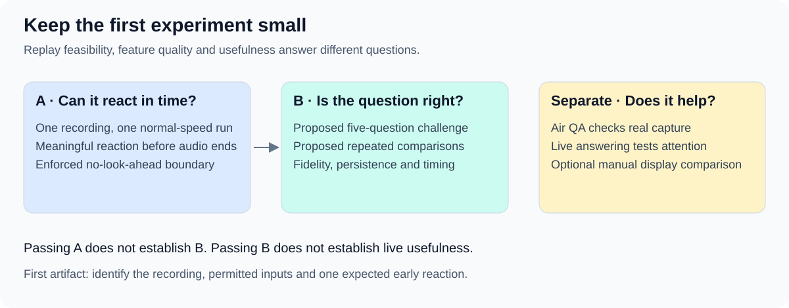

# First experiment: one recording, two separate questions

Can the product react to a conversation before it ends, without seeing the future? Once that works, can it keep the right question visible?
SC-B001 now identifies the [supplied recording candidate](03.3-first-recording-case.md). Benchmark admission, execution, owner and schedule remain pending.

## A — demonstrate valid progressive replay

Choose one clear recording with an analyzable exchange before its end. One normal-speed run is enough for this initial feasibility check.
For the supplied candidate, User wants to inspect listening, incremental transcription and differentiation of two speakers. Capture speaker-label transitions as diagnostic evidence; do not confuse anonymous speaker separation with identification of User.
Require progressive delivery, an input-dependent reaction before the final audio chunk and evidence that future audio and private references were inaccessible.
An interim transcript or question hypothesis can show a meaningful reaction; a heartbeat or playback acknowledgment cannot.
Save the source identity, permitted-input manifest, configuration, access-boundary evidence and delivery/output timeline.
Confirmed leakage invalidates the run; missing integrity evidence leaves feasibility unverified. Recognition errors remain separately visible.
Five questions, repeated comparisons and a complete quality benchmark are not prerequisites for this first demonstration.

## B — evaluate question-display quality

The proposed challenge case is a four-to-six-minute, two-speaker mock interview with five clear questions: direct, open, multipart experience and two follow-ups.
Include a user restatement, immediate answer, pause between question parts and brief overlap; otherwise prefer clear capture.
Reuse the first recording if suitable, or version a separate case. These are proposed coverage goals, not observed recording contents.

| Runtime may receive | Evaluator keeps private |
| --- | --- |
| Audio released at normal speed, elapsed time and state from earlier permitted input. | Complete recording, checked transcript and question/answer boundaries. |
| Fixed product instructions and declared background; optionally an independently recorded voice sample. | Ground-truth speakers, required meaning units, expected transitions and scoring decisions. |
| In a declared manual-assisted condition, timestamped P events as User signals the start and end of their turn. | Future cue events and evaluator annotations; these must not substitute for actual User input. |

No complete-file path, future transcript or retained case memory is available to analysis. Apply this to preprocessing and every downstream component.
User selected [P for Pablo](03.2-release-alternatives-and-review-decisions.md) for the proposed start/finish toggle. Report this condition's assistance and input effort separately from automatic attribution; the shortcut is not implemented.
Résumé and expected-answer material are not required for this pilot; any extra background needs an explicit justification.

## Run the comparison

Review the case and thresholds before scoring. Fix references, configuration and permitted context.
The proposal is three fresh-state replays per automatic approach, without tuning between scored repeats, against a simple baseline.
Retain visible transitions, input/output times, errors, semantic review reasons and available usage/cost data.
Score the [shared criteria](01.2-evaluation-criteria.md) using [pilot measurements](03.1-release-measurements-and-thresholds.md); report each run and question.
Three repeats of five questions are still one recording. A valid replay can succeed at feasibility while failing feature-quality gates.
Air QA can play the same case through speakers and a real microphone; record conditions and score that path separately.
Live answering or the [optional manual display trial](03.2-release-alternatives-and-review-decisions.md) addresses usefulness separately.

## Smallest next artifact

The [feasibility case card](03.3-first-recording-case.md) now identifies the MP3, verified file properties and reported capture conditions. Its private early-exchange reference and speaker labels are still pending.
Only the later feature evaluation needs all five question annotations, required meaning units, answer intervals and ambiguity labels.
The source's identical-opening/different-continuation check is an optional later isolation probe: compare permitted prefixes and access, not identical generated outputs.

This is a protocol proposal, not a scheduled release, accepted threshold set or implementation authorization.
[Strategy](01-evaluation-strategy.md) · [Alternatives and decisions](03.2-release-alternatives-and-review-decisions.md) · [Review index](README.md)
