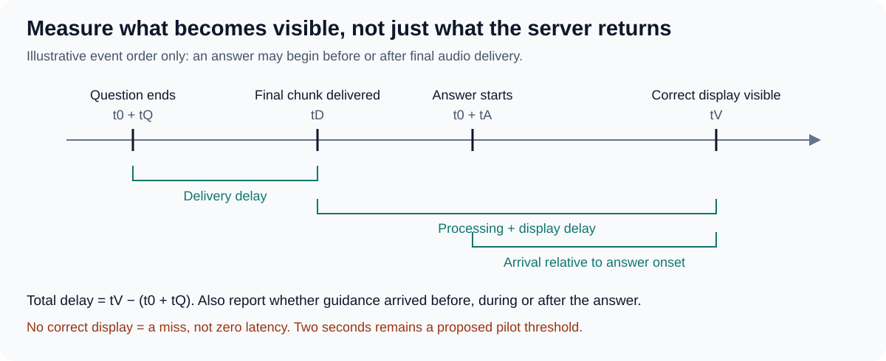

# Pilot measurements and proposed thresholds

Draft for review · 21 October 2026. All thresholds below are proposals for SC-B001, not accepted user tolerances or release criteria.
The quality gates apply to milestone B, the feature evaluation. Milestone A checks progressive delivery, a meaningful reaction before playback ends and input isolation as defined in [the protocol](03-release-single-recording-evaluation.md).
They expose failures in one selected case. Passing cannot establish performance across interviews, speakers or environments.

## Score only a valid run

Future audio or evaluator-reference access invalidates the run rather than producing a low quality score.
Missing delivery, access or output evidence makes the affected check unverified. Do not convert missing evidence into a pass.
Use private, reviewed annotations and fixed criteria; version any correction and identify results that need rescoring.

| Check | Observable measure | Proposed pilot threshold |
| --- | --- | --- |
| Input integrity | Delivered source intervals, times and accessible resources. | Zero future-audio delivery or reference access; evidence must cover preprocessing too. |
| Speaker attribution | Correctly assigned duration divided by annotated clear, non-overlapping speech duration; report overall and separately for interviewer and interviewee. | At least 95% overall remains provisional; report each participant’s numerator and denominator. Unknown/missing attribution is incorrect; overlap is separate. |
| Question capture | Required meaning units preserved, with no invented requirement. | All five clear questions complete and correctly attributed to the interviewer. |
| Persistence | Visible question history after first correct display through the answer. | Zero blanking or replacement caused by User’s speech, restatement or silence. |
| Transitions | Follow-ups, non-question turns and incomplete multipart questions. | Both follow-ups correct; zero false replacements or premature settled questions. |
| Timing | Delay until complete, correct, stable question text is visible, measured from question end and separately from answer onset. | No more than two seconds after each clear question ends remains provisional. Report each result, the worst delay and arrival before/during/after the answer. |
| Reliability | Audio coverage, errors and complete run trace. | No crash, unrecovered error or unexplained missing/duplicated input interval. |
| Visual stability | Rendered text and revisions during the answer. | No clipped question text or unnecessary rewriting after the correct question is established. |

For capture, score pass when all required meaning is retained, partial when useful but incomplete, and fail when wrong, missed or invented; only pass satisfies the pilot gate.
For each participant, use only that participant’s annotated clear speech as the denominator. Long answers must not conceal interviewer errors in the overall score; no separate participant threshold is yet agreed.
The all-five-questions attribution requirement remains an independent gate. Report a participant with no eligible speech as unavailable, not 100% correct.
Faithful quotation and faithful shortening can both pass meaning checks. Exact wording preference is a separate review decision.
Annotate unclear spans in advance. Score conservative handling and recovery there without demanding recovery of inaudible words.
Evaluate each run against the gates; averages must not hide a failed repeat. Repeated observations remain dependent on the same recording.

## Timing definitions

Let tQ be the annotated end of the complete question on the recording timeline, and t0 the replay start on the monotonic run clock.
Let tD be when its final relevant audio chunk reaches analysis, and tV when complete, correct question text first appears and remains stable until a legitimate update.
End-to-end delay is tV − (t0 + tQ). Delivery delay is tD − (t0 + tQ); processing/display delay is tV − tD.
Let tA be answer onset on the recording timeline. Answer-relative arrival is tV − (t0 + tA): negative means before answering, zero means at onset, and positive gives seconds into the answer; use answer end to flag arrival after it finished.
Report this offset for every question, with before/during/after counts. If no answer occurs, the offset is unavailable. Use subsequent live experience to judge usefulness; meeting two seconds alone does not establish timely help.
Record all timestamps, answer end, premature display and output revisions. A server response timestamp alone is not a visible-display measurement.
For a question with no correct display, report a miss and failed timing gate, not a zero or omitted latency.
For Air QA, align the played source and captured microphone timeline and report the extra physical-path delay; do not silently subtract it.

## Automation and human judgment

Automate delivery checks, timestamps, coverage, errors and display-change counts where observable. Keep semantic scoring grounded in reviewed meaning units.
Human review initially decides fidelity, unsupported content, ambiguity and whether a rewrite was unnecessary; retain the reason for each judgment.
An automated semantic judge is a future candidate and must be checked against human-reviewed examples before its scores are relied on.
Record usage or cost per audio minute where available; no cost gate is proposed yet.
Air QA can assess readability and apparent disruption, but actual distraction and better answering require live use. No user-benefit pass is inferred from replay.

[Shared evaluation criteria](01.2-evaluation-criteria.md) · [Pilot protocol](03-release-single-recording-evaluation.md) · [Review decisions](03.2-release-alternatives-and-review-decisions.md) · [Review index](README.md)
