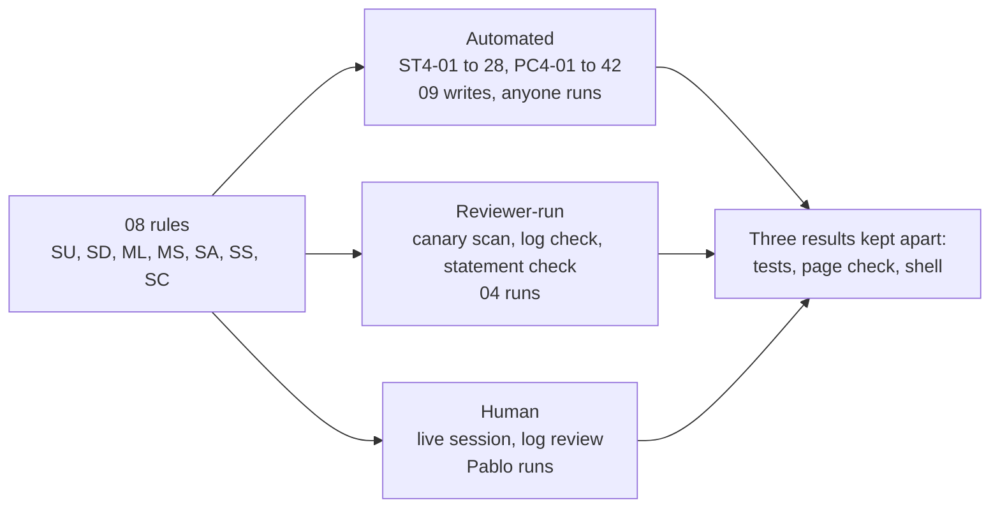

# SPRINT-004 checks: package upload, meeting log and the new screen

Pablo wants to load his package from the page, keep a complete log of each meeting and work from a new screen. This page says what a pass looks like for each, who runs it, and which of 08's [72 checks](../08-low-level-design/03.8-sprint-004-test-map.md) already carry it, so nothing is checked twice or left out. The plan criteria are 1 and 2 (status, upload), 3 (log), 4 (download), 5 (screen), 6 (cue keys), 9 (statements) and 10 (live session); the idle-pause guard (7) moved to SPRINT-005 and has no check here. It is a draft of 19 November 2026; nothing has been run and no package or log text was read.

*Automated checks settle function for free; the reviewer and Pablo settle what a script cannot.*

## Upload and log: what a pass looks like

| Check | Pass | 08 check | Runs |
| --- | --- | --- | --- |
| U1 caller | A wrong Host, Origin or non-JSON content type is refused and nothing is read | ST4-08, ST4-36 | `node --test` |
| U2 body cap | 200 KB is read; one byte more is refused and reading stops | ST4-03 | `node --test` |
| U3 file rules | 20 files pass, 21 fail; only `.md`/`.txt`; dotfiles refused; README skipped | ST4-02, ST4-03 | `node --test` |
| U4 names | Unsafe names (`..`, `/`, `\`, a drive letter) are refused, as 05 settles; I accept its rule | ST4-03, ST4-35 | `node --test` |
| U5 UTF-8 | A file that is not UTF-8 is named and nothing is sent | PC4-36 | page check |
| U6 total | 20,000 characters pass, 20,001 fail, never cut | ST4-03 | `node --test` |
| U7 failure | Every refusal keeps the old package; listening gives 409; Stop keeps it | ST4-04 to 06 | `node --test` |
| U8 no text | After upload and Stop, invented canary strings are found nowhere on disk, in logs, status or output | ST4-01, 07, 22 | `node --test` plus 04 scan |
| L1 complete | Every scripted final item, pause of 800 ms or more and Focus change is in the log, in order | ST4-12 to 17, 23 | `node --test` |
| L2 time | Each line has UTC time with ms; `ms` never decreases; line 1 is `log_started` | ST4-12; no order case | `node --test` |
| L3 no package file content | No canary of a package file is in the log; in a live log the bullets shown in `answer_shown` are reviewed, since they may quote the package, and shingle matches elsewhere than `transcript` and `focus_changed` go to Pablo | ST4-07, 22; reviewer step | `node --test`, 04 |
| L4 one per session | Two sessions leave two files with distinct names | ST4-24; no count case | `node --test` |
| L5 download | 200 with the file and attachment name; 404 with none; a mid-session download is a prefix of the final file | ST4-09, 10, PC4-41 | tests, then Pablo |
| L6 local only | Another Host or Origin gets 403 on `/log` and `/package`. Limit: these are Host and Origin checks only; another program on the Mac can still fetch the log | ST4-08 | `node --test` |
| L7 Git-ignored | `poc/logs/` (or `ALICE_LOG_DIR`) is Git-ignored, a log never appears in `git status`, modes are 0700 and 0600 | ST4-25, SH4-1 | 04, by hand |
| L8 size | The live session reports log bytes per hour and in total, against the 5 MB cap | MS-4, ST4-26 | 04 in the live session |
| A1 still page | Outside the avatar box nothing animates; the box keeps 08's size and place (AV-1, SA-3, SA-19) and moves nothing | 08 PC4-50, PC4-57 (AV-1, SA-16); no 04 check | page check |
| A2 silent failure | A failing library, model or WebGL leaves the page identical; a throwing adapter harms nothing | 08 PC4-56, PC4-59 (AV-6, AV-8); no 04 check | page check |
| A3 no request out | Every request of load and a session stays on this origin; it works offline | 08 PC4-58 covers avatar files only; 08 to widen it | page check |
| A4 controls | Toggle and key A, reduced motion, hidden tab and about 15 frames a second | 08 PC4-53 to 55 (AV-4, AV-5); no 04 check | page check |
| A5 jank | Live, with the avatar on then off: report long tasks, cue-timer lateness and gaps in audio sent, and whether Pablo saw the cue late; no limit is justified | none | 04 in the live session |
| M1 manual cue | After G, L or S the cue holds 10 seconds, restarts on a second key, then the timer resumes | PC4-43 to 46 (page clock controlled) | page check |

## The new screen

Automated: sizes, weights and boxes at three window sizes (PC4-01 to 16) and the states (PC4-17 to 26). Live, Pablo says yes or no after each answer: the question was bold and the largest text; suggestions were left and his words right; nothing was cut when he scrolled; he named the cue by its colour and small word; the bar and its buttons stayed reachable. The cue is named by colour plus the small cue word (08's SA-5, decided 19 November 2026).

## What 08 and 05 must change

1. Avatar: mapped to 08's AV-1 to AV-8 and PC4-50 to PC4-59, so 04 keeps no duplicate of A1, A2 or A4. 08 widens PC4-58 from avatar files to every request (A3). A5, the live jank report, has no 08 check and stays with 04. 05 keeps the library and model local (01.11).
2. 08 has added the content-type case (ST4-36), the unsafe-name case (ST4-35), the page clock for PC4-46 and the criterion numbers. Still open at 20 November 2026: an `ms` order case (L2), a file-count case (L4) and the wider PC4-58 (A3).
3. 05: 08 now refuses unsafe names and non-JSON content types; 05's 01.8.1 and 08's SU-3 must say the same.
4. Decided and consistent: log inside the project in Git-ignored `poc/logs/` (`ALICE_LOG_DIR` may move it); bullets logged on purpose, other people's speech kept locally, no retention; Remove covered by ST4-29 and PC4-45.

Draft of 19 November 2026 by 04 Benchmarks, amended after the SPRINT-004 alignment review; no approval is recorded. [Live session and statement check](03.11-sprint-004-live-session-and-statement-check.md) · [Review index](README.md)
