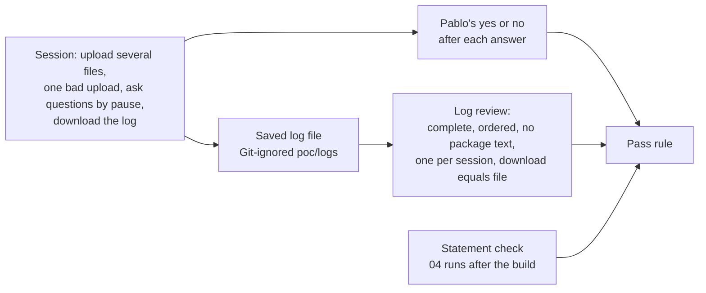

# SPRINT-004 live session, log review and statement check

This page restates the live-session pass rule for SPRINT-004, says how Pablo reviews the downloaded log afterwards, and defines the statement check for the two data statements. It builds on the [checks page](03.10-sprint-004-upload-log-and-screen-checks.md). The rule Pablo decided on 18 November 2026 for [SPRINT-003](03.6.1-sprint-003-live-session.md) stays; he accepted the additions here on 19 November 2026, as relayed by 00 Governance. A draft of 19 November 2026: nothing has been run, no package or log text was read.

*The session proves it works for him; the log review proves the record is trustworthy; the statement check proves the wording is true.*

## Live session

Steps, with fresh questions and the package he uploads from the page (invented files for any shared run): 1 load several files and read the package line; 2 try an over-limit upload and see the old package kept; 3 start, ask a direct question and pause; 4 answer about 40 seconds with a pause inside; 5 ask a question the package covers and one it does not; 6 repeat a question to replace it; 7 press G, L or S and see the cue hold 10 seconds before the timer resumes; 8 stop, then download the log.

**Pass rule (decided 19 November 2026).** Every step meets its expectation; no answer is shown for an earlier question; every statement about him is in the package; after each answer he could take in the bar, the bold question and the two columns at a glance; the package line was true after each upload; the log passes the review below; and he would keep the feature on. After each answer he also answers yes or no to "did the avatar draw your eye or delay the cue?" and, after the session, keeps or removes the avatar; that decision is reported and does not fail the session. The reviewer reports jank (check A5) with the avatar on and off during a call. Delay and fit are reported, not part of the rule. He alone judges statements about himself, and says he wrote the package.

## How Pablo reviews the downloaded log

He opens the saved file in a text editor, with the 04 reviewer for counts, and records yes or no for each: 1 every question he asked appears as a `transcript` line, then a `pause`, then a `focus_changed`, in that order; 2 the first line is `log_started` and `ms` never decreases from one line to the next, in write order (08 ML-12); the reviewer checks this on the `ms` and `type` fields only, never reads `text`, and leaves out a pause's `startMs`, which may be earlier; 3 an answer shown for each Focus; 4 two sessions give two files; 5 the downloaded copy has the same SHA-256 as the file in the log folder (a mid-session copy is the start of it); 6 the log folder is Git-ignored, `git status` never lists a log, and its modes are 0700 and 0600; 7 he reads each `answer_shown` line once for package text; the reviewer reports bytes per hour and in total against the 5 MB cap. The reviewer runs the package shingle comparison on the log and reports counts per event type, never text. A shingle match in `answer_shown` goes to him; in `transcript` it is his own speech and is expected. Any no is a fail; the log is never copied into a report.

## Statement check (defined)

Run by 04 after the build, once ST4-01 to ST4-34 pass. 1 List every sentence about what leaves the Mac or is kept, in the root `AGENTS.md` and `poc/README.md`. 2 Allowed items: audio and transcript text to transcription and the agent; the term hint at session start; the instructions, the cleaned question and the package text in each pause request; uploaded files held in memory only; the log kept on this machine, in the Git-ignored log folder, holding other people's speech and the bullets shown, never sent to OpenAI, with no retention rule. 3 Compare both ways with SU-9, ML-11, MS-5 to MS-7 and the revised request rules: no sentence names what is not sent or kept, and every item is named, including the log's place and retention. 4 Fail rule: any difference fails criterion 10; Pablo or Admin corrects the root `AGENTS.md`, 09 corrects `poc/README.md`, and the check reruns. Also count that the statements fit 50 nonblank lines.

## Decided on 19 November 2026, relayed by 00 Governance

Log folder `poc/logs/` inside the project, Git-ignored, movable by `ALICE_LOG_DIR`; bullets shown are logged and no package file content is copied into the log; other people's speech is kept, local only; no retention; scope is every meeting; a manual cue holds 10 seconds; the live pass rule additions are accepted; the cue is named by colour plus the small cue word. Nothing remains open from this page. The idle-pause guard moved to SPRINT-005 on 19 November 2026 and is not checked here.

Draft by 04 Benchmarks; no approval is recorded. [Review index](README.md)
