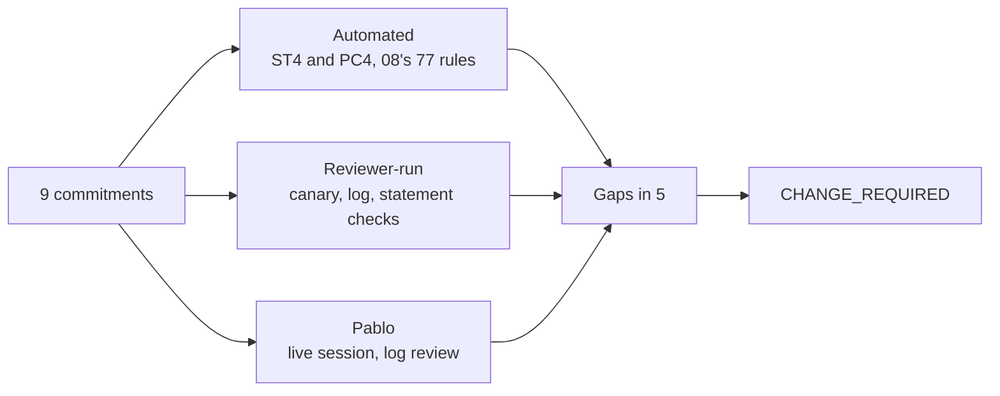

# SPRINT-004 evaluation review: how success is established

This is the Evaluation stage's first-pass report on the proposed SPRINT-004 in the [review brief](../07-planning/03.15-sprint-004-review-brief.md). It was written before reading any other stage's SPRINT-004 report. It reads documents only: nothing was run, no OpenAI request was made, and no package, log or transcript text was read. A draft of 19 November 2026; no approval is recorded.

*Four of nine commitments are fully covered; five have gaps, and one of those has no check at all.*

## Baseline and sources

Brief `f287d715…49d9d` (full hash `f287d7158e4735cc0f9e2bc3872f40a3e7f6e4bfd2e0a1d6aa7648e3ac949d9a`); plan [03.14](../07-planning/03.14-sprint-004-working-plan.md) `9eed53db…b9eb31` and [03.14.1](../07-planning/03.14.1-sprint-004-documents-and-decisions.md) `f17b7383…6e20`; Git HEAD `7d06df18…c87`, branch `sprint-03`; no sprint snapshot exists. Read, first and last eight characters: my [checks](03.10-sprint-004-upload-log-and-screen-checks.md) `02fef0fb…8b96e867` and [live session](03.11-sprint-004-live-session-and-statement-check.md) `9140044c…1dca2336`; [criteria](01.2-evaluation-criteria.md) `3a221ccc…c34dc7dd`; 08's [test map](../08-low-level-design/03.8-sprint-004-test-map.md) `d0641506…dbb12771`, [service tests](../08-low-level-design/03.8.1-s004-service-tests-and-shell.md) `18e6e6f7…5d8bc334`, [behavior checks](../08-low-level-design/03.8.3-s004-page-checks-behavior.md) `4c2d45b7…0eb3b81d`, [upload](../08-low-level-design/03.7.4-s004-upload-and-download.md) `e1d3b83c…1524a060`, [log](../08-low-level-design/03.7.5-s004-meeting-log.md) `4ba55a70…37aa6379`; 05's [limits](../05-high-level-design-and-architecture/01.8.1-upload-limits-and-statements.md) `fca360b1…79ac691a` and [statements](../05-high-level-design-and-architecture/01.10.1-upload-and-log-statements.md) `a9638182…0f32e3d4`; root `AGENTS.md` `09af6e17…ec8d99a2`, 45 nonblank lines.
Intended: the plan's ten criteria. Actual: documents only. Planned: the plan itself.

## The nine commitments

| ID | How success is established | Status |
| --- | --- | --- |
| S004-STATUS | ST4-01, PC4-17, 23, 40; no text in status by canary scan. Pass or fail. | Covered |
| S004-UPLOAD | ST4-02 to 06, 29, PC4-35 to 39, 45; body cap, file rules, UTF-8 and total at their boundaries. | Gap 1 |
| S004-LOG | ST4-12 to 30, 34, SH4-1; completeness by a scripted fixture, then Pablo's review of a real log. | Gaps 2, 3 |
| S004-DOWNLOAD | ST4-09, 10, 08, PC4-41; downloaded file equals the saved file by SHA-256. | Gap 4 |
| S004-SCREEN | PC4-01 to 26 at 1280 × 900, 1280 × 500 and 390 × 844; Pablo's yes or no after each answer. | Gap 5 |
| S004-CUE | PC4-43 to 46: keys, 10-second hold, restart, Esc. | Covered, note below |
| S004-GUARD | None: 08 has no idle-pause rule or check. Conditional ("if kept"). | Gap 6 |
| S004-STATEMENTS | My [statement check](03.11-sprint-004-live-session-and-statement-check.md) with SH4-2; counts all lines. | Covered |
| S004-CARRY | Tests, page check and the run script re-run and reported apart; recorded live session; [03.9 flow measures](03.9-sprint-003-automatic-flow-and-channels.md) for the pause. | Covered |

## Missing, contradictory or ambiguous

1. Upload: 01.8.1 refuses unsafe names and requires a JSON content type; SU-3 keeps the last path part and no case tests the content type. Decide the name rule; add the case.
2. "Complete" log: a scripted fixture proves ordering, not that a real meeting is complete. The cap of 5 MB (MS-4) can end completeness; bytes per hour is unmeasured, so the live session reports it.
3. Criterion 3 says "no package files in it" while bullets shown are logged and may quote the package. Wording should say no package file content is copied; the bullets are reviewed.
4. "Local callers only" means Host and Origin checks; another program on the Mac can still fetch the log (05's statements say so). The check must not claim more.
5. The [glance check](01.2-evaluation-criteria.md) still names the cue word, Focus, Live and a details area; the screen has a bar, one Question, a candidate line, two columns and no details. Its "no smaller than revision 7d60c0f" rule cannot hold; use 08's sizes. Rewrite it, and retire the details row.
6. The 10-second hold needs a controllable clock or it is flaky; 08 and 09 must provide one. The `idle` guard needs a rule first.
7. 08's map calls the log "criterion 11 (proposed)"; the plan has it as 3 to 4, statements as 9. The root `AGENTS.md` has 45 lines, leaving five for new sentences.

## Required amendments, none applied

1. 04: rewrite the glance check and retire the details row (gap 5); name the log-text review and local-caller limit (gaps 3, 4); add the live bytes-per-hour report (gap 2).
2. 08: add the content-type and name cases, a clock for PC4-46, the idle-pause rule if kept, and fix the criterion numbers.
3. 02 and 05: settle the name rule and the criterion 3 wording. Downstream: 07 counts S004-GUARD out unless kept.

## Verdict

**CHANGE_REQUIRED.** The evaluation fits the plan, but the glance check is stale and five commitments lack a complete check. Written by 04 Benchmarks on 19 November 2026. Return to the [review index](README.md).
