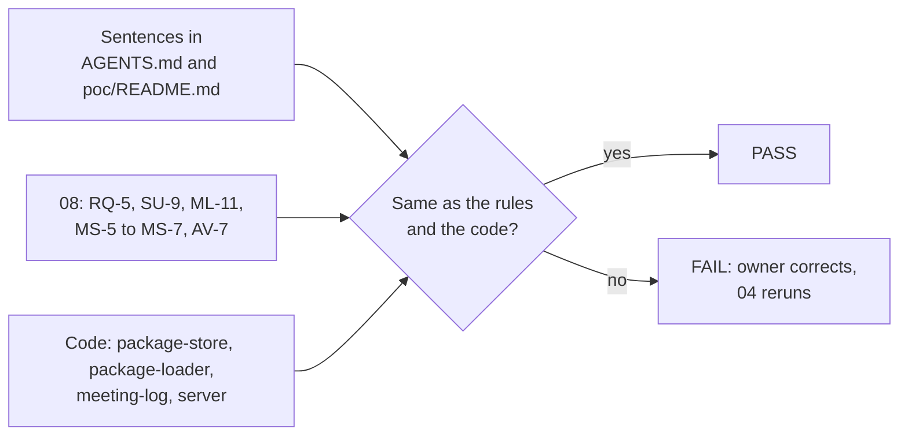

# SPRINT-004 statement check: result for the root AGENTS.md and poc/README.md

This records the S004-STATEMENTS check defined on the [live session page](03.11-sprint-004-live-session-and-statement-check.md), run by 04 Benchmarks on 22 November 2026 at Git HEAD `9326d67` with uncommitted `AGENTS.md` and `poc/README.md`, and rerun on their new bytes the same day after 09 corrected the README, and rerun a third time on 22 November 2026 for SPRINT-005 on the committed README (Git HEAD `673c3bd`). A fourth rerun the same day covers the uncommitted README of 09's logging step. It compares each sentence about what leaves the Mac or is kept with 08's rules and with the code, read as source and not run. No log or package text was read. A draft; no approval is recorded.

*Each sentence is compared both ways: nothing named that is not true, nothing true left unnamed.*

## Sources

Rerun bytes: root `AGENTS.md` `0c0b722c…0a8db5ae`, 48 nonblank lines (limit 50: PASS); `poc/README.md` `f10d2099…b287782b`, then `d2adcc63…8c18c7d7` (SPRINT-005 rerun: one line changed, the keys sentence, which no longer lists G, L and S and says no key sets the cue; it matches `app.js`, where only A, Space and Esc act; every data sentence R1 to R7 is byte-identical to the PASS). First run: `098786c3…7897987f` and `6fcb80c9…159df931`, three README sentences failed. Rules: 08's [upload](../08-low-level-design/03.7.4-s004-upload-and-download.md), [log](../08-low-level-design/03.7.5-s004-meeting-log.md) and [storage](../08-low-level-design/03.7.6-s004-meeting-log-storage.md) pages, and RQ-5 as 08 amended it on 22 November. Code facts, read as source: `FILES_MAX = 20` only in `package-store.mjs`; `modelInput` in `answer.mjs` sends document texts without names; the post-pause reader in `agent.mjs` sends name and text; the log is made 0700 and files 0600 in `meeting-log.mjs`.

## Result by statement

| # | Statement | Result |
| --- | --- | --- |
| A1 | AGENTS.md: Upload package, Remove and Download log; log saved to the Downloads folder, outside the project | PASS |
| A2 | AGENTS.md: package held in memory or read from Git-ignored `poc/context/interview/`; its text and file names go to OpenAI after each pause; its text is never written to the log | PASS |
| A3 | AGENTS.md: log in Git-ignored `poc/logs/`, `ALICE_LOG_DIR`, files only Pablo's account can read, holds others' speech and answers shown, never sent to OpenAI, kept until he deletes it | PASS |
| R1 | README: the page never receives credentials or package text | PASS |
| R2 | README: audio, selected transcript text and the term hint go to OpenAI while listening | PASS |
| R3 | README: after each pause text and file names go in one request and need no Confirm; Confirm stays optional and sends the text, without names, in a separate request | PASS (was FAIL); matches the code |
| R4 | README: 20,000 characters in all; uploads also 20 files and 200 KB; the folder has no file-count limit | PASS (was FAIL) |
| R5 | README: uploads stay in memory, are never written to disk or the log; the package line shows counts, the upload reply names skipped files | PASS (was FAIL) |
| R6 | README: log not sent to OpenAI, not deleted by Alice, holds others' speech and answers shown, copies carry it | PASS |
| R7 | README: avatar files vendored and loaded from this service only | PASS |
| R9 | README: the log also holds, for each model call and question, times, the model name and token counts, with no text (new, 22 Nov, README `5c203fe6…34bb6`) | PASS; `callEvent` takes numbers and fixed code words only, and R6 is unchanged otherwise |
| R8 | README: keys Space, Esc and A; no key sets the cue (new in the rerun; not a data statement) | PASS; matches `app.js` |

## Open notes

1. Conflict for 08, not for the statements: RQ-5 as amended says file names go "on each Confirm" too, but the code's answer request sends texts only and the README says so. The code and README agree; 08 should correct RQ-5.
2. Optional: A2 does not say that Confirm also sends the package text (README does), and the root file omits the term hint; there are two lines of room.
3. The README's smoke-test sentence says the smoke still expects the old cue buttons; true, no fault. Not assessed: the Cloud Run deploy sentence and guide. The log folder is 0755 where it already existed (files 0600), against MS-3.

**Overall: PASS for criterion 9.** Every statement is true against the code, and the README matches it. 08's RQ-5 wording is the one disagreement left. Draft by 04 Benchmarks; no approval is recorded. [Review index](README.md)
