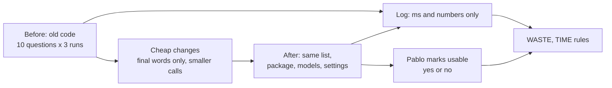

# SPRINT-005 measurement: question list, method and pass rules

This page sets, before any code changes, how SPRINT-005 is measured and what counts as a pass for S005-WASTE, S005-TIME and S005-QUALITY. The baseline is 09's [measured times](../../../poc/docs/08.1-measured-times.md): 7 live questions, mean 8.6 s, median 8.3 s, range 6.4 to 10.3 s; 16 of 23 model calls showed nothing. A draft of 22 November 2026; nothing has been run and no private text was read. No approval is recorded.

*Same list, same settings, before and after. The rules below are fixed now so the result cannot move them.*

## The question list

Ten generic questions, none from `eval-data/`; Pablo may use his own words if the list is written down first and reused unchanged. After each question he answers aloud for about 15 seconds, so calls made while he answers are counted.
1 Tell me about yourself. 2 Why are you interested in this role? 3 Describe a project you led and its result. 4 What is your biggest weakness? 5 Tell me about a time you disagreed with a colleague. 6 How do you decide what to build first? 7 A term from the package, said as it sounds (acronym case). 8 A question the package does not cover. 9 A long question with a pause of about one second inside it. 10 A short follow-up, "And what did you learn?". Three runs of ten (A, B, C), the same order each time, at the usual 800 ms pause. Record the models, effort, package size and time of day for each run.

## Method

| What | How |
| --- | --- |
| Time to the Question and to the first bullets | `question_timing` `toQuestionMs` and `toBulletsMs` (08 RT5-5), one per turn (09's `speechEndMs` is the last voiced packet on the log's clock, not `pause.startMs`; it includes any thrown-away reading in the same turn). Only turns with `outcome` `bullets` count as answered |
| Questions asked and missed | Turns per run against the ten asked; a turn ending `no-question`, `rejected`, `failed`, `superseded` or `stopped` with no Focus is a miss |
| Calls and waste | `model_call` `outcome` (RT5-4): a call shows nothing unless `question`; each answer attempt is its own call; changed words is `reason` `corrected-evidence` |
| Tokens | `inputTokens`, `cachedTokens`, `outputTokens` of `model_call`; `null` leaves S005-SMALLER unverified; 09 checked tokens on a stub only, so the first real log decides |
| Order | The logging lands alone, with no behaviour change, and the before runs use that code |
| Reading the log | Numbers, `ms` and `type` only; never `text`; questions matched to the list by order |

One live step is added: Stop right after speaking, then count `speech_lost` (S005-STOP). The 7-question baseline used `pause.startMs`, a constant offset from `speechEndMs`, so only the before and after runs are compared. Report the median and the worst per variant for each time, the calls per question, and the share that showed nothing. Precision is about 0.3 s. A run is invalid if a question is not heard, is cut in two, or the network fails; repeat it once and report both. At least 27 of the 30 runs must be valid.

## Pass rules (set 22 November 2026, before the change)

| Criterion | Pass |
| --- | --- |
| S005-WASTE | On the 30 runs, calls that show nothing are at most 35% of all calls (baseline 70%), and none is rejected because the words changed |
| S005-TIME | Median time to the Question is at least 1.5 s lower than the median of the before runs, the worst is no higher than the before worst, and the same holds for the first bullets. 6 s is reported as 09's estimate, not required |
| S005-SMALLER | Median input tokens per call is lower, or the cached share is higher, and median call time is no higher; otherwise the change is reverted |
| S005-QUALITY | Pablo marks usable on at least 24 of 30 answers, and not more than one fewer than the before runs |

## How Pablo marks an answer usable

Right after each answer appears, before he sees any timing, he writes yes or no by question number on a sheet that holds no text: **yes** only if the Question is what he asked, the bullets are things he would say aloud, and every statement about him is in his package. A wrong question, an unsaid addition or an unusable bullet is a no. He marks the before runs the same way. Only counts reach the report; the sheet is not copied into the repository. A speed gain that fails this rule fails the sprint.

Draft by 04 Benchmarks. [Statement check result](03.13-sprint-004-statement-check-result.md) · [Review index](README.md)
