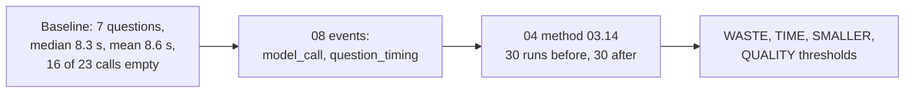

# SPRINT-005 evaluation review: first pass by 04

This is the first-pass report of 04 Evaluation on the [review brief](../07-planning/03.20-sprint-005-review-brief.md) (SHA-256 `e9f5613a…b2029`), 22 November 2026, asked how success is established: criteria, method, observations and thresholds. Sources read: 08's [rules](../08-low-level-design/03.11-sprint-005-response-time-rules.md) (`52fbaeff…`) and [checks](../08-low-level-design/03.11.1-s005-checks-and-open-items.md) (`3e6d122d…`), the plan, 09's analysis and my [measurement plan](03.14-sprint-005-measurement-plan.md). A draft; no approval is recorded; nothing was run and no private text was read.

*The baseline has no tokens, no list and no median per question; the new events and the before runs supply them.*

## Commitments covered

| Criterion | Established by | Covered |
| --- | --- | --- |
| S005-FINAL | ST5-1, ST5-2 (service tests, fixtures) | Yes |
| S005-WASTE | `model_call` outcomes on 30 runs; share of calls showing nothing at most 35%, none rejected for changed words | Yes |
| S005-SMALLER | `model_call` tokens; kept only on a gain | Yes, if the API reports cached tokens |
| S005-TIME | `question_timing`; median 1.5 s lower, worst no higher | Yes |
| S005-QUALITY | Pablo's yes or no, at least 24 of 30 and within one of before | Yes |
| S005-STOP | ST5-8, ST5-9; one live Stop in mid-sentence, `speech_lost` count 0 | Yes, step added below |
| S005-CARRY | live session; statement check rerun on the final README | Yes; 10 reviews |

## Fields my method needs, and 08's proposal

Needed: per question `toQuestionMs` and `toBulletsMs`; per call `outcome`, `reason`, `inputTokens`, `cachedTokens`, `outputTokens`, `durationMs`; a count of questions heard. **08's RT5-4 and RT5-5 cover all of them**, and SH5-1 matches my method, so my open items for 08 are met. I amended 03.14 to read these events instead of `focus_changed` and `answer_shown` (hash below).

## Gaps and amendments

1. **Order (the known gap).** The events do not exist on the old code, so the before runs need them first. Amendment for Planning and 09: logging lands alone, with no behaviour change, then Pablo runs the before runs, then RT5-1 to RT5-3. 09 owns the build order, 10 checks that the logging commit changes no behaviour, and Pablo runs the before runs. 03.14 now says so.
2. **No Focus, no timing.** RT5-5 writes `question_timing` per Focus version, so a question that never gets a Focus has none. I count `pause` lines for questions heard; 08 may instead write the event with `questionMs` null.
3. **Reason value.** "Rejected for changed words" needs a stable `reason`; 08 should name the value (`corrected-evidence` today).
4. **Cached tokens.** If the API returns none, S005-SMALLER is unverified, not passed; 09 confirms where it is reported.
5. **Stop step.** Add to the live run: stop right after speaking and read `speech_lost` (counts only).
6. **Baseline.** The 8.6 s mean is from 7 questions with no list; the before runs on the list are the baseline for TIME and WASTE. 09's 6 s is an estimate only.

## Downstream implications

- 08: name the reason value and decide gap 2. 09: logging first, and check cached tokens. 10: confirm the logging-only commit and review the final revision. 05: adding event types to a version 1 log (ML-1, ML-15), and the data statements; the call's content is unchanged, only its order.
- The statement check reruns on the final README (rerun on `d2adcc63…` passes).

## Verdict

**CHANGE_REQUIRED.** The method and thresholds are complete, but the logging must land alone before the before runs (gap 1), and 08 must settle gaps 2 and 3. My own amendments are done; 04 owes nothing else. Draft by 04 Benchmarks; no approval is recorded. [Review index](README.md)
