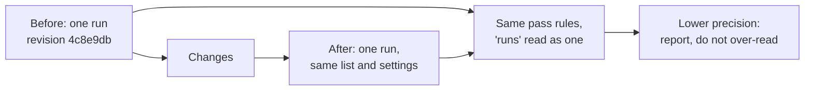

# SPRINT-005 baseline run and the one-run deviation

Pablo did the before-run on revision `4c8e9db` and decided on 22 November 2026, "Use this one run" as the baseline, instead of the three runs of [03.14](03.14-sprint-005-measurement-plan.md). This page records that deviation and the baseline numbers, computed from `type`, `ms`, `outcome`, `reason` and token fields only; 04 read no text. The log stays in his Downloads, outside the repository. A draft; no approval is recorded.

*One run each way keeps the rules and loses precision.*

## Baseline (one run, 35 model calls, 8 answered turns)

| Measure | Value |
| --- | --- |
| Calls by outcome | 8 `question`, 11 `no-question`, 16 `rejected` (all `corrected-evidence`) |
| Calls that showed nothing | 27 of 35, 77%; the 16 rejected took 50.6 s of call time |
| `toQuestionMs`, sorted | 3996, 4460, 7446, 7523, 8624, 8686, 9227, 13048: median 8073.5 ms, worst 13048 ms |
| `toBulletsMs` | Equal to within 1 ms: the bullets come from the reader call |
| Speech end to final | Median 1374 ms |
| Rejected first | 6 of 8 answered turns had a rejected call before the kept one |
| Tokens and calls | `cachedTokens` 0 on every call; median input 4841 tokens; median call 3023 ms |
| Package | The 3-file folder package, 18,843 characters |

## What changes in the rules

The pass rules of 03.14 stay as set, with "runs" read as one run of the same list:
- **S005-WASTE:** at most 35% of calls show nothing (baseline 77%), and none is rejected for changed words (baseline 16).
- **S005-TIME:** median to the Question and to the bullets at least 1.5 s below 8073.5 ms, that is at most 6573 ms, and the worst no higher than 13048 ms. The worst of eight values is weak; report it, do not rest on it.
- **Answered turns:** the after run answers at least 8 turns, so speed is not gained by losing questions.
- **S005-SMALLER:** the baseline is median input 4841 tokens and cached 0; a gain is fewer input tokens or cached above 0, with median call time no higher than 3023 ms.
- **S005-QUALITY:** at most one fewer usable answer than the before run, and at least 80% of answers usable; Pablo's marks for the before run are not in yet and must be entered before he sees the after timing.
The after sitting is one run of the same list, on the same package, models and settings. With one run, differences under about 0.5 s are noise (packet precision 0.1 s, plus the spread of a single sample), so a pass or fail near a limit is reported with that caveat.

Draft by 04 Benchmarks; no approval is recorded. [Review index](README.md)
