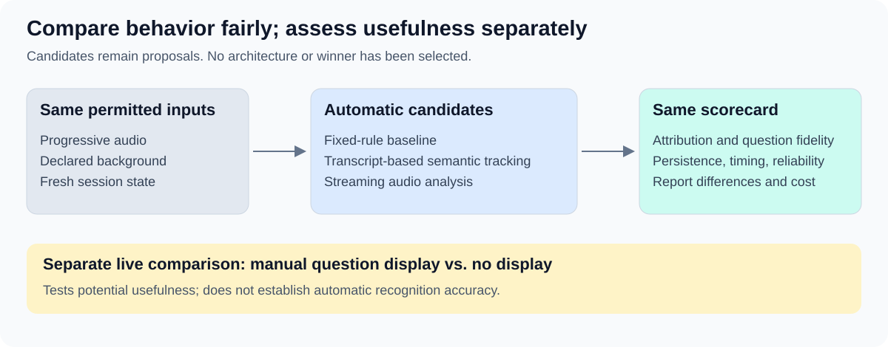

# Alternatives and decisions for review

Draft for review · 21 October 2026. These are evaluation candidates and open decisions, not an architecture choice or implementation plan.
No candidate has been implemented or benchmarked as part of this assessment, and no evidence-based winner is established. The automatic baseline itself requires capability that is not yet implemented.

## Optional manual display comparison

A human operator can listen to a live mock interview and maintain the current question in a simple editable text view while User answers. This is a separate, optional usefulness trial, not a prerequisite for replay feasibility.
The operator should use only what has been heard, preserve the question and offer no answer coaching. Compare against the current experience without a question display, using comparable fresh questions and varying condition order where practical.
Record display delay relative to question end and answer onset, operator effort and errors, User’s distraction/usefulness report, and observable loss of the question or need to ask for repetition.
This can inform whether the display is worth pursuing, but it cannot establish automatic recognition accuracy or prove broad benefit from one small trial. Human-operated timing and quality must remain identified as such.

## Simple baseline and candidates

| Approach | Proposed behavior | What the comparison would reveal |
| --- | --- | --- |
| Simple automatic baseline | Incremental transcription, online speaker estimates, fixed question-trigger rules, and retention of the last qualifying question. | Whether extra semantic reasoning improves on a small explicit rule set; inspect failures on indirect requests and multipart questions. |
| Transcript-based semantic tracking | Interpret the developing transcript and speaker estimates to maintain current-question state. | Whether meaning, follow-ups and false triggers improve enough to justify observed delay and cost. |
| Streaming audio analysis | Analyze progressively delivered audio and maintain explicit current-question state. | Whether attribution, fidelity, stability and timing meet the same criteria with this input approach. |
| Existing duration signals | Current amplitude/timing-based color display. | A reference condition for later live usefulness checks; it does not implement question recognition. |

All automatic approaches receive the same permitted audio and background, with fresh case state. Ground-truth speakers and prepared transcripts stay private.
Fix the baseline rules before scoring. If candidates use different online speaker or transcription components, record that difference and compare whole pipelines rather than attributing all gains to one component.
Use [the pilot protocol](03-release-single-recording-evaluation.md) and [the same measurements](03.1-release-measurements-and-thresholds.md). Capture semantic review reasons alongside automated measurements.
No vendor, model, meeting integration or custom-build decision is selected. Broader product alternatives can be added when their suitability and access are evidenced.

## User's manual turn cue: P

On 25 October 2026, User selected **P for Pablo** for the proposed turn toggle: press once to signal “I'm speaking,” and press again to signal “I've finished.” The intended visible states are “Pablo speaking” and “Listening”; audio continues throughout, and “Listening” does not assert that the interviewer is speaking.
Treat this as a manual-assisted evaluation condition. The cue supplies User's declared turn state; it does not prove the identity of every voice during interruptions or overlap. Automatic attribution can be evaluated separately or as assistance when cues are missing.
Measure missed or late presses, accidental typing, held-key repeats, meeting-app focus, correction effort and distraction, alongside question persistence and timing. A phone button with the same meaning remains a proposed equivalent.
Declare timestamped cue events as runtime inputs and expose them only when they occur. Recorded replay cues must have documented provenance; private evaluator turn labels must not be silently converted into perfect user input. Report manual assistance separately from fully automatic results.
The P choice is recorded; the shortcut and toggle are not implemented. This decision does not start an implementation sprint or accept the full evaluation protocol.

## Direction established in this discussion

Permanent progressive replay, no future-input access, Air QA, live validation and an initial ten-recording target are User-selected directions.
One recording starts the experiment. Question persistence is the first candidate feature; eventual grounded hints and attention remain in the broader strategy.
Enabled and agreed live recordings become candidates for the collection after review. This is intended behavior, not a claim of current implementation.

## Details awaiting review

1. Review replay feasibility and feature quality as separate milestones: one minimal streaming run first; the proposed four-to-six-minute, five-question challenge case belongs to the feature evaluation.
2. Accept or revise three replays per approach and the feature gates, especially 95% overall attribution and two-second latency. Review participant breakdowns and answer-relative arrival before inferring useful performance.
3. Decide whether the independently recorded User voice sample is available and appropriate for the pilot; a cold-start variant must be identified separately.
4. Confirm that semantic fidelity can initially accept either exact or shortened question text, while readability is assessed separately.
5. Review live recording and candidate admission as additions to the documented system behavior, including recording enablement and permitted use.
6. Later, choose the development/reserved-case allocation, live attention rubric and eventual hint criteria as evidence becomes available.
7. Decide whether the optional manual display comparison would resolve a useful uncertainty before investing in automatic recognition.

The draft’s identical-opening/different-continuation check remains an optional later integrity check. It compares delivered prefixes and access, not identical generated outputs.
Keep the first experiment to one recording; this optional extension is not a prerequisite for that case.
Architecture selection belongs to subsequent design work, and implementation sequencing belongs in the integrated Stage 07 plan. No owner, schedule or sprint transition is recorded here.

The [recording card](03.3-first-recording-case.md) and [initial voice-profile comparison](03.4-voice-profile-probe.md) now exist. The next evaluation proposal can use P-marked turns; checked references and live input-effort evidence remain pending.
[Current evidence](02-evidence-and-reconciliation.md) · [Review index](README.md)
