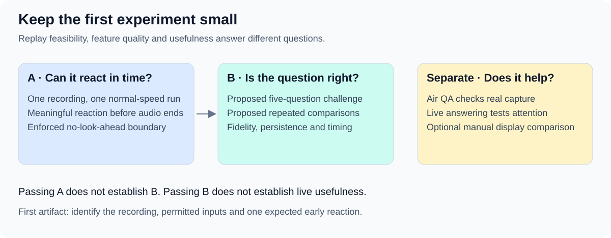

# First recording: listening, transcription and speaker separation

Candidate SC-B001 · 24 October 2026. User supplied [mock-interview-0.mp3](../../../eval-data/mock-interview-0.mp3) for the first technical test.
The immediate question is whether the application can consume this audio progressively, emit transcript text before playback ends and keep the two voices distinguishable as the conversation develops.

## What we have

| Property | Evidence |
| --- | --- |
| Source | `eval-data/mock-interview-0.mp3`; original preserved. Exact digest and command evidence are in the [intake record](sources/sc-b001-intake-2026-10-24.json). |
| Duration and size | 872.619637 seconds, approximately 14:33; 8,213,036 bytes. |
| Audio format | One MP3 audio stream, 44,100 Hz, two channels reported as stereo. Channels do not establish the number or identity of speakers. |
| Capture conditions | User reports two participants and recording over air through an iPhone microphone. Room conditions, device model, speaker roles and voice-to-person mapping remain unverified. |
| File integrity check | Full local FFmpeg decode completed without reported errors. A later [offline profile comparison](03.4-voice-profile-probe.md) covers the first 90 seconds; no application playback or transcription has run. |

The file is longer than the proposed four-to-six-minute feature-quality case. That proposal is not a prerequisite for the first feasibility demonstration.
Use the complete recording at normal speed for the proposed feasibility run. The separate offline profile probe uses a versioned 0:00–1:30 excerpt; reserve later audio for quality validation after any calibration.
The original acoustic capture makes this a useful candidate for testing recorded room audio. Digital replay does not by itself validate the application’s current microphone path; a new Air QA pass would do that separately.

## Proposed first probe

1. Feed only elapsed audio into analysis, preserving pauses and overlap. The replay controller holds the full file; analysis receives neither its path nor future audio or private references.
2. Emit timestamped transcript segments while audio is still arriving. A meaningful early transcript is evidence of reaction; decoder success or a playback heartbeat is not.
3. Label distinct voices consistently as Speaker A and Speaker B, retaining unknown/overlap where uncertain. Confirming which voice is User requires a reviewed example or separately declared enrollment input.
4. Retain source intervals, delivery times, transcript revisions, speaker-label transitions and errors so later review can identify omissions, substitutions, missed switches or label swaps.
5. Report replay feasibility separately from transcription and speaker quality. Input isolation is mandatory; the later question-display gates do not determine whether this first streaming demonstration worked.

## Optional voice enrollment comparison

User also supplied [pablo-voice-solo-recording.mp3](../../../eval-data/pablo-voice-solo-recording.mp3) as their solo voice recording. It is 181.479637 seconds (about 3:01), 1,611,008 bytes, MP3 at 44,100 Hz with two channels.
The [enrollment intake](sources/sc-b001-enrollment-intake-2026-10-24.json) preserves the original file checks. At User's subsequent request, local processing generated [pablo-ecapa-v1.json](../../../eval-data/voice-profiles/pablo-ecapa-v1.json): a 192-dimensional, unit-normalized SpeechBrain ECAPA speaker embedding. This is an experimental evaluation artifact, not an application architecture decision or integrated capability.
Silero VAD selected speech-rich, non-overlapping eight-second windows. Fifteen windows (120 seconds including internal pauses) formed enrollment; five other windows were held out before embedding extraction. Their cosine similarities to the profile were 0.805–0.903, mean 0.853; these same-recording scores are not recognition probabilities or accuracy against other speakers.
The profile records source and model hashes, pinned model revision, processing parameters, window boundaries and matching instructions. Comparison requires the same encoder and 16 kHz mono preprocessing; the recognition threshold is unset pending calibration. The [model card](https://huggingface.co/speechbrain/spkrec-ecapa-voxceleb) describes the encoder; no generalization to this interview is claimed.
Propose paired fresh-state runs of the same interview and configuration, with and without the fixed enrollment profile. Keep this optional so the first replay demonstration does not depend on enrollment.
For the enrolled variant, declare the profile, its source intervals, digests and user-provided identity in the permitted-input manifest before replay. Confirm it is an independent capture; do not obtain enrollment speech from a future part of the test interview. Other private references remain inaccessible.
Report transcript errors, speaker separation, label swaps and attribution per participant. Score anonymous labels against private speaker references consistently; report identification of User separately, retaining unknown matches. Do not treat an anonymous label as a recognition error merely because it lacks a name.
On 25 October, User explicitly confirmed that the solo file contains only them and the interview contains them plus one other speaker. Individual interview turns still need reference labels; independent-capture confirmation and scored validation remain pending. The interview's reported iPhone capture conditions have not been assumed for the solo recording.

## Private references and unresolved inputs

A checked early exchange containing both speakers is still needed, with verbatim words, speaker turns, uncertainty spans and start/end times. No exchange boundaries or transcript have been invented from the filename.
Keep that reference outside runtime access. A transcript made from the complete file can support evaluator review but cannot establish real-time transcription or be fed into the streaming test.
Speaker count comes from User’s report. Voice identity, language, intelligibility, question count and overlap coverage have not been independently assessed.
Begin quality review with the checked exchange: compare transcript errors and speaker labels per participant and note uncertainty. No new numeric pass threshold is introduced for this intake.

## Readiness and next evidence

The candidate is readable and documented, but is not yet an admitted or scored benchmark. The inspected application currently implements amplitude/timing-based color signals without transcription or voice identification.
The next evidence is the checked early-exchange reference and separate-session/other-speaker validation of the optional profile; application implementation and replay execution remain separate decisions under the [two-milestone protocol](03-release-single-recording-evaluation.md).
The profile, its same-recording consistency check and an [offline comparison of the interview's first 90 seconds](03.4-voice-profile-probe.md) now exist. The application remains unchanged, the sprint remains inactive, and no benchmark accuracy result or human acceptance is recorded.
[Review index](README.md) · [Measurements](03.1-release-measurements-and-thresholds.md)
