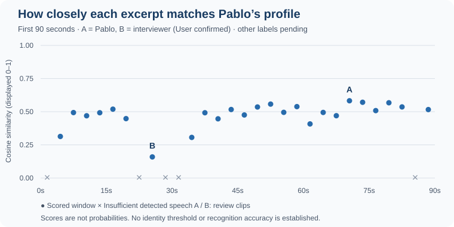

# First comparison with the interview recording

On 25 October 2026, User confirmed that `mock-interview-0.mp3` contains two speakers including them, and `pablo-voice-solo-recording.mp3` contains only them. These are the existing files in `eval-data/`; no additional recording was required for this exploratory comparison.
The frozen solo-derived profile was compared with the first 90 seconds of the interview. This prepares speaker-reference review; it does not establish recognition accuracy or real-time application behavior.

## Observed result

Local analysis divided the excerpt into 30 non-overlapping three-second windows. Twenty-five met the proposed 70% detected-speech filter and received a cosine similarity score; five remain unscored. This filter selects analyzable audio, not speaker identity.
Scores range from 0.159 to 0.583. User listened to the review clips and confirmed A as themself and B as the interviewer. This pair has the expected ranking, but no recognition accuracy, automatic decision threshold or pass/fail result is established. The profile and original recordings are unchanged.

| Review example | Interview interval | Similarity to profile | Confirmed speaker |
| --- | --- | --- | --- |
| A | 1:09–1:12 | 0.583 | Pablo / User, confirmed by User |
| B | 0:24–0:27 | 0.159 | Interviewer, confirmed by User |

These examples were selected because they have the highest and lowest scores. They are useful for checking interpretation, but are not a representative accuracy sample. A window may contain a turn change, overlap or background sound; higher similarity alone does not confirm that it is User.
The earlier solo-recording consistency check used eight-second windows. Its higher scores are not a directly comparable acceptance threshold for these shorter interview windows.

## Evidence and next reference

The [complete result](../../../eval-data/interview-analysis-2026-10-25/sc-b001-profile-probe-2026-10-25.json) records all windows, missing scores, model/profile hashes, processing settings, source intervals and temporary review-clip hashes. The [original audio](../../../eval-data/mock-interview-0.mp3) remains the durable source for those intervals.
The two confirmations label only those six seconds; the other windows remain unreviewed. The next reference is an independently checked transcript and turn labels across an exchange. Do not generate reference labels from the profile's own predictions or extend these two labels to adjacent turns without review.
Treat 0:00–1:30 as exploratory/development material. Audio after 1:30 has not been analyzed in this probe and remains available for later validation; freeze any calibrated settings before scoring it.
This was an offline diagnostic. There was no timed replay, verified access isolation, transcription, application integration, recognition-accuracy score, sprint transition or benchmark acceptance.
[First recording](03.3-first-recording-case.md) · [Review index](README.md)
