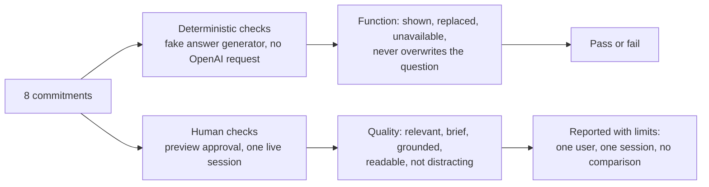

# SPRINT-003 evaluation review: how success can be established

SPRINT-003 gives Alice (Alice.Good.Meetings) a new page layout and a proposed answer to the Focus question. This first-pass review asks, for each commitment in the [review brief](../07-planning/03.6-sprint-003-review-brief.md), whether success could be told from failure: an observable criterion, a method, and a justified threshold or a stated measurement limit.
It designs the evaluation only. Nothing was run, no OpenAI request was made and no other document was changed.

*Function can be settled by tests that cost nothing. Quality needs Pablo and real requests, and one session supports a report with limits, not a rate.*

## Baseline and sources

Brief SHA-256 `3a1a604830617a0fb4f570afbea0b685822725b7e9bbb63c92c3e8bad89fefe4`, with its direction page `1d12fda9…6cda` and sources page `a8bf6870…7a31`; sprint record `c81510f0…ddc4`; Git revision `7d60c0f`. Every Stage 04 file, the root `AGENTS.md`, `index.html`, `app.js`, `poc/poc.test.mjs`, `poc/start.sh` and the Stage 02, 03 and 08 pages cited here match the hashes listed in the [sources page](../07-planning/03.6.2-sprint-003-brief-sources.md).
Also relied on, unchanged from `7d60c0f`: [03 one-recording experiment](03-release-single-recording-evaluation.md) `771044fba7a121a8f359152d962a9b12f8da93a918e39fc2a3f4de89ec2f179e` and `poc/server.mjs` `0cdb1aa85391db218afd3997de797cbe55222e9f068a8ee28c61a70c84e50386`.
The same holds for `poc/docs/07-running-and-verification.md` `01f49e16f153f477f1e18c93a78628ae3cfd71419fd85adbc4fe48fbd9aed963`, `poc/browser-protocol.md` `21471fcf06e0cae1d4917d5a0690efc9d9f328a910fe804d8398af742ea89ea0`, `poc/live-capture.md` `4b4ad89faf65f4b97fe6a1406ceb01ecfe849ee9e2ab34b7c12fe31485f93858` and the [UC-04 live check plan](../09-build-and-test-cycle/01-uc-04-live-check-plan.md) `538a0aa39f81423a283cf25122f3955fb5bc0d094e8f3c8636fffa5bcc640bdc`.
Intended: the seven criteria Pablo approved, as relayed. Actual: the page and tests at `7d60c0f`, read as source. Planned: the brief itself; no other Stage 07 work item was read. No acceptance of the Stage 04 bytes is recorded, and their numeric thresholds remain proposals.

## Each commitment

| ID | What must be observed | Method | Threshold or limit | Stage 04 today |
| --- | --- | --- | --- | --- |
| S003-LAYOUT | In every cue state the full-screen color and cue word match today's page; Focus and the proposed answer are two separate cards; Live is one bar holding Confirm. | Extend the scripted page check (`poc/browser-protocol.mjs`) with fixed viewports and screenshots; compare cue size and color with `7d60c0f`. | Pass or fail. "Stay as today" justifies a same-or-larger rule for the cue word. The viewports (second screen, phone) are not fixed. | No layout criterion. |
| S003-PREVIEW | A dated approval by Pablo naming the exact preview (file hash or screenshot set), given before `index.html` is replaced. | Decision record. The preview shows all three cues with empty, longest expected, pending and unavailable content. | Pass or fail. Approval shows preference, not readability in use. | Nothing; what the preview must contain is unspecified. |
| S003-GLANCE | With worst-case text, Focus, Live and the cue word are not clipped, overlapped or scrolled, and are no smaller than today; after one brief look Pablo names the cue and the Focus question. | The scripted layout check, then Pablo's own check in the preview and in the live session at his usual screen distance. | Sizes relative to today, because the criterion says "stay". No glance time is justified: one user, self-report, no eye tracking. | [Criteria](01.2-evaluation-criteria.md) and [measurements](03.1-release-measurements-and-thresholds.md) require legible, unclipped, stable text but never define "at a glance". The answer card's own readability is in no criterion. |
| S003-ANSWER | Function: an answer is shown only for the current Focus version, is removed when Focus changes, and never writes Focus or Live. Quality: it addresses every part of the question, keeps the decided form and states nothing about Pablo that its declared inputs do not contain. | Function: the tests below. Quality: human review of each live answer as pass, partial or fail with a reason. Latency: Focus commit to rendered answer, using the existing render acknowledgement. | Function pass or fail. Zero stale and zero invented-fact answers, from the fail definition in the criteria. No relevance rate or latency limit is justified: report each one; the provisional 2 s question target does not transfer. | Coaching quality is a row marked future and "not a gate"; the [strategy](01-evaluation-strategy.md) promises "separate criteria" for hints that were never written. |
| S003-NOKEY | The page loads; meter, timer and GOOD / LAND IT / STOP work; a plain message says proposed answers are unavailable; no connection to OpenAI is attempted; no key or provider text appears. | Deterministic test through the `apiKey` and `connect` options of `createPocServer`; scripted page check; a start without `poc/.env.local`. | Pass or fail. "Without a key" should cover file absent, key empty and key rejected. Today the server ends the session with "Server needs OPENAI_API_KEY", so no question is recognized either: "still works" needs a definition. | Nothing. |
| S003-TESTS | Exit 0; the 19 existing cases still pass; new named cases cover the list below; no case calls OpenAI. | `node --test poc/poc.test.mjs`, the deterministic workflow described in `poc/docs/07-running-and-verification.md`. | Pass or fail. A pass says nothing about answer quality or the rendered page, whose checks sit in `browser-protocol.mjs`, a command criterion 5 does not name. | "Automate observable checks" applies; "new tests" has no minimum content. |
| S003-RUN | Nothing running: `/health` answers on 127.0.0.1 within a stated wait. Already running: no second process, exit 0, reuse is reported. Port held by another program: a clear failure, never "reused". The key is never printed. | Scripted shell check without an OpenAI request; it serves the one-local-process operating rule and Pablo's request. | Pass or fail. Behavior without `.env.local` (today `start.sh` passes it to Node as `--env-file`) and whether the browser opens are unspecified. | Not evaluation content; no change needed. |
| S003-LIVE | Each scripted step is pass, fail or unverified, against a pass rule fixed before the run. | A scripted session with fresh questions, captured with `poc/live-capture.mjs` as in the UC-04 live check; after each answer Pablo reports whether the proposed answer was relevant, helped, and interrupted his thinking. | One person, one session, no run without the answer: it can show the feature works, not that it helps. | The live method exists; the criteria say the live rubric and any success rate "remain to be agreed". |

## What the proposed-answer tests must show

Setting Focus produces one request and one answer bound to that Focus version, and no Focus produces neither. A Focus change removes the shown answer and discards the late result of the superseded request. An answer result cannot change Focus, Live or the phase, and Stop suppresses a late answer.
A failed, timed-out or refused request shows "unavailable" for that Focus, leaves Focus, Live, Confirm and the cue working, keeps no earlier answer on screen as current, retries a bounded number of times, and puts no key or provider text in the page or audit log. No sprint criterion covers this case.
The request body holds only the declared inputs and never audio, `eval-data/` content, evaluator labels or reference answers; the test asserts this on the body. Quality review uses fresh questions, never the benchmark recording or its transcript, and the reviewer's expected points stay private.

## Amendments proposed, none applied

1. [01.2 criteria](01.2-evaluation-criteria.md): turn the coaching row into proposed-answer criteria (relevant, decided form, grounded in declared inputs, bound to the current Focus) and drop "not a gate"; name Focus, Live, cue and answer card in the readability row and define the glance check.
2. [01 strategy](01-evaluation-strategy.md), line 37: link those criteria where it says "separate criteria", and name the answer generator among the components bound by input isolation, with its declared-input list.
3. New page `03.6-sprint-003-evaluation-plan.md`: the checks above, the preview state set, the latency definition, the live script and its pass rule. It is written once S003-Q1 to Q3 are decided.
4. [02 current evidence](02-evidence-and-reconciliation.md): a dated update. Line 26 says the page has no transcription or question display; at `7d60c0f` it has the Focus and Live panel, Confirm, Clear live and the POC service.
5. [03.2 decisions](03.2-release-alternatives-and-review-decisions.md), item 6, defers the live attention rubric and hint criteria to "later": both are now due. The [README](README.md) gains links.

## Open questions and what could not be established

- **S003-Q1 Form.** Purpose asks for "short text" and the criteria for "brief" hints; fuller wording needs a length limit and presses on S003-GLANCE. Both options are testable; the limit cannot be fixed before the choice.
- **S003-Q2 Trigger.** It changes the test fixture, the latency start and the number of billable requests, not the criteria. Criterion 3 reads as automatic.
- **S003-Q3 Inputs.** It decides the grounding rule. With the question alone, any statement about Pablo's own experience is unsupported and fails. With a résumé, answers are checked against that declared context, which is held constant and sent to OpenAI; the [first experiment](03-release-single-recording-evaluation.md) asks an explicit justification for such background.
- None blocks this verdict. Q1 and Q3 must be decided before the amended criteria are final and before S003-LIVE can be scored. The S003-LIVE pass rule also needs Pablo's agreement.
- Not established: no SPRINT-003 design, preview or OpenSpec change exists, so only the commitment text was reviewed; Pablo's words are as relayed. The 19 cases are counted from source (`poc/docs/07` says eighteen). Unspecified: whether a confirmed restatement counts as a Focus change, and what happens to the answer when the session stops.
- Downstream: the design must expose the Focus version of each answer, a render acknowledgement, an injectable generator, inspectable request inputs, and pending and unavailable states. Purpose still defers suggested answers ([planned improvements](../02-purpose/03-planned-improvements.md), line 15).

## Verdict

**CHANGE_REQUIRED.** Stage 04 has the right dimensions but no usable criteria for a proposed answer, no definition of "at a glance" and no live pass rule; amendments 1 to 5 close that. Written by 04 Benchmarks on 16 November 2026 before reading any other stage's SPRINT-003 report. Return to the [review index](README.md).
