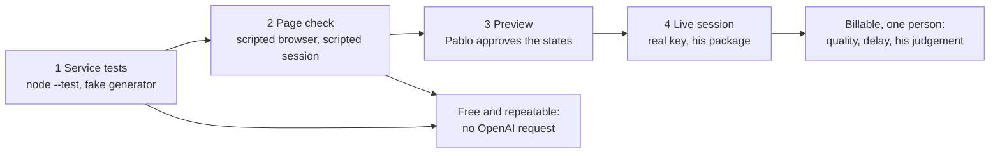

# SPRINT-003 evaluation plan: four layers of evidence

SPRINT-003 gives Alice (Alice.Good.Meetings) a new layout and a proposed answer: a card of short bullet points beside the Focus question and a details area below, built from the Focus question and Pablo's interview preparation package.
This plan says which check establishes each commitment of the [brief](../07-planning/03.6-sprint-003-review-brief.md) and its [addendum](../07-planning/03.6.3-sprint-003-brief-addendum.md). It is a design: nothing here has been run.

*Layers 1 and 2 settle function without cost. Only the live session can show answer quality and what Pablo makes of it.*

## What establishes each commitment

| Commitment | Layer | It passes when |
| --- | --- | --- |
| S003-LAYOUT | 2, 3 | In every cue state the full-screen color and cue word are as at revision `7d60c0f`; the Focus card, bullet card, Live bar with Confirm and details area are separate regions that never overlap. |
| S003-PREVIEW | 3 | A dated approval by Pablo names the preview files by hash and comes before `index.html` changes. |
| S003-GLANCE | 2, 3, 4 | The [glance check](01.2-evaluation-criteria.md) passes: its layout part in layer 2, Pablo's own part in the preview and the live session. |
| S003-ANSWER | 1, 2, 4 | The function lists below pass, and the review of every live answer finds none left from an earlier question. |
| S003-DETAILS | 1, 2, 3 | Readable on its own (N3 checks); details come from the same call as the bullets, carry the same Focus version, appear and disappear with them, and never shrink, cover or move the four glance elements. |
| S003-CONTEXT | 1, 4 | The generator is handed only the declared inputs; the package's file list and digests are recorded for the run; the reviewer-run [package check](#details-and-package-checks-n3) finds no benchmark material; the review finds no statement about Pablo that the package does not contain. |
| S003-STATEMENTS | Document check | Each sentence of the data statements in the root `AGENTS.md` and `poc/README.md` is compared with the layer 1 request-object assertion: only the fixed instructions, the question and the package text reach the model for an answer (RQ-5), besides the audio and transcript text already described. [Procedure](03.8-sprint-003-package-and-statement-checks.md). Any difference is a fail. |
| S003-NOKEY | 1, 2 | Three cases each get a layer 1 case and a layer 2 run: file absent, key empty, key rejected. Pablo's accepted reading, "page, timer and cue still work": the page loads, timer and cue work, and, for an absent or empty key, the answer area is Unavailable on load (a rejected key shows it once a session starts, per 08's R2) with a clear message that question recognition and proposed answers are unavailable. No connection to OpenAI is attempted and no key or provider text appears. |
| S003-TESTS | 1 | Exit 0, the existing cases still pass, named cases cover the layer 1 list, and no case calls OpenAI. |
| S003-RUN | Shell check | `bash poc/alice-run.sh` follows the decision path of [service start and key](../05-high-level-design-and-architecture/01.4-service-start-and-key.md) holds: start when nothing answers `/health`, reuse only this service when it is current, fail clearly on another program, never restart during a session, start without `poc/.env.local`, never print the key; it has three outcomes (start, reuse, refuse another program), each exit code and message checked. |
| S003-LIVE | 4 | The [live session](03.6.1-sprint-003-live-session.md) is recorded against its pass rule. |

## Layer 1: service tests

The area is always in one of the seven [answer states](../03-system-model-and-use-cases/01.5.1-proposed-answer-states.md) of [UC-05](../03-system-model-and-use-cases/01.5-proposed-answer.md): Empty, Preparing, Shown, General, Failed, Unavailable, Last known.
Confirm moves it to Preparing with one request for that Focus version; a result publishes bullets and details together as Shown. Any Focus change, a confirmed rewording included, returns to Preparing in the same update and drops the earlier result. No result ever changes Focus, Live or the phase.
Four rules proposed by Use Cases were accepted by Pablo on 16 November 2026; the tests check them as written. A result for the current Focus is published even after he starts speaking. A failing generator is called again with the same Focus version, one request at a time, once only (one service retry, decided on 18 November 2026), and then the state is Failed, a message with no retry button. With no package the generator receives no documents and the state is General. On Stop a pending request is dropped and the content becomes Last known.
No key gives Unavailable and no generator call. The request object holds only session, Focus version, question, context kind and documents, from a synthetic package and never from `eval-data/`. The service refuses a result over the limits, as RS-4 of the specification chooses, without cutting it: three bullets, with bullet and details lengths fixed from the approved preview. The package limit of 20,000 characters is tested at its boundary as the detailed design specifies.

## Details and package checks (N3)

Three checks apply the [details-area and no-benchmark rows](01.2-evaluation-criteria.md). Readability: layer 2 measures the details area at both sizes with the longest content; it must stay legible and scroll inside itself, with no collapse control (decided by Pablo on 18 November 2026; no package notice is shown before Start, only the no-key Unavailable state on load). Grounding: in layer 4 Pablo checks every statement about himself in bullets and details against the package.
No benchmark material: before any billable run, the reviewer lists the package files with digests, confirms none is a file of `eval-data/`, and runs the shingle check of the [procedure page](03.8-sprint-003-package-and-statement-checks.md): every run of eight consecutive words in the benchmark transcript, evaluator labels and reference answers is compared with the package, and only counts of matches and file names are reported, never package text. Any match is read by Pablo, who decides whether it is benchmark material. Only the reviewer runs this; no live component reads `eval-data/`. The same check serves the rule that the package is not written from the benchmark's questions; layer 1 asserts that the request body holds only the declared inputs. A failure makes the run invalid, not low quality.

## Layer 2: the page check that `node --test` cannot provide

Criterion 5 runs the service tests, which never reach the page. `poc/browser-protocol.mjs` drives the real page against a scripted session and already measures layout at 1280 × 900 and 390 × 844.
Extend it to render all seven states, Shown with the longest content, and assert: the layout part of the glance check; bullets in full; details scrolling only inside their area; no answer text inside the Focus or Live elements; General labelled as general; Failed and Unavailable worded differently; no retry control; content replaced in place with no animation or sound; and a render report naming the answer's Focus version. It needs an installed browser, so the Stage 07 plan schedules it beside criterion 5.

## Layer 3: the preview set

The preview shows all seven states and Shown twice, with the shortest and the longest content, at both sizes above. The longest Shown appears with each of the three cues, a multipart Focus question and a filled Live bar; the other states appear with GOOD.
Sample text is invented, never taken from `eval-data/` or from his real package, because preview files are committed.

## Answer delay

The definition is Architecture's [delay question](../05-high-level-design-and-architecture/03.2-answer-delay-question.md): t0, the service accepts Confirm; t1, the request leaves; t2, the complete result returns; t3, the page's render report for the bullets arrives. Answer delay is t0 to t3 on the service clock, and generation time is t1 to t2.
Pablo decided to "learn it in the live session": there is no experiment before building and no limit is set in advance. The [live session](03.6.1-sprint-003-live-session.md) is the first measurement; the only earlier figure is 1482 ms for a one-sentence reply in one synthetic trial.
Report every value and the slowest, and compare each with the pause from Confirm to his next speech. About seven values at one package size cannot support a limit; if an answer lands after he starts speaking, the options in Architecture's page return to him.

The live pass rule (conflict C8) was decided by Pablo on 18 November 2026 and is on the [live session page](03.6.1-sprint-003-live-session.md); no check here starts a billable run without synthetic speech or fresh questions.
Amended 17 November 2026 (A04-3 and N3), 18 November 2026 for the alignment correction round (three no-key cases, `alice-run.sh`, the shingle check and the data-statement check), and 18 November 2026, when Pablo decided the pass rule, the package rule, the delay approach and one service retry, as relayed by 00 Governance. A new version with no approval recorded.
Draft of 16 November 2026 by 04 Benchmarks, after Pablo's decisions as relayed by 00 Governance; he may change the accepted defaults at the preview or the specification review. The sprint record will be amended to add S003-DETAILS and S003-CONTEXT (Pablo triggers it); until then they are checked here as addendum commitments, and afterwards as criteria checks. No acceptance of this page is recorded. [Criteria](01.2-evaluation-criteria.md) · [First-pass review](03.5-sprint-003-evaluation-review.md) · [Review index](README.md)
