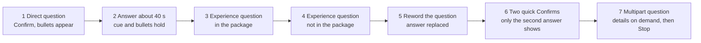

# SPRINT-003 live session: script, pass rule and viewing surface

Criterion 7 asks Pablo to run one live session with Alice (Alice.Good.Meetings) and record it as pass or fail. This page sets what he does in that session, what is written down and what "pass" means.
It is layer 4 of the [SPRINT-003 evaluation plan](03.6-sprint-003-evaluation-plan.md). It is also the first measurement of answer delay. The pass rule below was decided by Pablo on 18 November 2026, before the session.

*Seven steps, each checking one behavior of the proposed answer once.*

## Before the session

The service runs with its key and the interview preparation package in `poc/context/interview/`: plain text or Markdown, up to 20,000 characters. Record its file names, digests and total size, never its content. Before the session the reviewer runs the [package check](03.6-sprint-003-evaluation-plan.md#details-and-package-checks-n3); a failed check stops the run. The page is in a desktop browser window on his second screen, at a size and distance he notes once.
Capture with `poc/live-capture.mjs` into a folder outside the repository, as in the [UC-04 live check](../09-build-and-test-cycle/01-uc-04-live-check-plan.md). The session is billable and sends audio, question text and the package text to OpenAI.
Use fresh questions written for this session. Never play the benchmark recording or read questions from its transcript.

## Script

| Step | Pablo does | Expected |
| --- | --- | --- |
| 1 | Hears or restates a direct question and confirms it | Focus shows it; the answer area is Preparing, then Shown: at most three bullets with details below; the cue continues. |
| 2 | Answers for about 40 seconds, glancing at the card | Focus and bullets do not change; LAND IT, then STOP, stay readable. An answer that arrives after he starts speaking appears in place, silently. |
| 3 | Confirms an experience question that the package covers | The old bullets and details disappear at once; the new ones state only what the package contains. |
| 4 | Confirms an experience question on which the package holds nothing | Organizing points only: no invented employer, project, number or result. |
| 5 | Rewords the Focus question and confirms the new wording | The answer is replaced, following "Yes, always replace". |
| 6 | Confirms a question, then at once confirms a different one | The first answer never appears; only the second question's answer is shown. |
| 7 | Confirms a multipart question, reads the details once, then stops listening | The bullets cover each part; reading details leaves the cue, Focus and Live unchanged; after Stop the answer stays with its Focus question, both marked last known. |

After each answer Pablo says yes or no to five questions: could he take in the cue, the Focus question and the bullets at a glance, did the bullets fit the question, did they help him organize his own answer instead of reading one out, did looking at them interrupt his thinking, and was anything said about him untrue. After step 7 he also says whether the details helped and stayed out of the way.
Each step is recorded as pass, fail or unverified, with the answer delay. State names are those of the Use Cases [answer states](../03-system-model-and-use-cases/01.5.1-proposed-answer-states.md).
For delay, each confirmed question records the four times of the [plan](03.6-sprint-003-evaluation-plan.md), the pause from Confirm to his next speech, and whether the bullets were visible before he spoke. No limit is set in advance.
Failed, Unavailable and General are not staged live; layers 1 and 2 cover them. Whether a General answer really says nothing about Pablo is model behavior, seen only if he repeats step 1 without the package.

## Decided by Pablo on 18 November 2026

- **Pass rule.** The session is a pass when every step meets its expectation, no answer is shown for an earlier question, every statement about him is found in the package, he could take in the cue, the Focus question and the bullets at a glance after each answer, and he says he would keep the proposed answer on in a real interview. Any other outcome is a fail; an unverified step is rerun before a result is recorded. Fit and delay are reported but are not part of the rule.
- **Reviewer.** Pablo reviews statements about himself: only he holds the package and knows what is true. Limit: he also wrote the package, so "every statement is in the package" is checked by its author, not an independent reviewer, and the result says so.
- **Package rule.** The package is not written from a benchmark case's questions, as the [strategy](01-evaluation-strategy.md) explains.

Also accepted on 16 November 2026, as relayed by 00 Governance, with the answer delay learned in this session (no limit in advance, every value reported) and one service retry for a failed request; open to change at the preview or the specification review: at most three bullets, details read on demand, a late answer shown silently, a failed request shown as a message with no retry button, general points when there is no package, last known after Stop, and a desktop window on a second screen for the glance check. The phone width is checked only by the scripted page check at 390 × 844.

## What the result can and cannot show

One person in one session can show that the proposed answer works and that he accepts it. It cannot show that he answers better, because nothing is compared with a session without it.
The capture stays local; copy only the wording needed as evidence, and never package content.

Draft of 16 November 2026 by 04 Benchmarks, updated 18 November 2026 to record Pablo's decisions as relayed by 00 Governance (his reply "Accept all"); no approval of this page is recorded. [Evaluation plan](03.6-sprint-003-evaluation-plan.md) · [Criteria](01.2-evaluation-criteria.md) · [Review index](README.md)
