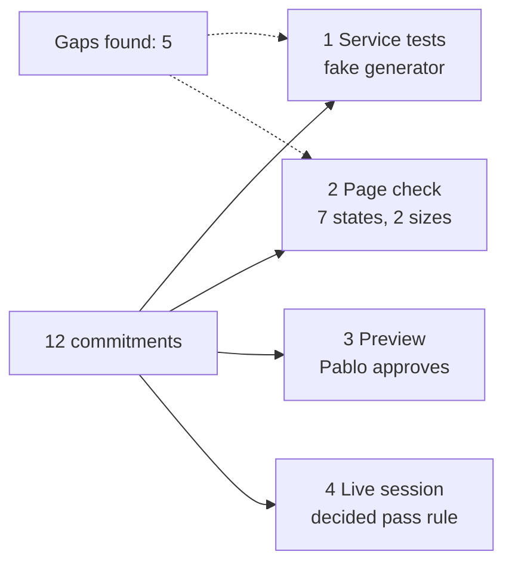

# SPRINT-003 evaluation review, version 2: how success is established

This is the Evaluation stage's first-pass review of the amended SPRINT-003 baseline in the [brief v2](../07-planning/03.8-sprint-003-review-brief-v2.md). It was written before reading any other stage's new report. It reads documents only: nothing was run, no OpenAI request was made, and no package text was read or copied. It replaces nothing; the [17 November review](03.5-sprint-003-evaluation-review.md) keeps its bytes.

*Layers 1 and 2 settle function without cost; only layer 4 can show quality and acceptance. Five gaps remain in the plan.*

## Baseline and sources

Brief SHA-256 `58a423ee…7f16`; `.asdg/sprint.json` `90d6dab6…9131`; Git HEAD `fe3c00ed…851`, branch `sprint-03`. Relied on, hashes equal to the brief's sources pages: [strategy](01-evaluation-strategy.md) `31fff9f0…69af`, [criteria](01.2-evaluation-criteria.md) `d1a65a36…5980`, [evidence](02-evidence-and-reconciliation.md) `d203468c…1928`, [plan](03.6-sprint-003-evaluation-plan.md) `c5cca0f5…23e4`, [live session](03.6.1-sprint-003-live-session.md) `bc165bed…7708`, [17 November review](03.5-sprint-003-evaluation-review.md) `3eccae7a…1999`.
Also read: the [record amendment](../07-planning/03.7.4-sprint-003-record-amendment.md), [UC-05](../03-system-model-and-use-cases/01.5-proposed-answer.md), [service start and key](../05-high-level-design-and-architecture/01.4-service-start-and-key.md) and the [data statements](../05-high-level-design-and-architecture/decisions/Proposed%20answer%20and%20its%20context/03-data-statements.md). Intended: the nine criteria. Actual: documents only, no run. Planned: the plan above. No acceptance is recorded for any page.

## The twelve commitments

| ID | Criterion, method and limit | Status |
| --- | --- | --- |
| S003-LAYOUT | Layer 2 compares cue color, word and size with `7d60c0f`; layer 3 shows all cue states. Pass or fail. | Covered |
| S003-PREVIEW | Dated approval naming the preview by hash before `index.html` changes. Shows preference, not readability in use. | Covered |
| S003-GLANCE | Glance check in [criteria](01.2-evaluation-criteria.md): layout part scripted, human part yes or no. No glance time: one user, self-report. | Covered |
| S003-ANSWER | Layer 1 tests; layer 4 review of every answer. Zero stale and zero invented statements; no relevance rate or delay limit is justified. | Covered |
| S003-NOKEY | Layers 1 and 2: Unavailable, no connection attempted, no key text. | **Gap 1** |
| S003-TESTS | `node --test`, existing 19 cases pass, new named cases, none calls OpenAI. A pass says nothing about the page. | Covered |
| S003-PAGECHECK | Layer 2 renders all seven states, Shown at longest content, at 1280 × 900 and 390 × 844. Needs an installed browser; not run. | Covered |
| S003-RUN | Shell check by the decision path of 01.4. | **Gap 2** |
| S003-LIVE | Seven-step script, decided pass rule, Pablo as sole judge of statements about himself. One person, one session: shows it works and is accepted, not that he answers better. | Covered |
| S003-DETAILS | Layer 2 legibility and inner scrolling; same call and Focus version in layer 1; no motion or sound asserted. | Covered |
| S003-CONTEXT | Request-body assertion, package digests, no-benchmark check, general points without a package, 20,000-character boundary. | **Gap 3** |
| S003-STATEMENTS | No check exists in the plan. | **Gap 4** |

## Missing, contradictory or ambiguous

- Gap 1: the review of 17 November asked that "without a key" cover file absent, key empty and key rejected; the plan tests one case. With the key now in place and a fallback, all three need a case in layers 1 and 2.
- Gap 2: criterion 6 names `bash poc/alice-run.sh`, which does not exist yet, and the plan's S003-RUN row does not name it. The row must check that script's three outcomes (start, reuse, refuse another program) without printing the key.
- Gap 3: "no benchmark text appears in the package" has no method. Exact digest equality with `eval-data/` files misses pasted passages. Method to add: a local check using word shingles of the private transcript, which reports only match counts and never the package text, run by the reviewer and never by a live component. The same check applies to the proposed rule that the package is not written from the benchmark's questions.
- Gap 4: add a documentation check. Each sentence in the two data statements is compared with the layer 1 request-object assertion: only session, Focus version, question, context kind and package text leave, plus the audio and transcript text already described. `poc/README.md` is inside the sprint gate and has no assigned owner.
- Gap 5: the independence limit is not stated. Pablo wrote the package and judges it, so "every statement is in the package" is checked by its author; say so in the result.
- Ambiguity: criterion 5 has two parts (service tests, page check) that can pass separately; the record should report them separately. Retry is once in UC-05 and the plan; the design pages need the same number.

## Carry-forward of the 17 November review

Planning's reading is confirmed for S003-RUN as a shell check and for the 19 cases that must keep passing. Corrected: the review's list of five amendments is now applied (criteria, strategy, evidence, 03.2 and README), and the plan and live-session pages exist and carry Pablo's 18 November decisions. The review's 'open' items (S003-Q1 to Q3, the pass rule) are decided; it still lists eight commitments, not twelve.

## Amendments required, none applied

1. [Plan](03.6-sprint-003-evaluation-plan.md): add the three no-key cases (gap 1), name `alice-run.sh` (gap 2), the shingle method (gap 3) and the data-statement check (gap 4).
2. [Live session](03.6.1-sprint-003-live-session.md): state the author-as-judge limit (gap 5); add that the package check runs before the session.
3. [Criteria](01.2-evaluation-criteria.md): report criterion 5's two parts separately.
Downstream: 05 must state the retry number and expose the request body; 07 must schedule the page check and the shell check; 02 holds the boundary behind gap 4.

## Verdict

**CHANGE_REQUIRED.** The plan fits the amended record, but four commitments lack a complete check and one limit is unstated. Written by 04 Benchmarks on 18 November 2026. Return to the [review index](README.md).
