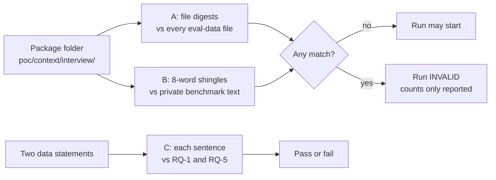

# SPRINT-003 checks the reviewer runs: the package and the data statements

Two checks complete rules that service tests cannot settle. The package check shows that nothing from the benchmark is in the text sent to OpenAI; the statement check shows that what the project says leaves the Mac is what leaves it. They are tasks T33 and T34 of the plan and complete S003-CONTEXT and S003-STATEMENTS. This page is a procedure: nothing here has been run, and no package text was read.

*Only the reviewer runs these. They read the private benchmark and report counts, never package text.*

## Package check (T34), before every billable run

1. Record the sha256 of the bytes of each eligible package file and compare with the `package_loaded` audit of [PK-9](../08-low-level-design/03.5.5-s003-package-loader.md), so the bytes checked are the bytes sent.
2. Check A: compare each digest with the sha256 of every file under `eval-data/`. Equality is a match.
3. Check B: build eight-word shingles (Unicode NFC, lower case, punctuation removed, spaces collapsed) from the private benchmark text: `transcript.json`, `transcript.txt` and every evaluator label or reference answer file the reviewer lists. Count the package's shingles found in that set, per file.
4. Report only file name, shingle count, match count and line numbers. Never print package or benchmark text.
5. Failure rule: any equality, or any shingle match that Pablo, reading those lines himself, finds to be benchmark material, makes the run **invalid**, not low quality. No billable run starts; he removes the text, and steps 1 to 4 run again on the new bytes. A match he judges generic is recorded with his decision. A missing or unreadable benchmark source, or a digest that differs from the audit, is **unverified** and also stops the run.

## Statement check (T33), after ST-01 to ST-53 pass

1. List every sentence of the data statements in the root `AGENTS.md` and `poc/README.md`, numbered.
2. For each, name the data items it says leave the Mac. The allowed set is: microphone audio and transcript text to transcription and the interview agent as already described, and for an answer request the fixed instructions, the Focus question and the package document text ([RQ-5](../08-low-level-design/03.5.1-s003-answer-request-and-result.md)).
3. Check both ways: no sentence names an item RQ-5 does not send (session id, file names, Live text, interview replies), and every item RQ-1 and RQ-5 send is named by some sentence.
4. Record a table of sentence, rule, match yes or no. Failure rule: any difference fails criterion 9; the page is corrected by its owner (00 for `AGENTS.md`, 09 for `poc/README.md`) or the code is, and the check reruns. Wording equal to the [data statements](../05-high-level-design-and-architecture/decisions/Proposed%20answer%20and%20its%20context/03-data-statements.md) is checked separately by tasks T31 and T32.

## Where the script lives

The reviewer script is `poc/review/package-check.mjs`, inside the sprint scope (decided by Pablo on 18 November 2026). It reads `eval-data/`, so no `poc/` source outside `poc/review/` may import it, import `eval-data/` or name either in source; `alice-run.sh` and `node --test poc/poc.test.mjs` never run it. Stage 09 writes it, from this page, and the reviewer runs it by hand. Pablo also accepted 08's items R1 to R10 on that date.

## Match with the 08 test map, and disagreements

Consistent: PK-9 (digests of file bytes) feeds step 1; ST-30 and ST-31 cover package text staying out of the page and audit; ST-52 and FX-5 keep fixtures off `eval-data/`; the map's PK-10 and RQ-1/RQ-5 links match T33 and T34.
1. My plan said the statement lists session and Focus version as leaving; RQ-5 says they do not. I corrected the plan (08's R7 asks Pablo to confirm).
2. My plan said results are "refused or cut"; RS-4 only refuses. Corrected in the plan; R3 is pending.
3. The static check that live code never reads `eval-data/` is now in 08 as PK-11 (18 November 2026): no `poc/` source outside `poc/review/` names `eval-data` or the script. No disagreement remains.
4. Criterion 9 says "only those are sent"; T02 is decided (18 November 2026): it means the answer request alone, while audio and transcript still go to OpenAI for transcription and the interview agent. The statement check follows RQ-5.

The change of 18 November 2026 adds a hint list and a one-call request to both checks (draft, see the [automatic flow and channels page](03.9-sprint-003-automatic-flow-and-channels.md)).
Draft of 18 November 2026 by 04 Benchmarks; no approval is recorded. [Plan](03.6-sprint-003-evaluation-plan.md) · [Review index](README.md)
