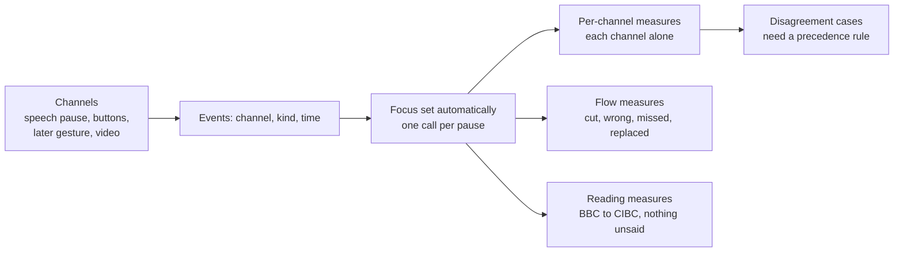

# Measuring the automatic flow, contextual reading and several input channels

On 18 November 2026 Pablo decided, through 00 Governance, that a pause of about 800 ms ends a question, one model call then returns the cleaned question, whether the package covers it, and the points and details, and Confirm is optional. Package names and acronyms also help transcription and the reader. This page proposes how to measure that and how to extend to gesture and video. It is a draft; nothing has been run and no package text was read.

*Each channel is measured alone first; only then are combinations and disagreements scored.*

## Measures for the flow

| Question | Measure on fresh, synthetic spoken questions | Limit |
| --- | --- | --- |
| Pause threshold | Sweep 500, 800 and 1200 ms with scripted mid-question pauses; count questions cut in two and the delay added | No threshold justified; report both, 800 stays tunable |
| Wrongly taken | Focus changes caused by his own answer, thinking aloud or interviewer chatter; scripted answers with 1 s pauses | One user; speakers are not told apart, so report counts |
| Missed | Spoken clear questions with no Focus within the delay | Count against all questions asked |
| Replaced | A repeated question replaces the earlier one; no answer for an earlier question stays | Pass or fail |
| No question heard | The last good answer stays and a note says so; Focus is never blanked | Pass or fail |
| Cleaned question | Meaning units against the expected question; any unsaid addition is a fail | Zero tolerance |
| Covered flag | Package covers it, yes or no, against Pablo's judgment; "no" gives general points | Counts, not a rate |
| Fallback | How often the separate answer request replaces an invalid one-call result | Report |

Delay is redefined: t0 is the service marking the pause end, then t1 to t3 as in the [plan](03.6-sprint-003-evaluation-plan.md). The agent call reported at 2.3 to 5.7 s (about 3 s typical) plus a 2.5 s wait between runs is a service log reading, not mine, so the first bullets can come 3 to 8 s after the pause. No limit is set in advance; report each value.

## Contextual reading

Use an invented package of invented acronyms and synthetic speech, never his package or `eval-data/`. Cases: a spoken term that sounds like a package term and must be corrected; a control where the spoken word is not in the package and must stay; a term the package lacks. Report the correction count, the false-correction count and every unsaid addition, which is a fail. The vocabulary hint list is checked to hold only package terms. With his real package, Pablo judges "BBC" becoming "CIBC" and reports counts only.

## What changes in the checks

- Package check (T34): the same file digests and shingle comparison now cover three sends: the hint list, the reader and the one request after each pause. The hint extractor and the reader never read `eval-data/`; PK-11 must name them. A reviewer recomputes the hint list from the package and compares its digest without printing terms.
- Statement check (T33): the allowed set grows to the hint list at session start and the package text in every one-call request. T02's "answer request alone" is superseded, so the check waits for 08's revised request rules and for the `AGENTS.md` sentence that Pablo or Admin owns.
- Live pass rule: Confirm steps become pause steps. Proposed additions, awaiting Pablo: no Focus change from his own answer, "no question heard" keeps the last answer, nothing unsaid in any question, and the acronym step passes by his judgment. Delay and fit stay reported only.

## Extending to gesture and video

An input channel is an event source with a definition (what it signals), a ground truth, its own measures (precision, recall, delay, outage) and a data statement. Add one by adding its profile and fixtures; never remove one. Buttons and the [P key](03.2-release-alternatives-and-review-decisions.md) stay measurable beside speech.
Disagreement, for example speech starting a new question while a button clears it, needs a precedence rule from Use Cases and Architecture before it can pass or fail; until then report each outcome. Gesture and video data need fresh invented or Pablo-recorded samples, new data statements and the same input isolation, and the glance check must still pass with more channels.

Draft of 18 November 2026 by 04 Benchmarks; no approval is recorded. [Plan](03.6-sprint-003-evaluation-plan.md) · [Live session](03.6.1-sprint-003-live-session.md) · [Checks](03.8-sprint-003-package-and-statement-checks.md) · [Review index](README.md)
