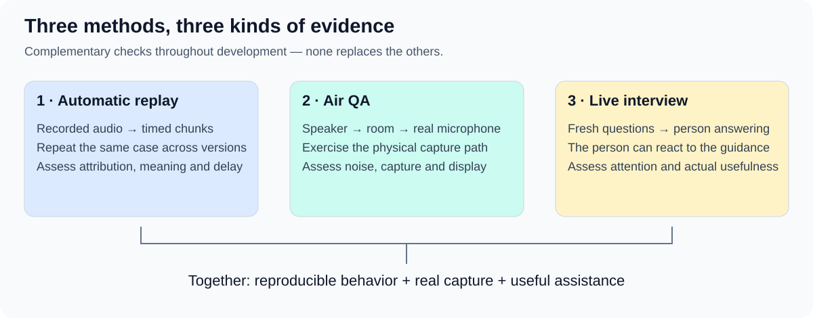

# How we will know SpeakerCoach helps

We need evidence that SpeakerCoach follows the conversation correctly, works through real audio capture and helps a person answer without losing focus.

## Read the approach first

| Read | What it explains |
| --- | --- |
| [01 Evaluation strategy](01-evaluation-strategy.md) | The overall approach: automatic replay, Air QA and live interviews. |
| [01.1 Benchmark collection](01.1-benchmark-collection.md) | How one recording can grow into a trustworthy ten-recording suite. |
| [01.2 Evaluation criteria](01.2-evaluation-criteria.md) | What correct, timely and useful behavior looks like, and how to assess it. |
| [02 Current evidence](02-evidence-and-reconciliation.md) | What the 21 October assessment inspected, reported and left unverified. |

## Then review the first experiment

| Proposal | Decision it supports |
| --- | --- |
| [03 One-recording experiment](03-release-single-recording-evaluation.md) | First establish replay feasibility, then evaluate question-display quality. |
| [03.1 Measurements and thresholds](03.1-release-measurements-and-thresholds.md) | Review provisional numeric targets and precise timing definitions. |
| [03.2 Alternatives and decisions](03.2-release-alternatives-and-review-decisions.md) | Compare approaches fairly and identify choices still needing review. |
| [03.3 First recording candidate](03.3-first-recording-case.md) | Inspect the supplied MP3 and define the first listening, transcription and speaker-separation probe. |
| [03.4 First voice-profile comparison](03.4-voice-profile-probe.md) | Inspect the opening 90 seconds and two User-confirmed speaker examples. |

The [original source draft](sources/strategy-draft-0.1.md) supplies the central evaluation story and remains unchanged.
The user selected replay, Air QA, live validation and a ten-recording target. Detailed protocols, scoring and numerical targets remain proposals.
User supplied `eval-data/mock-interview-0.mp3` on 24 October: a candidate with two participants, reported as recorded over air through an iPhone microphone.
User also supplied `eval-data/pablo-voice-solo-recording.mp3`; a [numerical voice profile](../../../eval-data/voice-profiles/pablo-ecapa-v1.json) has now been generated locally at their request. The [candidate card](03.3-first-recording-case.md) explains its same-recording consistency check and the proposed with/without-reference comparison.
An [offline comparison](03.4-voice-profile-probe.md) has now scored the interview's opening 90 seconds against the profile. User confirmed one clip as themself and another as the interviewer; the profile ranks the User clip higher. No application evaluation or accuracy estimate exists; the wider transcript and turn references remain pending.
The filenames show Intended (01), Current (02) and Planned (03); dotted numbers separate useful topics.
[Project documentation](../README.md)
