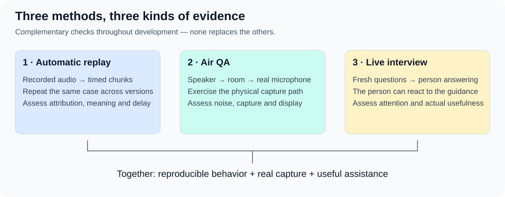

# How we will know Alice.Good.Meetings helps

We need evidence that Alice.Good.Meetings follows the conversation correctly, works through real audio capture and helps a person answer without losing focus.

## Read the approach first

| Read | What it explains |
| --- | --- |
| [01 Evaluation strategy](01-evaluation-strategy.md) | The overall approach: automatic replay, Air QA and live interviews. |
| [01.1 Benchmark collection](01.1-benchmark-collection.md) | How one recording can grow into a trustworthy ten-recording suite. |
| [01.2 Evaluation criteria](01.2-evaluation-criteria.md) | What correct, timely and useful behavior looks like, including a proposed answer and the glance check. |
| [02 Current evidence](02-evidence-and-reconciliation.md) | What the 21 October assessment inspected and left unverified, with a 16 November update. |

## Then review the first experiment

| Proposal | Decision it supports |
| --- | --- |
| [03 One-recording experiment](03-release-single-recording-evaluation.md) | First establish replay feasibility, then evaluate question-display quality. |
| [03.1 Measurements and thresholds](03.1-release-measurements-and-thresholds.md) | Review provisional numeric targets and precise timing definitions. |
| [03.2 Alternatives and decisions](03.2-release-alternatives-and-review-decisions.md) | Compare approaches fairly and identify choices still needing review. |
| [03.3 First recording candidate](03.3-first-recording-case.md) | Inspect the supplied MP3 and define the first listening, transcription and speaker-separation probe. |
| [03.4 First voice-profile comparison](03.4-voice-profile-probe.md) | Inspect the opening 90 seconds and two User-confirmed speaker examples. |
| [03.5 SPRINT-003 evaluation review](03.5-sprint-003-evaluation-review.md) | See how each SPRINT-003 commitment could be shown to pass or fail, and which criteria were missing on the first pass. |
| [03.6 SPRINT-003 evaluation plan](03.6-sprint-003-evaluation-plan.md) | Decide whether service tests, the page check, the preview and one live session are enough for the new layout and the proposed answer. |
| [03.13 SPRINT-004 statement check result](03.13-sprint-004-statement-check-result.md) | See which data statements in the root `AGENTS.md` and `poc/README.md` pass the check and what to correct (draft). |
| [03.14 SPRINT-005 measurement plan](03.14-sprint-005-measurement-plan.md) | See the question list, method and pass rules for waste, time and quality before the speed change (draft). |
| [03.15 SPRINT-005 evaluation review](03.15-sprint-005-evaluation-review.md) | See how 04 judged the sprint's evidence, the gaps and the verdict (draft). |
| [03.16 SPRINT-005 baseline and deviation](03.16-sprint-005-baseline-and-deviation.md) | See the one-run baseline numbers and how the pass rules read with one run (draft). |
| [03.12 SPRINT-004 evaluation review](03.12-sprint-004-evaluation-review.md) | See how each SPRINT-004 commitment could be shown to pass or fail, and what is missing (draft first pass). |
| [03.10 SPRINT-004 upload, log and screen checks](03.10-sprint-004-upload-log-and-screen-checks.md) | See what a pass looks like for the package upload, the meeting log and the new screen, and who runs each check (draft). |
| [03.11 SPRINT-004 live session and statement check](03.11-sprint-004-live-session-and-statement-check.md) | Agree the live pass rule, the log review and the statement check (draft). |
| [03.9 SPRINT-003 automatic flow and channels](03.9-sprint-003-automatic-flow-and-channels.md) | Measure the pause-triggered answer, contextual reading and several input channels (draft). |
| [03.8 SPRINT-003 package and statement checks](03.8-sprint-003-package-and-statement-checks.md) | Follow the reviewer-run procedures that show no benchmark material is sent and the data statements are true. |
| [03.6.1 SPRINT-003 live session](03.6.1-sprint-003-live-session.md) | Agree the live script, the pass rule and the viewing surface for the glance check. |

The [original source draft](sources/strategy-draft-0.1.md) supplies the central evaluation story and remains unchanged.
The user selected replay, Air QA, live validation and a ten-recording target. Detailed protocols, scoring and numerical targets remain proposals.
User supplied `eval-data/mock-interview-0.mp3` on 24 October: a candidate with two participants, reported as recorded over air through an iPhone microphone.
User also supplied `eval-data/pablo-voice-solo-recording.mp3`; a [numerical voice profile](../../../eval-data/voice-profiles/pablo-ecapa-v1.json) has now been generated locally at their request. The [candidate card](03.3-first-recording-case.md) explains its same-recording consistency check and the proposed with/without-reference comparison.
An [offline comparison](03.4-voice-profile-probe.md) has now scored the interview's opening 90 seconds against the profile. User confirmed one clip as themself and another as the interviewer; the profile ranks the User clip higher. No application evaluation or accuracy estimate exists; the wider transcript and turn references remain pending.
The filenames show Intended (01), Current (02) and Planned (03); dotted numbers separate useful topics.
[Project documentation](../README.md)
