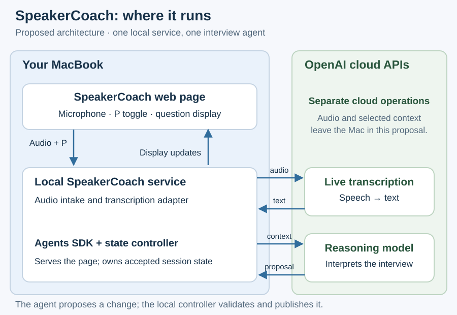

# A local interview helper with cloud reasoning

SpeakerCoach should retain the interviewer's question while Pablo answers, using brief private visual guidance that preserves his attention.
This intended architecture is a proposal from the 25 October 2026 discussion. The first increment covers question capture and retention; personal-context retrieval and answer suggestions remain later capabilities.

## Where the parts run

One local SpeakerCoach service serves the web page on localhost and owns the interview session. The browser captures microphone audio and renders updates.
The proposed service uses the OpenAI Agents SDK for one interview agent. Model inference runs through the OpenAI API in the cloud, separately from the ChatGPT application.
Cloud transcription supplies incremental text; the agent sends permitted conversation context to a reasoning model. These are separate operations and may use different models.
Audio and selected text therefore leave the Mac in this candidate. Running transcription or reasoning entirely locally remains an alternative requiring performance evidence.

| Component | Responsibility and interface |
| --- | --- |
| Browser page | Sends timed audio and declared P-toggle events; receives versioned question, phase, connection-status and visual updates. |
| Audio intake | Accepts live or replay packets, checks order and coverage, and normalizes audio for the selected transcription service. |
| Speech interpretation | Combines incremental text with separately obtained speaker estimates, uncertainty and manual turn hints. Recognition placement remains open. |
| Interview agent | Reads permitted observations and current state; proposes a phase, question or later cue update with supporting observation references. |
| State controller | Owns accepted session state in memory, validates updates and rejects obsolete proposals before publishing to the page. |
| Cloud adapters | Connect to transcription and reasoning APIs, handle errors and retain provider credentials on the local service. |

These are logical components within a small service, not separately deployed services. A database is not required for the first session; any retained evaluation trace is a separate, explicit output.

## What the agent owns

The agent interprets meaning: a greeting, a developing question, an answer, a clarification or a closing exchange.
It receives recent observations plus the retained question and session context; it does not own audio transport, render the page or directly overwrite accepted state.
Its application interface is a bounded state-update proposal. General shell, filesystem and unrelated tools are unnecessary for this first behavior.
The controller owns the transition rules and revision checks described in [interview state](01.2-interview-state.md).
Speaker identity remains an estimate unless established by suitable evidence; the Agents SDK itself does not solve speaker recognition.

## Runtime choice and development tools

The Agents SDK is the preferred candidate because its loop runs inside application code while the application controls tools and state. [Official SDK documentation](https://developers.openai.com/api/docs/guides/agents/sdk).
Codex SDK and app-server remain alternatives; [planned decisions](03-planned-decisions.md) explains when their capabilities would be useful.
Codex's desktop app supports development, debugging and replay inspection. The intended interview service launches independently and does not require an open Codex chat.
The local service must remain running during a session; Start and Stop must control capture, connections and cleanup explicitly.

## Scope and basis

The initial capture assumption is a microphone that can hear both participants. Capturing meeting audio when headphones are used requires a separate input decision.
The [Purpose priority](../02-purpose/03-planned-improvements.md) and [use-case model](../03-system-model-and-use-cases/01-system-model.md) supply the desired behavior.
Their historical approval records are stale after document changes; the user's working direction remains the basis for this proposal.
[Current implementation](02-current-architecture.md) · [Streaming and replay](01.1-streaming-and-replay.md) · [Architecture index](README.md)
