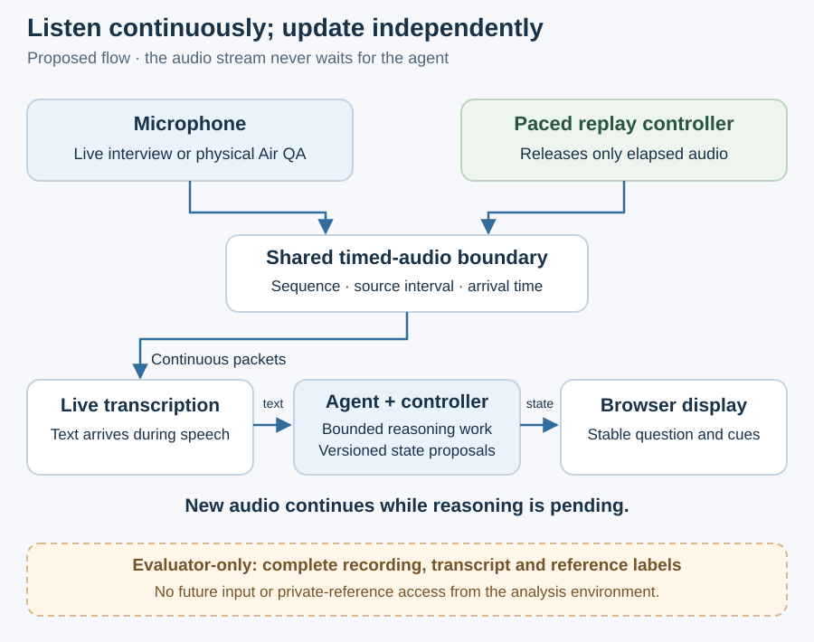

# Continuous listening, independent display updates

SpeakerCoach should keep receiving audio while transcription and reasoning are underway. Streaming consists of small, ordered packets sent over connections kept open during the interview.
This is proposed behavior. The current page samples sound level but does not transmit audio.

## Two activities at different rates

The browser opens a bidirectional WebSocket to the local service. It sends audio packets and control events; the service pushes display and connection updates through that same connection.
A separate persistent connection forwards audio to cloud live transcription. Incremental text can arrive during speech; final segment events reconcile the developing transcript.
The service schedules agent reasoning when meaningful new text, a speaker hint or a question boundary warrants it. It can analyze partial speech and does not have to wait for a whole answer to finish.
Audio handling continues while a model request is pending. Start with one reasoning request at a time, accumulating new observations and coalescing pending work into the next relevant snapshot.
Packet duration of roughly 100 ms is an initial experiment setting, not a selected contract or a promise of 100 ms advice. Encoding, sample rate and scheduling cadence remain low-level design decisions.
The Agents SDK handles reasoning and tools; the application's audio transport handles the packets. Live transcription is documented separately in the [OpenAI guide](https://developers.openai.com/api/docs/guides/realtime-transcription).

## Interfaces and ordering

| Boundary | Information that must be retained |
| --- | --- |
| Audio input | Session ID, sequence, source interval, audio format and arrival time; preserve silence and overlap. |
| Speech observations | Segment identity, text revision/finality, source timing, speaker estimate and its provenance; unknown is valid. |
| Agent request / proposal | Observation cutoff, base-state revision, exchange identity and proposed changes; keep the evidence behind a change. |
| Browser update | Increasing state revision, phase, active question, optional cue and connection status; ignore older revisions. |

Transcript revisions must reconcile the same segment rather than duplicate it. Validate agent results against the current exchange; an old request must not overwrite a newer question.
Publish complete, validated state changes to the user-facing display. Partial model output can remain diagnostic information without causing continuous visible rewriting.

## Timing and failure boundaries

Retain both the source-audio timeline and a monotonic run clock. Record audio delivery, transcript availability, reasoning completion and the browser's rendered-update acknowledgement.
Measure when the correct question becomes visible relative to question end and answer onset, following the [Stage 04 definitions](../04-benchmarks-and-eval-strategy/03.1-release-measurements-and-thresholds.md).
Small packets reduce one source of buffering; recognition, scheduling and reasoning still add delay. The two-second pilot target remains provisional and no latency is measured here.
Bound the audio and reasoning queues. On an unrecoverable gap or excessive backlog, show degraded status, record the discontinuity and resynchronize explicitly; do not silently drop audio or present old guidance as current.
On recognition or network failure, keep the last established question with a clear status indication and suppress unsupported new advice. Reconnection must account for gaps and duplicates before normal updates resume.
Stop ends microphone tracks, timers, connections and pending work; late callbacks from the ended session cannot update a new one.

## One processing path for live input and replay

A replay controller owns the complete recording and releases only elapsed audio at normal speed into the same timed-audio interface used by live capture.
All analysis, including preprocessing and transcription, sees only delivered audio and declared background. Neither the complete-file path nor private transcripts, evaluator labels or future P events are available to it.
Enforce that separation through a restricted analysis environment and resource-access controls, not a prompt alone. A separate process with unrestricted shared-file access would not suffice; the mechanism remains a design decision.
Log delivery and access evidence so the boundary can be checked. Replay P events require actual recorded provenance; evaluator labels must never become perfect simulated user input.
Air QA plays audio through real speakers into the microphone; it adds the physical path. Live answering separately tests whether visual help preserves attention and improves usefulness.
The [accepted evaluation strategy](../04-benchmarks-and-eval-strategy/01-evaluation-strategy.md) remains sufficient for this design; it is not being redefined here.
[Architecture](01-architecture.md) · [Interview state](01.2-interview-state.md) · [Architecture index](README.md)
