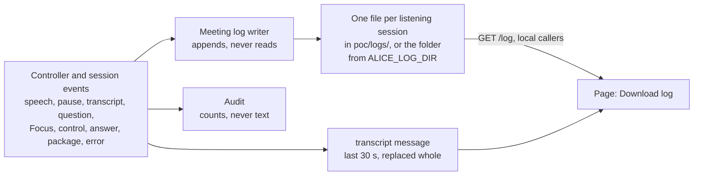

# The meeting log and the transcript message

Pablo wants a complete, time-stamped log of each meeting that he can download, and the new screen shows what he is saying as a short, fading list. The log is the first place Alice keeps private speech text beyond a session, so its place and limits are an architecture matter. This draft of 19 November 2026 fixes them at the high level; [08's pages 03.7.5 and 03.7.6](../08-low-level-design/03.7.5-s004-meeting-log.md) own the format. Nothing is built and nothing is accepted.

*The log and the audit are separate: the audit stays free of text, the log is private text on this Mac.*

## The log in the architecture

| Question | Draft answer |
| --- | --- |
| Events | Session start and stop, speech and pauses, each final transcript item, Live question and Focus changes with their source, Confirm and Clear, answers shown, failed or dropped, package status counts, errors. 08's ML-1 to ML-12 are this list; I accept them at the high level. The cue is left out because it lives in the page. |
| Producer | One writer subscribes to the controller's events. It only appends and never reads, so a write failure never stops a session; the monitor line then says "log not saved" (ML-12). |
| Never in it | Package text or file contents, the key, prompts, hints and replies to OpenAI, the interview agent's reply, audio. Answers shown may quote the package, which is 08's Q9; I support logging them, since he asked for a complete log. |
| Where | By default `poc/logs/` inside the project, with its own `.gitignore` that ignores everything but itself; `ALICE_LOG_DIR` may move it, and tests use a temporary folder. Pablo chose this on 19 November 2026 because this checkout is not synced to Google Drive. 08's MS-1 and MS-2 stand. The Git ignore is the only barrier to a commit, so 04 may check that the ignore rule exists; the service itself does not test it. |
| Permissions | Folder 0700, file 0600, one file per listening session, named by its start time (MS-1, MS-3). |
| Who may fetch | `GET /log` only, with the same Host check as every route; the service listens on 127.0.0.1 and sends no cross-origin permission, so another page cannot read it. It returns the newest file's complete lines. There is no list, delete or other read route. |
| Size | A provisional 5 MB per file, then one `log_full` event (MS-4). An hour of speech is a small fraction of that; the number is untested. |
| Retention | None by Alice: no deletion, rotation or expiry; Pablo deletes files himself, decided 19 November 2026 (MS-8). Logs from every meeting accumulate in the project folder until then. |
| Relation to OpenAI | Nothing in the log is sent anywhere or read back by the service, except to the download. |

## The `transcript` message (SA-17)

The service sends the page a snapshot of the last 30 seconds: at most 8 items and 1,500 characters, each with `id`, `text`, `final` and `at`.
- **Snapshot, not changes.** Each message replaces the last, so a late or repeated one cannot leave the page wrong, and the service needs no memory of what the page has seen.
- **Same ids as the log.** `id` is the transcription item id that the log calls `itemId`, and `at` counts milliseconds from the start of the listening session, like the log's `ms`.
- **Partial text.** It goes to the page and is never logged (ML-4). The service keeps the window in memory for the session only.
- **Not a reading.** It changes no state and cannot set Focus. Newest per item is decided in the page (08's Q11).

## Asks from 12's learning needs, 19 November 2026

Pablo wants a first log "as is", improved later. 12's [page](../12-observability-insights-and-learning/01-meeting-log-learning-needs.md) asks for six things; these are my positions, proposed until he accepts them.

| Ask | Decision |
| --- | --- |
| Schema version | **Yes.** One `version` in the first line of each file is enough: a file is one session, so repeating it on every line adds size, not meaning. 08's ML-1 already has it. |
| Two clocks | **Yes**, already ML-1: `t` wall time in UTC and `ms` since the session started. |
| Session header | **Yes**, on `log_started`: session id, UTC start with the local offset, app revision or "unknown", model names, key configured yes or no, the pause setting, package source and counts only. The end is `session_stopped`'s `t` and `ms`. Cue rules and the 10-second hold live in the page and are not in the header. |
| Cue-change events | **No for now.** The cue lives only in the page, so this needs a new page-to-service message and a second writer of events. It is a SPRINT-005 candidate: a small `cue` message that the log records and that never touches state. The first log says it has no cue events. |
| Transcription confidence | **No for now**; the service does not keep it today. |
| Mark key, audio reference, speaker labels | **Later.** A versioned file lets them be added without breaking old files. |

**08 changes:** ML-1 and ML-2 gain the header fields above (`tzOffsetMin`, `revision`, `models`, `keyConfigured`, `pauseMs`) and ML-9's package counts appear in the header too; ML-3 to ML-8 and ML-10 to ML-12 stay. Add an ML rule that the log has no cue events in version 1. The Focus `source` of ML-6 stays.

## Open questions for Pablo

- **Decided 19 November 2026:** the default folder is inside the project and Git-ignored, no automatic retention, and the log keeps other people's speech and the bullets shown, for every meeting, local only.
- **Decided 19 November 2026:** the Git ignore rule alone is enough; the service does not refuse to log if `git check-ignore` fails. 04 may keep a check that the rule exists.
- **Decided 19 November 2026:** only the data statements warn that logs in `poc/logs/` travel with any copy of the folder; there is no exclude rule.

Later risk, out of scope: any program running as the same user can read the folder and call `/log`; a shared server needs sign-in, per-user logs and a retention rule.
[Sprint review](01.9-sprint-004-architecture-review.md) · [Statements](01.10.1-upload-and-log-statements.md) · [Architecture index](README.md)
