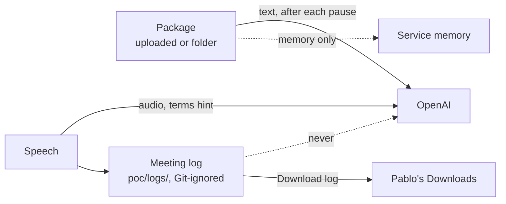

# What upload and the meeting log keep and send: wording for the statements

Two reader-facing pages tell Pablo what leaves the Mac and what stays: the root `AGENTS.md` and `poc/README.md`. SPRINT-004 adds an uploaded package and a meeting log, so both need new sentences. Architecture owns neither page; this draft of 19 November 2026 gives Stage 02 and the owners the facts and suggested wording, and applies nothing. It builds on [the earlier statements](decisions/Proposed%20answer%20and%20its%20context/03-data-statements.md) and their 18 November change.

*Upload changes where the package is held, not what is sent. The log is a new store that is never sent.*

## The facts to state

| Subject | What is true in the draft design |
| --- | --- |
| Package source | Files added on the page, or, with none, the folder `poc/context/interview/`. The upload replaces the folder package. |
| Package retention | An uploaded package lives in the service's memory only: never written to disk, never in the log or the audit, gone when he removes it or the service stops. It survives Stop. |
| Package sent | The same as before: its text goes to OpenAI after each pause. Upload adds no new destination. |
| What the log keeps | Transcript text, the questions, Focus changes, controls, answers shown and times, in `poc/logs/` inside the project, Git-ignored, or the folder in `ALICE_LOG_DIR`, until Pablo deletes the files. It includes what other people said. |
| What the log never keeps or sends | Package files, keys, prompts, replies to OpenAI, audio. The log is never sent to OpenAI. |
| Who can read it | A program on this Mac that passes the service's local checks can fetch it through `/log`, and anyone who can read the folder can read the files. |
| Download | The browser saves the log to his Downloads folder, outside Git and the project; Alice cannot remove it from there. |
| Copies | Any copy, zip or backup of the project folder, or a sync of it, carries `poc/logs/` and everything in it. Git ignores it, but a plain file copy does not. |
| Status | `GET /package` and the page's package line show counts and source, never names or text. |

## Suggested wording

**Root `AGENTS.md`, constraints.** Replace the package sentence with: "The interview preparation package (Pablo's résumé and other documents) is added on the page and held only in the service's memory, or is read from `poc/context/`, which Git ignores; do not print it, commit it, or copy it into documents, logs or tests." Add: "Each meeting is also logged, with times, to `poc/logs/`, which Git ignores (`ALICE_LOG_DIR` may move it); the log holds transcript text, including what other people said, and the answers shown, which can quote the package. It is never sent to OpenAI, is kept until Pablo deletes it, and must not be committed, zipped, shared or copied with the project."

**`poc/README.md`.** Add under the Run section: "Choose files with Upload package; they replace the folder package, stay in memory and are cleared by Remove or when the service stops. A meeting log is written to `poc/logs/` (Git-ignored; `ALICE_LOG_DIR` moves it) and can be downloaded with Download log. The log is not sent to OpenAI and is not deleted by Alice."

The older sentence "each time a Focus question is confirmed" is already superseded by the pause flow in the 18 November change; criterion 9's "only" must follow, as noted there.

## Does a project folder change a statement or risk?

Yes, in three ways. The statement must say the log is private text inside the project and is carried by any copy. The root rule "do not print, commit or copy it into documents, logs or tests" now covers a second kind of file. And the risk grows with every meeting: a later zip (SPRINT-005 for packages), backup, sync or sharing of the checkout carries other people's speech, so only these statements warn about it, by Pablo's decision; there is no exclude rule and the service does not test the ignore. 04 may keep a check that the ignore rule exists. A move to a synced folder reverses Pablo's reason for choosing it.

## Evidence and limits

Written from 08's pages 03.7.4 to 03.7.6 and the 05 drafts; nothing was run. Stage 02 decides its record boundary and 04 checks the statements (fifty nonblank lines, the same words in both pages). Pablo or ASDG Admin applies the root `AGENTS.md` change.
[Meeting log](01.10-meeting-log-and-transcript-message.md) · [Architecture index](README.md)
