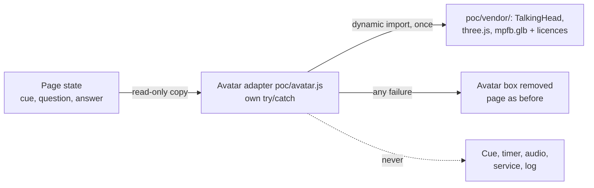

# A small avatar in the page: loading, licences, failure and limits

Pablo wants a small animated avatar in the page, using the TalkingHead library, moved by what Alice already knows and nothing else. This draft of 19 November 2026 answers five questions briefly. It is a proposal: nothing is built, no code is changed and no acceptance is recorded.

*The adapter only reads. If it cannot start it disappears, and nothing else notices.*

| Question | Answer |
| --- | --- |
| 1. Vendored or CDN | **Vendored in `poc/vendor/`, pinned, committed:** TalkingHead, three.js and `mpfb.glb`, each with its licence file beside it. The adapter is `poc/avatar.js` with its companion `poc/avatar.md`. A CDN script would run inside the page that holds the microphone and receives the transcript, so a changed file there could read both. The service also serves only files in its fixed asset list, so each of these files needs an entry in the fixed asset list in `poc/server.mjs`. That is a code edit, though not new behavior, so "no backend change" is not quite true. |
| 2. Licences | The library is MIT (its LICENSE file says so); three.js is MIT, which I know but did not re-check. Avatar files differ: the library's example `mpfb.glb` is CC0, while its other examples (Ready Player Me, Avaturn, AvatarSDK, VRoid) are non-commercial or CC BY-NC. The model needs a Mixamo-compatible rig with ARKit and Oculus viseme shapes. Pablo's use is personal, but the licence of the chosen file must be recorded beside it. The model is `poc/vendor/mpfb.glb`, the CC0 example, its licence file beside it; its size I did not measure. |
| 3. Failure or no WebGL | The adapter tests for WebGL first, then loads the library inside one try/catch with a time limit. On any failure it removes its own box and logs one quiet line. It must not move other elements: 08 decides whether its place reserves space, and Pablo asked for it centred in a slightly taller bar (08: 60 px in a 76 px bar); a fixed-size slot in the bar means a failed avatar leaves an empty slot or none, never a shifted page. A page check should run the 29 cases with the adapter forced to fail. |
| 4. ES module | `index.html` loads `app.js` as a classic script and is unchanged. The adapter is a separate file that `app.js` loads by dynamic `import()`, which a classic script may call, after an import map placed before it for the library's `three` imports. The import map affects only module imports, so `app.js` is untouched apart from one optional hook. |
| 5. Audio, timing, log | Microphone capture runs in an audio worklet, off the page's main thread, but audio chunks are still sent to the service from the main thread, as are the cue timer and the key handlers. A 3D draw loop could delay them on a modest machine. Cap it at about 15 frames a second, stop it when the tab is hidden, give Pablo an off switch, and watch for jank in the live session. The adapter gets a frozen copy of state and has no write path. The log and the service never see it. |

## Needs Pablo's decision

- **Purpose.** His rule is brief, glanceable cues. A moving face in the corner of his eye may compete with the cue. Is it wanted, and how still should it be? 02 should say whether it has a purpose rationale.
- **Committing the model:** `mpfb.glb` is a multi-megabyte binary in Git; he may swap it for his own file later, with its licence recorded.
- **Sprint.** SPRINT-004 is already large; adding it needs a new commitment from 07.
[Architecture index](README.md)
