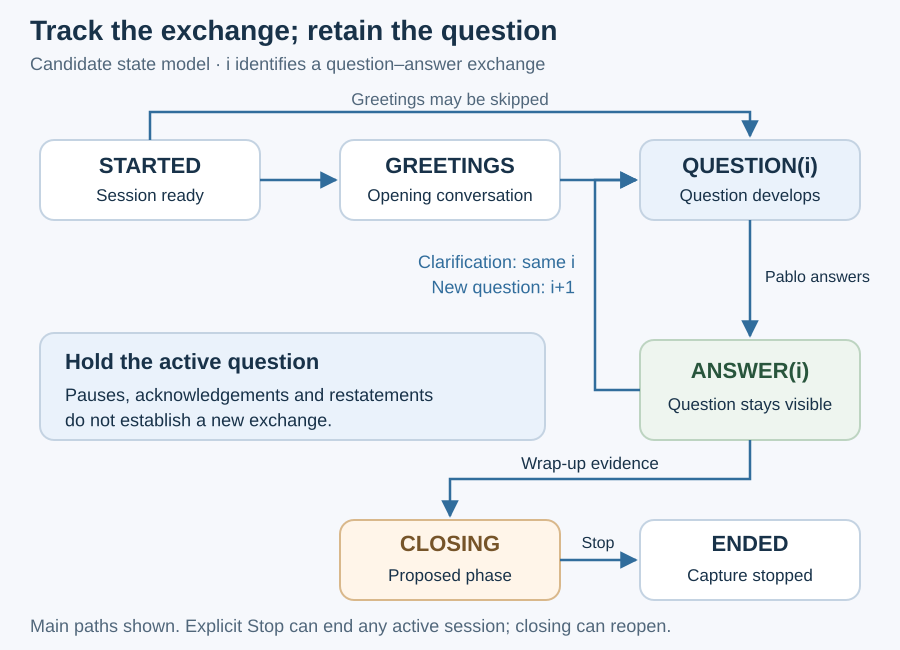

# Keep the current question stable

SpeakerCoach tracks the meaning of the interview separately from microphone activity. A pause, overlap or speaker change alone does not establish a new question or end an answer.
STARTED, GREETINGS, QUESTION(i) and ANSWER(i) came from the user's architecture discussion. CLOSING, ENDED and the transition rules below are proposals for review.

## Interview phases

| Phase | Meaning and display behavior |
| --- | --- |
| STARTED | Session exists; no meaningful conversation has been established. Show ready/listening status. |
| GREETINGS | Introductions or opening conversation. Keep the display quiet. |
| QUESTION(i) | The interviewer is forming question i. Accumulate its relevant parts; a candidate is not yet the settled question. |
| ANSWER(i) | Pablo is answering question i. Retain the active question throughout speech, reflection and pauses. |
| CLOSING | There is evidence the interview is wrapping up. Preserve context and allow a return to another question. |
| ENDED | Explicit session termination stops capture and processing. A farewell or silence alone does not force this state. |

Greetings are optional. The service can move from STARTED to QUESTION(1), including when Pablo starts answering immediately after a short question.
During ANSWER(i), a brief acknowledgement or Pablo's restatement preserves the exchange. A clarifying interviewer turn may return to QUESTION(i); a genuinely new question creates i+1.
The same-exchange clarification rule is a candidate policy. Preserve links between exchanges so later review can distinguish clarification, follow-up and topic change.

## State and observations

| Session information | Owner and purpose |
| --- | --- |
| Phase, exchange ID and revision | The state controller owns the accepted values; the agent proposes changes. |
| Active question and candidate question | Keep established wording separate from a developing replacement or multipart extension. |
| Recent conversation and supporting observations | Supply the meaning and evidence for a proposed transition, within the permitted input cutoff. |
| Speaker estimate, manual speaking flag and uncertainty | Independent observations; unknown identity does not become a confident interviewer label. |
| Audio/connection status | Tracks ready, listening, degraded or stopped independently of interview phase. |

The P toggle means Pablo declares “I'm speaking” or “I've finished.” It does not prove the identity of every voice during overlap; its Listening state does not assert that the interviewer is speaking.
Anonymous speaker separation, identification of Pablo and semantic identification of an interviewer question are different operations. The existing offline voice profile is optional evidence, not a calibrated online recognizer.

## Accepting a question update

The agent proposes the phase, question change and supporting observations against a known state revision. The controller checks schema, session, revision and allowed transition before publishing it.
These checks prevent malformed or obsolete updates; they do not prove semantic correctness. Question fidelity and attribution require the Stage 04 evaluation.
Promote a candidate when sufficient evidence establishes the question and its relevant parts. Exact quotation versus faithful shortening remains open.
While evidence is ambiguous, retain the last established question and expose uncertainty unobtrusively. Necessary corrections remain possible; avoid replacing useful text on every transcript revision.
For example, “Tell me about yourself” stays visible when Pablo says “I describe myself using four pillars,” and remains through a short interviewer acknowledgement.
This example uses the [unchanged working transcript](../../../eval-data/interview-analysis-2026-10-25/README.md); it is not evidence of product execution or independently verified labels.

The current color timer is a separate display concern. Whether it should count only Pablo's declared or identified answer time remains an open integration decision.
[Architecture](01-architecture.md) · [Streaming](01.1-streaming-and-replay.md) · [Planned decisions](03-planned-decisions.md)
