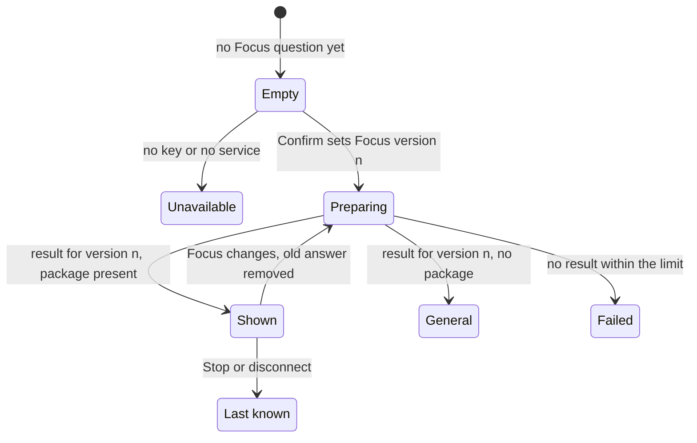

# A proposed answer tied to the Focus question

When Pablo confirms an interview question, Alice.Good.Meetings should show him a few short bullet points beside it, built from that question and his interview preparation package.
This page describes the parts that produce that answer and the rule that keeps it attached to the right question. It is intended design for SPRINT-003 (S003-ANSWER, S003-DETAILS, S003-CONTEXT); nothing here is built. Where the parts sit on the page is decided through the layout preview, not here.

*States of the answer area as the controller publishes them, using the seven names of the Use Cases [answer states](../03-system-model-and-use-cases/01.5.1-proposed-answer-states.md). General and Failed also return to Preparing when Focus changes, and a result for an earlier Focus version is dropped.*

## Parts and responsibilities

| Part | Responsibility |
| --- | --- |
| State controller (local service) | Starts one request when Focus changes, accepts a result only for the current Focus version, and publishes the answer state to the page. It remains the only owner of what the page may show. |
| Answer generator (local service, new) | Makes one bounded model call from the Focus question, fixed instructions and the preparation package. It returns text and decides nothing. |
| Preparation package (local disk, new) | Pablo's résumé and other documents as text files, read by the service. The [decision record](decisions/Proposed%20answer%20and%20its%20context/README.md) covers where it is kept and what is sent. |
| Page | Shows the bullets for the Focus version it displays and reports what it rendered. There is no details area from SPRINT-004. It never calls OpenAI and never receives the package text. |

## One result with two parts

Pablo decided on 16 November 2026 that one model call produces bullets and details, and on 19 November 2026 (08's Q11) that the model is no longer asked for details. **From SPRINT-004 the result is bullets only, at most three short points, on both paths that produce an answer:** the reader call after each pause and the fallback answer request. Each path's instructions ask for no details and its schema accepts no `details` field, so a result that carries one fails as an invalid result and takes the one retry. The `proposed` message carries bullets and no details.
The controller checks the bullets against their length limit before anything is shown and publishes them complete. Showing bullets earlier is no longer needed, since there is no second part to wait for. The earlier details decision of 16 and 18 November stays in the record for the SPRINT-003 build, which 08 says is superseded when SPRINT-004 builds.
The delay and cost of the shorter result are not measured; the live session will show them, as [answer delay](03.2-answer-delay-question.md) says.

## Binding to the Focus version

Every request carries the session and the Focus version it was made for. The controller accepts a result only while that session is active and the version is unchanged.
Any Confirm raises the version, including a confirmed rewording, so it always cancels the earlier request, removes the earlier answer in the same update that changes Focus and starts a new request. Pablo confirmed this rule: "Yes, always replace".
The answer is separate state with no write path to the Focus or Live question, and the cue never depends on it.
On Stop or a disconnect an unfinished request is cancelled and its result is never shown. Whatever the area showed stays with its Focus question, marked as last known, which Pablo accepted; a new session starts empty.
A failed request leaves the cue, Focus, Live and Confirm working. Pablo accepted on 16 November that it shows a message with no retry button, and that an answer arriving after he starts speaking appears in place, silently. On 18 November 2026 he accepted one automatic service retry, so a request is tried at most twice, it carries the same Focus version, and at most one request is in flight.

## Points for the detailed design

- The answer needs its own field and message name: `answer` and `reply` already carry the interview agent's output.
- Publishing an answer must not make the controller reject an in-flight Live update as based on an old revision.
- The interview agent's input no longer excludes the package: since Pablo's direction of 18 November 2026 the reader receives terms and package text, and this page's separate generator is the fallback ([automatic flow](01.7-automatic-question-flow.md)).
- The generator is passed in as a function, like today's model call, and receives one request object: session, Focus version, question, context kind and documents. Tests replace it and can inspect exactly what would be sent. The transcription connection is passed in the same way, as `createPocServer` already does, so the scripted page check can drive all seven answer states from fixtures without OpenAI.
- [Pending state and inspectable inputs](01.5-pending-state-and-inspectable-inputs.md) states how the pending state, the request object and the start marker are exposed.
- The audit log gains events without text: answer requested, accepted, dropped and failed, with duration, Focus version and context size. The page's render report names the answer's Focus version.

This draft was written on 16 November 2026 from Pablo's decisions as relayed in the [brief addendum](../07-planning/03.6.3-sprint-003-brief-addendum.md), and updated with the defaults he accepted later that day, as relayed by 00 Governance. On 18 November 2026 he accepted the separate generator and the other recommended defaults ("Accept all", relayed by 00 Governance). This page is a new version and no document acceptance is recorded.
[Architecture](01-architecture.md) · [Service start and key](01.4-service-start-and-key.md) · [Architecture index](README.md)
