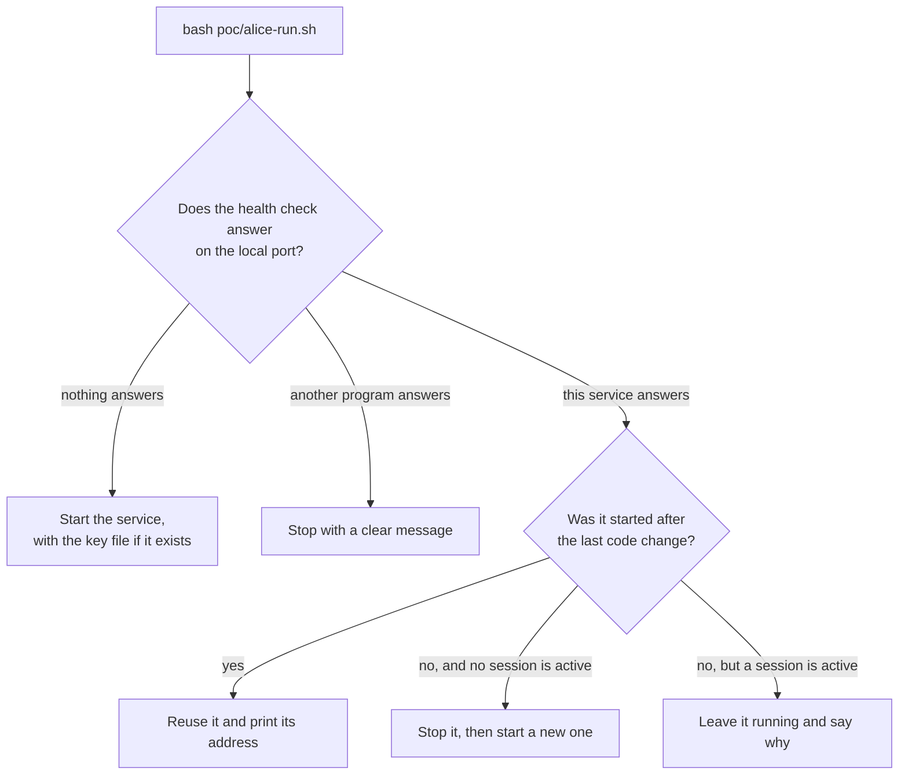

# Starting the service, with and without a key

Pablo asked for one command that gets Alice (Alice.Good.Meetings) ready, and the page must stay useful when no OpenAI key is in place.
This page states what the run command `bash poc/alice-run.sh` and the page must do (S003-RUN, S003-NOKEY), for the detailed design to turn into exact steps. Neither exists yet.

*Proposed decision path of the run command. The command itself makes no OpenAI request.*

## What the run command must do

- Find Node the way [start.sh](../../../poc/start.sh) does, and read the port without printing the key file.
- Probe `/health` on `127.0.0.1`. Reuse a process only if it identifies itself as this service; a different program on the port is a failure, never a reuse.
- Compare the service's start marker with the newest service source file. The service loads its code once, so an older process would serve new page files with old behavior.
- Never interrupt an active session to restart. Say that a restart is pending and leave the choice to Pablo.
- Start when `poc/.env.local` is missing, and say that recognition and proposed answers are unavailable until a key is added. Today's `--env-file=.env.local` makes Node exit with code 9; passing the option only when the file exists avoids that on every supported Node version.
- Report success only once `/health` answers, and never print the key or the package text.

Whether the command also opens the page, and whether it stays in the terminal or returns, is not stated in criterion 6. Neither that nor the restart behavior above was put to Pablo; they remain proposals for him and the detailed design.

## What the health check reports

`/health` already reports `status`, `configured` and the number of sessions. It needs three additions: a name that identifies this service, the time it started, and whether a preparation package was found, with its size.
It never includes the key, file names inside the package or any package text. The page reads it once when it loads, before Start Listening, so it can say what is unavailable without opening a session. Pablo decided on 18 November 2026 that the page gives no notice about the package before Start, so it does not show the package fact before a session; the flag serves the run command and tests. His protection is the data statements, which say the package text is sent at each Confirm.

## Page states

The last column uses the state names of the Use Cases [answer states](../03-system-model-and-use-cases/01.5.1-proposed-answer-states.md).

| Situation | Cue and timer | Questions | Answer card and details |
| --- | --- | --- | --- |
| Page opened without the service | Work | "Not listening", with a message that the service is not running | Unavailable, same reason |
| Service running, no key | Work | Unavailable: a clear message that recognition needs a key | Unavailable: no key |
| Key present, no Focus question | Work | Live follows speech | Empty |
| Focus question confirmed | Work | Focus fixed, Live follows speech | Preparing, then Shown or Failed |
| Key present, no preparation package | Work | Normal | General: points from the question alone, labelled as general (accepted by Pablo) |
| Stop or disconnect | The timer ends with Stop; after a disconnect it keeps running | Focus as last known | Last known: what the area showed, marked not live |

The first two rows follow the reading of criterion 4 that Pablo accepted on 16 November 2026, as relayed by 00 Governance: without a key the page, the timer and the cue still work. A clear message says recognition and proposed answers are unavailable.
A key that OpenAI rejects, or an exhausted quota, is found only when a session starts. The session ends with the existing public error text, and the page treats recognition and answers as unavailable.

## The layout preview

Pablo approves the layout from a preview before it replaces the page (S003-PREVIEW). The preview is a static page with sample content for every answer state. It has no microphone, no key, no package and no OpenAI request, and it holds no text from his documents.
It is kept under `poc/` or `images/`, because a new file at the root is outside the sprint scope, and the service serves it from its own entry in the fixed file list. It is not part of the product page.

## Evidence and status

Observed on 16 November 2026: Node v24.22.1 exits with code 9 when the file named by `--env-file` is missing, and continues with `--env-file-if-exists`. `poc/.env.local` was absent from this checkout at first inspection and present a few hours later, so `start.sh` itself was not run without it. Nothing else was run.
This draft follows the [first-pass review](03.1-sprint-003-architecture-review.md) and item C14 of the [alignment report](../07-planning/03.7.2-sprint-003-conflicts.md). No acceptance is recorded.
[Proposed answer](01.3-proposed-answer.md) · [Current architecture](02-current-architecture.md) · [Architecture index](README.md)
