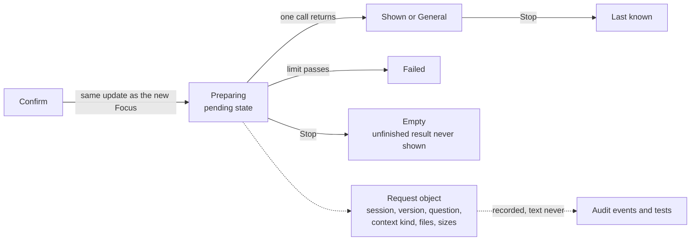

# What Pablo and the tests can see while an answer is prepared

After Pablo confirms a question, the answer takes seconds, and the request carries personal documents to OpenAI. Four behaviors make that safe and checkable: a visible pending state, inputs that can be inspected, an answer kept after Stop, and a marker that says which code is running.
This page states them for the detailed design (item C14 of the [conflicts page](../07-planning/03.7.2-sprint-003-conflicts.md)) and adds the delay effect of one call (item C5). It is intended design for SPRINT-003; nothing is built. Written on 18 November 2026.

*Where each behavior appears. The pending state is published by the controller, and the request object is what an injected generator receives in a test.*

## The four behaviors

| Behavior | What the design states |
| --- | --- |
| Pending state | The update that sets a new Focus version also removes the old answer and publishes Preparing. The area never stays blank or shows the old answer. Preparing ends only with a result, a failure or the end of the session. |
| Inspectable request inputs | The generator receives one request object: session, Focus version, question, context kind and the package files. The audit records its version, file names, sizes, digest and total size, never any text. A test replaces the generator and reads the object. |
| Last known after Stop | Stop cancels an unfinished request and never shows its result. A shown answer stays with its Focus question, marked not live, as in [01.3](01.3-proposed-answer.md). If Preparing was interrupted, the area returns to Empty, never to the old answer. |
| Start marker on `/health` | `/health` adds a service name, a start time and whether a package was found with its size, never names inside it. [01.4](01.4-service-start-and-key.md) uses the start time to tell whether a running process predates a code change. |

## Seeing exactly what is sent

A test sees the request object, but in a real session Pablo cannot see the text sent to OpenAI. Pablo accepted on 18 November 2026 an off-by-default start option that prints the assembled request to the terminal and nowhere else.
It would let him check once before an interview that nothing unwanted travels, such as the meeting link and folder address that his current package contains. It never goes to the page, the audit log or an HTTP route. The start option warns that its output is private text: the terminal may be read by other tools or sessions, so he uses it only where that is acceptable and clears it afterwards. Its exact name and form belong to the detailed design.

## What one call does to the delay

The page shows bullets and details together, so the bullets wait for the whole result. Generation time grows with the length of the output, and the start grows with the size of the input; the package is about half of its 20,000-character limit today.
No time is measured. The result keeps bullets and details as separate fields, so showing bullets earlier later needs no change to the page or the controller. [Answer delay](03.2-answer-delay-question.md) says how the live session will measure it.

## Evidence and limits

Read from source and from file sizes on 18 November 2026; nothing was run and no request was made. The request inspection option is decided; the other behaviors are proposed. No acceptance of this page is recorded.
[Proposed answer](01.3-proposed-answer.md) · [Preparation package](decisions/Proposed%20answer%20and%20its%20context/02-preparation-package.md) · [Architecture index](README.md)
