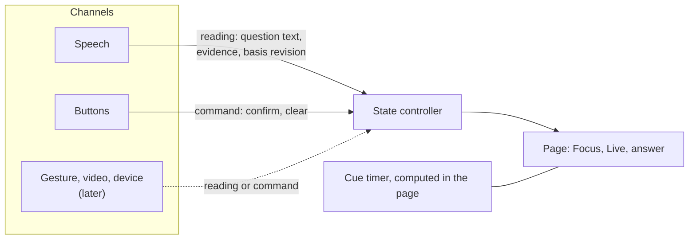

# Many ways to give Alice a cue, one place to decide

Pablo wants Alice to take cues from speech now and, later, from gestures, video, buttons or other devices, "whatever works", without losing any tool when another arrives. This page states the model that lets a channel join without redesign.
It is intended design proposed on 18 November 2026; today speech and the buttons exist. SPRINT-004 changes the cue tools: see below. No acceptance is recorded.

*Channels propose or command; the controller alone changes accepted state. The GOOD / LAND IT / STOP cue stays in the page and is not a channel.*

## The model

| Element | Rule |
| --- | --- |
| Channel | Anything that tells Alice about the meeting: it turns its raw input into readings or commands and sends nothing else. It knows nothing about other channels. |
| Reading | An uncertain proposal, such as question text with evidence and the state revision it was based on. The controller validates it and may reject it. Speech after a pause is a reading. |
| Command | An explicit act by Pablo, such as Confirm or Clear live. The controller applies it if the state allows. |
| Controller | Owns accepted state and one order of changes. A reading based on evidence older than a later accepted change is dropped, as the cutoff does today. |
| Source | Every accepted change records its channel, so the page, the audit and tests can tell speech from a button. |

## Rules that keep every tool

- Adding a channel adds an adapter and its tests; no other channel's code or buttons change. Removing a tool needs Pablo's own decision.
- There is no hidden priority. The later accepted change wins, and a reading that merely repeats the Focus wording changes nothing.
- A channel that fails or is absent leaves the others working. With no key there is no speech channel, and the buttons still work.
- Each channel declares what leaves the Mac. A camera frame or a gesture stream sent to a cloud service is a new kind of data and needs its own decision; processing on the Mac is preferred.

## The tools after SPRINT-004

Pablo accepted in 08's Q1 and Q4 that the cue is set by the keys G, L and S, held 10 seconds, with no on-screen cue buttons, and that Esc clears. The tools are therefore speech, Confirm, Clear live (button, Space or Esc), the keys G, L, S and Esc, Start and Stop. Keys are page-local commands to the cue, which is not a channel; no tool is removed without his decision.

## Where the code stands

Speech and the buttons already end in the same controller. They differ in form: speech arrives as a model proposal, the buttons as page messages. The missing seam is the source tag. [Code assessment](03.4-18-november-code-assessment.md) lists it.
Evidence: read from `poc/session.mjs` and `poc/server.mjs` in the working tree on 18 November 2026; nothing was run.

[Automatic flow](01.7-automatic-question-flow.md) · [Interview state](01.2-interview-state.md) · [Architecture index](README.md)
