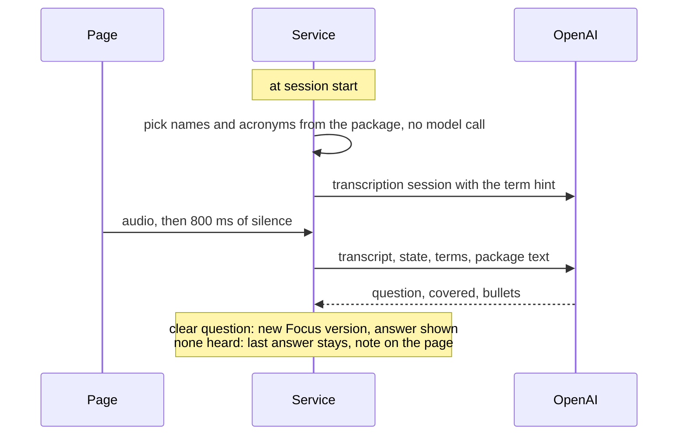

# Alice reads the question after a pause

Pablo decided on 18 November 2026 that a clear question is the last thing said before a pause, so Alice reads it, sets the Focus question and prepares the answer with no Confirm. This page states the flow, what it changes in the earlier design and what now leaves the Mac.
The flow is built in the working tree and is a proposal for Architecture to ratify, not settled design. No acceptance of this page is recorded.

*One request after each pause. If the reading's answer is not valid, the separate answer request is the fallback. From SPRINT-004 both return bullets only, with no details, under [01.3](01.3-proposed-answer.md).*

## What changes from the earlier design

| Earlier design | Now |
| --- | --- |
| Only Confirm writes Focus | The controller also sets Focus after a pause; Confirm and Clear live stay as an optional tool |
| The interview agent never sees the package | The reader receives terms and package text, as reference material, never instructions |
| One answer request per confirmed question | One request per pause returns the reading and the answer; a later pause replaces the earlier reading |
| Transcription gets audio only | It also gets a short term hint picked locally from the package |
| A wrong word stays wrong until Pablo corrects it | The reader writes the package's spelling when a word sounds like a package term, and adds nothing unsaid |

## What leaves the Mac

| When | Sent to OpenAI |
| --- | --- |
| Session start | A hint of at most 40 terms and 500 characters, picked locally from the package |
| While listening | Microphone audio to transcription |
| After each pause | Recent transcript, the state, the terms and the package text, to the reasoning model |

Nothing is stored by OpenAI and tracing is off, as before. The page never receives the package text. The [data statements](decisions/Proposed%20answer%20and%20its%20context/03-data-statements.md) carry the wording for the two owners' pages.

## Constraints and uncertainty

The key stays in the service and the controller validates every result. Cost and delay per pause are not measured; the earlier agent call alone took 2.3 to 5.7 seconds. Whether the 800 ms pause ends a question reliably is for the live session. [Alternatives](decisions/Automatic%20question%20flow%20and%20input%20channels/01-flow-alternatives.md).

[Input channels](01.6-input-channels.md) · [Proposed answer](01.3-proposed-answer.md) · [Architecture index](README.md)
