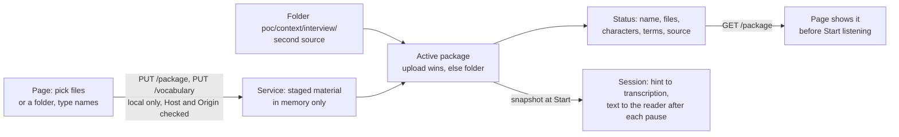

# Adding the preparation package and names from the page

Pablo wants to hand Alice his preparation package from the page instead of placing files in `poc/context/interview/` on the machine that runs the service, and to type a few names that are in no document, such as Simplii. This page is the Stage 05 draft design.
It is a proposal written on 18 November 2026. Nothing is built, no code is changed and no acceptance is recorded. [01.8.1](01.8.1-upload-limits-and-statements.md) holds the limits and the data wording.

*Material is staged before Start, one source becomes the active package, and a snapshot of it is what a session uses.*

## Where it lives

| Question | Draft answer |
| --- | --- |
| Which owner | The service holds one staged package and one term list in memory. They belong to the service process, not to a listening session, because the upload comes before Start. |
| Lifetime | Never written to disk. Kept until Remove, until a new upload replaces it, or until the service stops. Pablo said "session only": whether Stop should also clear it is open question Q1. |
| Source order | An uploaded package wins; with none, the folder is used as today. The status names the source. The two are never merged, so the 20,000 characters mean one package. Merging is open question Q2. |
| Snapshot | Start copies the active package and term list into the session. The controls are disabled while listening, so a session never changes under him, and the next Start picks up the change. |
| Channel model | The upload is a setup-time, explicit command from the page in the [channel model](01.6-input-channels.md), carrying reference material, never a reading and never a Focus input. It has no priority over speech or buttons because it cannot change Focus. |
| Automatic flow | Nothing changes after Start. The [flow](01.7-automatic-question-flow.md) still receives the terms at session start and the package text after each pause; only where they came from differs. |

## The user's term list

- Up to 40 names, each at most 40 characters of letters, digits, spaces and `&.'-`, typed one per line or with commas.
- They join the term hint and the question reader's terms ahead of terms picked from the package, so they are never cut by the existing 40-term and 500-character limits.
- The service keeps them in memory with the package. Remembering them between visits is possible in the page's own browser storage, never in the service; this is open question Q3.
- The status counts them apart: "12 terms, 3 yours".

## Where the status lives

`/health` stays as it is: liveness, key, start marker and folder-package size, readable by any local program that passes the host check. The staged package is session material, so it gets its own `GET /package`. It returns source, package name, file count, characters, term counts and a usable state, and names a file only in the answer to the upload itself, to the page that sent it.
This keeps [01.4's rule](01.4-service-start-and-key.md) that a health read never names files, and lets the page show the status after a reload.

## Open questions

- **Q1.** After Stop, keep the package for the next Start (my recommendation) or clear it?
- **Q2.** Should an upload add to the folder package instead of replacing it? I recommend replace.
- **Q3.** Remember his term list in the browser between visits? I recommend yes.
- **Q4.** Does this ride on SPRINT-003 by amendment, or start a later sprint? See [01.8.1](01.8.1-upload-limits-and-statements.md); it is the lead's and Pablo's call.

[Input channels](01.6-input-channels.md) · [Automatic flow](01.7-automatic-question-flow.md) · [Preparation package](decisions/Proposed%20answer%20and%20its%20context/02-preparation-package.md) · [Architecture index](README.md)
