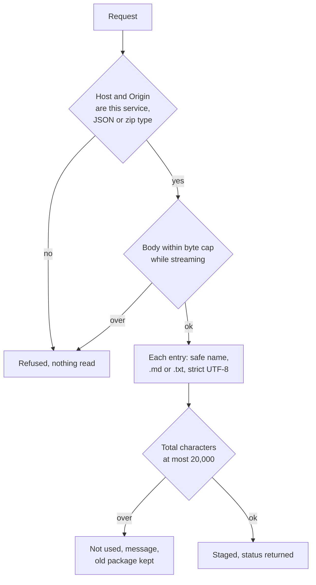

# Upload limits, the zip decision and the data wording

This page completes the draft design in [01.8](01.8-package-upload-and-vocabulary.md): how the service accepts what the page sends, whether to add a zip library, what the data statements would say, and what this needs from the sprint. It is a proposal of 18 November 2026; nothing is built and no acceptance is recorded.

*A failed upload changes nothing; the previous package stays staged.*

## Safe limits

| Check | Draft rule |
| --- | --- |
| Caller | Same Host and Origin rules as the session socket; the body must be `application/json` or `application/zip`. A custom type forces a browser preflight, so another web page cannot post to it. |
| Body | At most 200 KB, counted while reading, and the read stops at the cap. 20,000 characters are at most about 80 KB, so this is generous. |
| Files | At most 20; only `.md` and `.txt`; no dotfiles; `README.md` skipped, as in the folder rule; skipped names are reported to the page only. |
| Names | Only the last path part is kept. Any name with `..`, a drive letter, a leading slash or a backslash is refused. Names are labels; nothing is written to disk, so no path is ever opened. |
| Text | Strict UTF-8 as today; a file that fails is reported and the upload is refused as `unreadable`. |
| Total | 20,000 characters across all files, the decided limit. Over the limit the package is not used and the page says so; the old one stays. |
| Zip only | Compressed size at most 1 MB; at most 100 entries; links, nested archives, `__MACOSX/` and `.DS_Store` ignored; inflated bytes counted as they are produced and stopped at 200 KB, never trusting the declared size. |

## Zip: library or several files first

| Option | For | Against |
| --- | --- | --- |
| A. Several files and a folder pick first | No dependency; the page reads each file as text, and `webkitdirectory` lets him choose his whole folder. No archive parsing at all. | He cannot drop one zip. |
| B. Own reader on `node:zlib` | No new package. | About 80 lines of parser for untrusted input, written by us. |
| C. A small pinned library such as `fflate` | Small, no dependencies, tested by others. | One more package in a project whose rule is pinned, frozen, no scripts; I have not checked that it enforces output limits. |

**Recommendation: A now, zip as a second step.** If zip follows, choose between B and C only after a test with a zip bomb and a declared-size lie, which is Stage 06's check. Q5: is dropping a single zip important enough to take that step this sprint?

## What the statements would say

- Where text comes from: "from files you add on the page, or, if none, from `poc/context/interview/` on this Mac."
- Retention: "An added package is held in the service's memory only, is never written to disk or logged, and is gone when you remove it or stop the service."
- Leaving the Mac: unchanged in kind; the post-pause request and the term hint carry it as in [01.7](01.7-automatic-question-flow.md). Your own terms go to transcription as part of the hint.
- The statement of `AGENTS.md` and `poc/README.md` is owned by Pablo, Admin and Stage 09. This page writes no change there.

## Sprint and later risk

SPRINT-003's scope covers `poc/` and `app.js`, so the files are in scope, but its commitment S003-CONTEXT and criterion 9 name the folder as the only source, and this adds the service's first write route. **I recommend an amendment record if Pablo wants it in SPRINT-003, adding an upload commitment and rewording S003-CONTEXT and criterion 9; otherwise a new sprint.** Stages 03, 04, 07 and 08 also need updates either way; the choice is for the lead and Pablo.
Later risk, out of scope by Pablo's choice: a shared server needs sign-in, one package per user, encrypted transport and a retention rule. The present checks assume one person on one machine.

[Package design](01.8-package-upload-and-vocabulary.md) · [Architecture index](README.md)
