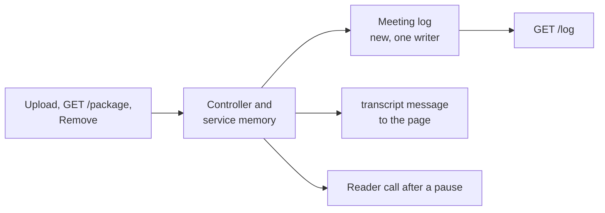

# SPRINT-004 at the high level: what 05 accepts, amends and answers

Governance asked 05 on 19 November 2026 to take a position on the upload design, three earlier code items and the differences with 08's screen specification. This is a draft position, not an approval: SPRINT-004 is still a plan, no code is changed and nothing is recorded as accepted. The log and the new `transcript` message are on [01.10](01.10-meeting-log-and-transcript-message.md), the wording on [01.10.1](01.10.1-upload-and-log-statements.md).

*Four things SPRINT-004 adds to the service, all behind the one controller.*

## 1. 01.8 and 01.8.1 for this sprint

**Accepted, with three amendments, now applied to both pages.**
- Zip, folder pick and the user's term list are out, as Pablo decided; the service takes JSON only.
- The package is kept after Stop and replaced by an upload (Q1, Q2 as accepted); the 20,000-character limit stands.
- Remove is added: `DELETE /package` clears the staged package and the page then falls back to the folder, as 08 asked in its Q5.
- `GET /package` returns counts and source only, and names files only in the upload's own answer. 08's SU-4 and SU-8 agree.

## 2. Earlier items from 03.4

| Item | Position | Condition |
| --- | --- | --- |
| C1 print the post-pause request and the hint | **Moved to SPRINT-005** with C3, by Pablo on 19 November 2026. 08 had not sized it, so it does not stay as "cheap". | The accepted print option still covers the answer request until then. |
| C3 skip the request when nothing new was said | **Moved to SPRINT-005.** | Until then an idle pause sends the full request; cost, not correctness, and unmeasured. |
| F3 the monitor line | **Accept 08's treatment.** | The line is small and regular in the bar, and the last words move to the transcript column. Skipping a hide control (08's Q6) is acceptable for that reason. |
| C2 source tag, C5, terms | SPRINT-005, as directed. | One exception below. |

S004-GUARD therefore leaves the sprint. **Exception:** the log must say whether a Focus change came from a pause or a button (08's ML-6). That is a field on the log event, derived where the controller already knows the path; it needs no new audit field and no channel-wide tag, so C2 stays in SPRINT-005.

## 5. Where 01.8 differs from 08

| Point | Settled as |
| --- | --- |
| Strict UTF-8, page or service | **The page.** It reads bytes and decodes with a fatal decoder, so a bad file is named and nothing is sent (SU-2). The service gets already-decoded text, so it cannot test bytes; it refuses U+FFFD or NUL as `unreadable`. One rule, two places, stated in 01.8.1. |
| Who reads files | The page, as text, for several files. 01.8 and 08 now agree. |
| Refusal reasons | 08's list (`too-many-files`, `body-too-large`, `empty`, `unreadable`, `refused`, `listening`, over the limit) is the full set. The 409 for `listening` is accepted. |
| Log folder | Pablo decided on 19 November 2026: `poc/logs/` inside the project, Git-ignored, movable by `ALICE_LOG_DIR`. 08's MS-1 and MS-2 stand; see 01.10. |
| Focus source in the log | Accepted as the exception above. |

## Applied in the 19 November correction round

**A1:** 01.3, 01.2, 01.5, 01-architecture and 01.7 now say the result is bullets only on both paths. **A2:** 01.6 lists the keys. **Names:** unsafe names are refused, as 01.8.1 says.
**08 must change:** AD-1 to say the instructions of both the reader call and the answer request ask for at most three bullets and no details; AD-2 to say both schemas accept `{bullets}` only, so a result with `details` fails and takes the one retry, and the reader result keeps its question and coverage fields; AD-3 unchanged. **SU-3** replaces "names kept as the last path part" with "a name containing `/`, `\`, `..`, a drive letter, NUL or a control character, or over 255 characters refuses the whole upload as `refused`, naming the file; no name is trimmed".

## Needs a sprint record change

07's draft criteria 4 and 5 already describe a Git-ignored local file, so they stand. Criterion 10's statements follow 01.10.1, which now says the log is private text in the project and travels with any copy of it.
[Package design](01.8-package-upload-and-vocabulary.md) · [Architecture index](README.md)
