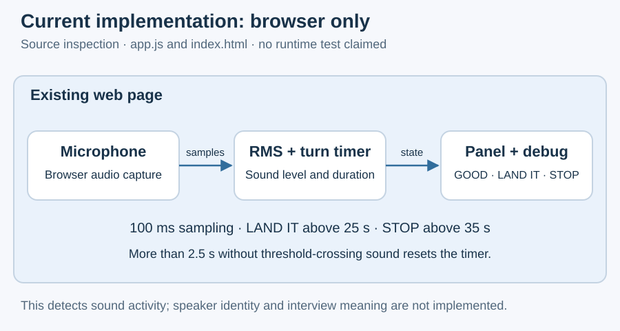

# What the current browser page actually does

Source inspection on 25 October 2026 establishes a browser page with microphone-level timing and three visual states. No application runtime, microphone session or deployed build was tested for this assessment.

## Existing responsibilities

| Source | Responsibility |
| --- | --- |
| [index.html](../../../index.html) and [its companion](../../../index.md) | Full-screen color panel, manual state buttons, Start Listening control, debug overlay and inline styling. |
| [app.js](../../../app.js) and [its companion](../../../app.md) | Microphone acquisition, Web Audio analysis, sound-level activity timing and DOM updates. |

Start Listening requests microphone permission, creates an AudioContext and AnalyserNode, then samples every 100 ms.
An RMS level above 0.02 starts or sustains a detected turn. The short speaking indicator uses a 300 ms hold; more than 2.5 seconds without threshold-crossing sound clears the turn timer.
The panel displays LAND IT above 25 seconds and STOP above 35 seconds; otherwise it displays GOOD. Pauses shorter than the reset interval count toward elapsed turn time.
Manual color selections can be overwritten by the next automatic tick. The existing source has no stop-listening control or complete cleanup after partial startup failure.
The timer reacts to sound activity, including possible interviewer speech or noise. It neither establishes speaker identity nor judges whether an answer is relevant.

## Gap to the proposed architecture

The two application files contain no audio-upload connection, local session service, live transcription, agent integration, interview-state controller or retained-question display.
No application replay harness, session recording pipeline or versioned display-event history is implemented in those files.
The proposed 100 ms transport packets are separate from the existing 100 ms volume-sampling interval; matching numbers do not establish an existing audio stream.
The initial GOOD label describes the display's default appearance, not a recognized interview phase or demonstrated answer quality.

## Offline evaluation materials

The [evaluation-data guide](../../../eval-data/README.md) identifies the longer mock interview, Pablo's solo recording and the stored experimental voice profile.
The [analysis guide](../../../eval-data/interview-analysis-2026-10-25/README.md) distinguishes a separate 85-second interview and its transcript from the profile comparison on the first 90 seconds of the longer MP3.
Pablo considers the short transcript and timestamps good enough for the current evaluation. They remain unchanged working references, with estimated speaker/overlap labels and no claim of independent ground truth.
Offline processing of complete files does not establish incremental transcription, online identity recognition, input isolation, end-to-end latency or live usefulness.
The two confirmed examples from the longer recording do not establish an automatic recognition threshold or general accuracy.

## Workflow facts and evidence limits

Fresh project-local status and structure verification are separate from application validation. The sprint is inactive and no release is recorded.
Stage 04's documentation is accepted and current. Purpose and use-case approval records are stale after document changes, while the user retains their working direction.
Stage 01 is intentionally empty for this seed; its missing-evidence index entry does not require restarting that definition exercise.
This document describes inspected sources and reported evaluation provenance, not a benchmark result, implementation approval or deployment claim.
[Proposed architecture](01-architecture.md) · [Planned decisions](03-planned-decisions.md) · [Architecture index](README.md)
