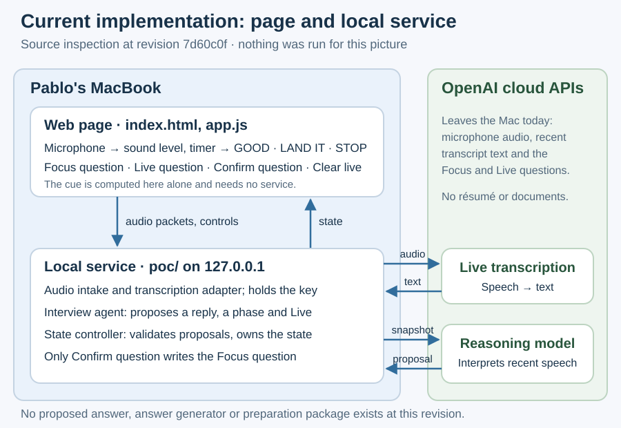

# What runs today: the page and its local service

Pablo opens one web page during an interview. It shows a full-screen GOOD, LAND IT or STOP cue, the Focus question he confirmed and the Live question the service is hearing.
This page records what the source on branch `sprint-03` does, read at revision `7d60c0f` on 16 November 2026 and rechecked on 18 November at `bde3f7a`. The later commits only renamed the product in the service, `poc/start.sh` and `poc/package.json`; behavior is unchanged. Nothing was run for this assessment, except one Node start check named below.

*Drawn from the source, not captured from a running page. [Editable SVG](images/current-system.svg). A labelled mockup of the question panel is in the [UC-04 design](../08-low-level-design/03-uc-04-focus-and-live-question.md).*

## Parts and what each one does

| Source | Responsibility |
| --- | --- |
| [index.html](../../../index.html), [app.js](../../../app.js) | The cue: microphone sound level, a turn timer and the three colors, computed in the page alone. The question panel: Focus, Live, Confirm question and Clear live. One WebSocket carries 100 ms audio packets and question controls out, and state back. |
| [poc/server.mjs](../../../poc/server.mjs) | Serves a fixed list of files on `127.0.0.1`, answers `/health`, accepts one session at a time, forwards audio to OpenAI live transcription and holds the key. |
| [poc/session.mjs](../../../poc/session.mjs) | The state controller. It owns the revision, phase, reply, Focus question with its version, and Live question. It validates each model proposal; only Confirm question writes Focus. |
| [poc/agent.mjs](../../../poc/agent.mjs) | One Agents SDK agent without tools. From recent transcript and the current state it proposes a short reply, a phase and a Live question. |
| [poc/start.sh](../../../poc/start.sh) | Finds Node (`ALICE_GOOD_MEETINGS_NODE`, then `node` on the path) and starts the service with `--env-file=.env.local`. |

## Behavior the next change depends on

The cue shows LAND IT after 25 seconds of a turn and STOP after 35; 2.5 seconds without sound ends the turn. It keeps working when the service is absent, refuses the session or disconnects.
Focus has a version that rises by one at each Confirm, including a confirmed rewording. The page applies a state only if its revision is newer than the one displayed, and tells the service which revision it has rendered.
The service runs one reasoning request at a time, started at least 2.5 seconds apart and limited to 30 seconds. A proposal based on an older revision is rejected.
Without a key, `/health` reports `configured: false` and a session is refused with "Server needs OPENAI_API_KEY". Nothing is transcribed, so no Live or Focus question can appear.
`start.sh` cannot start the service when `poc/.env.local` is missing: Node exits with code 9. This was observed on 16 November with Node v24.22.1 and a throwaway file name. The real file was absent from this checkout when first inspected that day and present a few hours later; its content was not read.
On Stop or a disconnect the page releases the microphone and shows Focus as "last known, not live". A new session starts with both questions empty.

## What leaves the Mac today

Microphone audio goes to OpenAI live transcription while listening. The last six transcript segments and the session state, including the Focus and Live questions, go to the reasoning model.
No résumé, document or other prepared material is read or sent. A preparation package has been placed in `poc/context/interview/` (five files, 10,733 characters, counted without reading them for content), and Git ignores it through `poc/context/.gitignore`; no code reads it yet. The audit log records events, versions and timings, never transcript or question text.

## Gap to SPRINT-003

Nothing at this revision prepares an answer: there is no answer generator, preparation package, bullet card or details area, and `poc/alice-run.sh` does not exist. `/health` carries no start marker.
The [proposed answer](01.3-proposed-answer.md) and [service start](01.4-service-start-and-key.md) pages describe what is intended. From the wider [intended design](01-architecture.md), the P toggle, speaker identification, isolated replay and automatic reconnection are also not built.

## Evidence and limits

The deterministic suite in [poc.test.mjs](../../../poc/poc.test.mjs) has 19 cases, counted from source again at `bde3f7a`, which settles the 18-versus-19 difference noted in item C15. The [POC results](../../../poc/RESULTS.md) record one synthetic browser trial on 26 October 2026, and [UC-04](../03-system-model-and-use-cases/01.4-confirm-current-question.md) records a live run on 4 November. None was repeated here.
Physical microphone behavior, question accuracy, speaker identity and usefulness in a real interview remain unmeasured. The recordings in [eval-data](../../../eval-data/README.md) are evaluation references, described in the [Stage 04 evidence page](../04-benchmarks-and-eval-strategy/02-evidence-and-reconciliation.md), and are not inputs to the service.
SPRINT-003 is active. This page replaces the 25 October description of a browser-only page; no acceptance of this version is recorded.

[Intended architecture](01-architecture.md) · [Planned decisions](03-planned-decisions.md) · [Architecture index](README.md)
