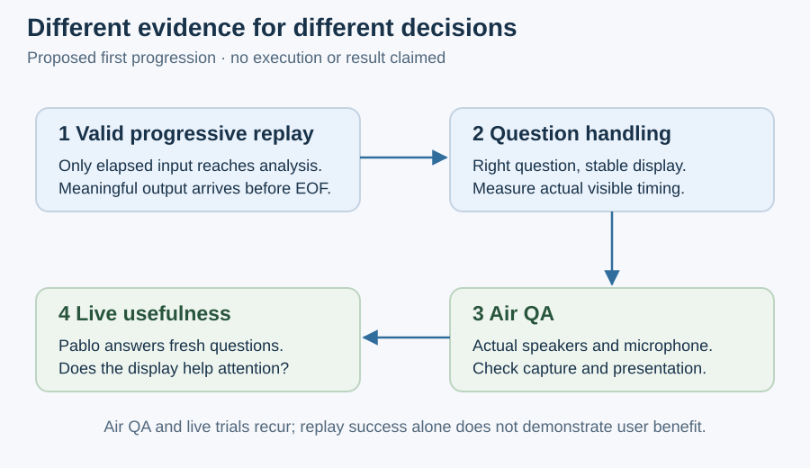

# Decisions for the smallest useful next behavior

The next outcome is a stable interviewer-question display during Pablo's answer. This page records candidate architecture choices and their next evidence, not a scheduled sprint or an accepted implementation plan.
Owner, model, implementation language, cost tolerance and delivery dates remain unselected. Integrated delivery commitments belong to Stage 07 and the authoritative sprint state.

## Direction and candidate choices

The user selected question retention, progressive replay, Air QA, live usefulness validation and the P turn toggle. This discussion proposes a local service with cloud transcription and reasoning to support those directions.
The request to document this proposal is documentation authorization; it does not establish formal architecture acceptance or successful execution.

| Decision | Proposed starting point and trade-off |
| --- | --- |
| Service placement | Run on the MacBook alongside the browser. This avoids a hosted application deployment for one user; the process must stay available during the interview. |
| Agent harness | One Agents SDK agent, with bounded state proposals and application-owned state. Direct Responses calls may be sufficient while the behavior is only structured state interpretation. |
| Speech and reasoning | Cloud live transcription followed by text-based interpretation makes intermediate errors inspectable; it adds transcription and reasoning delay. Direct audio reasoning remains an alternative. |
| Speaker identity | Keep estimates and unknowns explicit; combine declared P events with a separately evaluated recognizer if useful. The stored voice profile has no calibrated online threshold. |
| Display and exchanges | Retain an active question separately from its developing replacement. Confirm exact versus shortened wording and the clarification/follow-up rule before implementation. |
| Audio source | Begin with a microphone hearing both participants. Headphones, system-audio capture and meeting integrations need an explicit choice. |
| Timing and recovery | Start with bounded queues and versioned updates; measure browser-visible delay. Packet size, scheduling cadence and reconnect rules remain to be specified. |
| Capture and data | Select what leaves the Mac, cloud settings, and whether recordings or traces are retained. Recording is an explicit option, not implied by listening. |

## Harness alternatives

The [Agents SDK](https://developers.openai.com/api/docs/guides/agents/sdk) runs in application code and supports explicit tools and state integration; it is the preferred candidate, not a measured winner.
The [Codex SDK](https://learn.chatgpt.com/docs/codex-sdk) controls local Codex threads. [Codex app-server](https://learn.chatgpt.com/docs/app-server) exposes richer conversation and event integration; its WebSocket transport is documented as experimental.
Those alternatives become relevant if SpeakerCoach needs Codex's existing harness capabilities. The Codex desktop application itself remains a development tool in the proposed runtime arrangement.
A hosted service could support multiple devices or users later. Fully local inference could reduce cloud dependence, but requires evidence on the Mac's recognition quality, delay and resource contention.
Official product references were inspected during this discussion; model support and SDK contracts should be checked again at implementation time.

## Evidence before broader commitment

1. Resolve the input, harness and speech/model choices enough to define a bounded feasibility task; obtain the separate execution scope required for that task.
2. Use one recording to demonstrate progressive delivery, meaningful output before playback ends and enforced exclusion of future input and evaluator references.
3. Evaluate question fidelity, attribution, persistence and visible timing separately. The short working transcript can support its own case; it does not annotate the longer MP3.
4. Exercise the real microphone path through speakers, then live answering to judge attention and usefulness. Replay accuracy alone does not establish benefit.

Use [Stage 04's accepted strategy](../04-benchmarks-and-eval-strategy/01-evaluation-strategy.md) and its existing provisional measurements; no new benchmark definition is required here.
If a feasibility experiment is needed, its bounded question belongs with Stage 06. Stage 07 owns delivery sequencing; Stage 08 specifies packet, event and transition contracts before scoped build work.
This is a suggested handoff boundary, not a dispatched assignment. No active sprint, completed experiment or formal architecture approval is claimed.
[Architecture](01-architecture.md) · [Current evidence](02-current-architecture.md) · [Architecture index](README.md)
