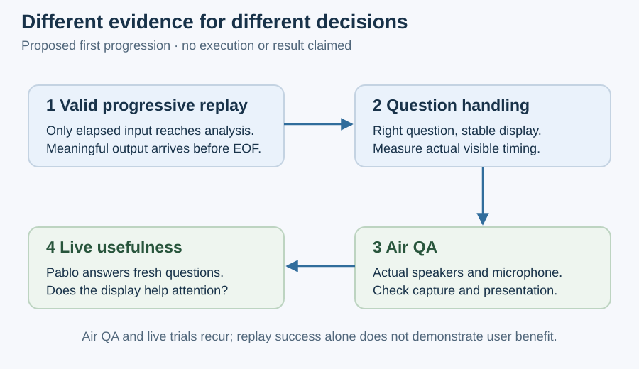

# Decisions behind the next behavior: a proposed answer

SPRINT-003 commits to a proposed answer beside the Focus question. This page lists the architecture choices behind it and the earlier ones still open, and says who decided each.
The answer model, cost tolerance and delivery dates remain unselected. Integrated delivery commitments belong to Stage 07 and the authoritative sprint state.

## Direction and choices

In October Pablo selected question retention, progressive replay, Air QA, live usefulness validation and the P turn toggle. On 16 November 2026 he selected the proposed answer, its form and its inputs.
"Selected" records his stated choice. It is not formal acceptance of a document, and "proposed" marks Architecture's recommendation awaiting his review.

| Decision | Status and trade-off |
| --- | --- |
| Service placement | Selected for the POC: on the MacBook beside the browser. No hosted deployment for one user; the process must stay available during the interview. |
| Agent harness | Selected for the POC: one Agents SDK agent with bounded proposals and application-owned state ([record](decisions/Use%20Open%20AI%20Agent%20SDK/README.md)). A direct model call may suffice while there are no tools. |
| Proposed answer | Selected by Pablo: built from the Focus question and an interview preparation package, one call for bullets and details, replaced on every Focus change. Proposed: a separate generator in the local service ([record](decisions/Proposed%20answer%20and%20its%20context/README.md)). |
| Capture and data | Selected by Pablo: the package text is sent to OpenAI, and the package is kept in the project at `poc/context/interview/`, ignored by Git, as plain text or Markdown up to 20,000 characters. Whether recordings or traces are retained stays open; recording is an explicit option, not implied by listening. |
| Service start | Selected by Pablo: without a key the page, timer and cue still work. Proposed: one run command that reuses a current service, replaces a stale idle one and starts without a key file ([service start and key](01.4-service-start-and-key.md)). |
| Display and exchanges | Decided on 4 November (UC-04): Focus changes only through Confirm question, and Live follows speech. Where the cards sit is decided through the layout preview. |
| Speech and reasoning | Cloud live transcription followed by text-based interpretation keeps intermediate errors inspectable; it adds delay. Direct audio reasoning remains an alternative. |
| Speaker identity | Open. Keep estimates and unknowns explicit; the stored voice profile has no calibrated online threshold. |
| Audio source | Begin with a microphone hearing both participants. Headphones, system-audio capture and meeting integrations need an explicit choice. |
| Timing and recovery | Bounded queues and versioned updates exist in the POC. Reconnect rules remain to be specified. The [answer delay](03.2-answer-delay-question.md) is unmeasured; Pablo chose to learn it in the live session. |

## Harness alternatives

The [Agents SDK](https://developers.openai.com/api/docs/guides/agents/sdk) runs in application code with explicit tools and state; it was selected for the POC, not measured against the others.
The [Codex SDK](https://learn.chatgpt.com/docs/codex-sdk) and [Codex app-server](https://learn.chatgpt.com/docs/app-server) become relevant only if Alice.Good.Meetings needs Codex's own harness; the desktop application stays a development tool.
A hosted service could support several devices or users later. Fully local inference could reduce cloud dependence, and would then keep the preparation package on the Mac, but needs evidence on recognition quality, delay and resource contention.
Product references were inspected in October 2026; model support and SDK contracts should be checked again at implementation time.

## Evidence still needed

1. Record the delay from Confirm to visible bullets in the sprint's live session, as Pablo chose, using the definition in the [answer delay question](03.2-answer-delay-question.md).
2. Use one recording to demonstrate progressive delivery, meaningful output before playback ends and enforced exclusion of future input and evaluator references.
3. Evaluate question fidelity, attribution, persistence and visible timing separately. The short working transcript can support its own case; it does not annotate the longer MP3.
4. Exercise the real microphone path through speakers, then live answering, to judge attention and usefulness. Replay accuracy alone does not establish benefit.

Use [Stage 04's strategy](../04-benchmarks-and-eval-strategy/01-evaluation-strategy.md) and its SPRINT-003 criteria; no new benchmark definition is made here.
A feasibility experiment belongs with Stage 06; none precedes this sprint's build, by Pablo's choice. Stage 07 owns delivery sequencing, and Stage 08 specifies the messages, limits and run-command steps before scoped build work.
These are suggested handoff boundaries, not dispatched assignments. No completed experiment or formal architecture approval is claimed.
[Architecture](01-architecture.md) · [Current evidence](02-current-architecture.md) · [Architecture index](README.md)
