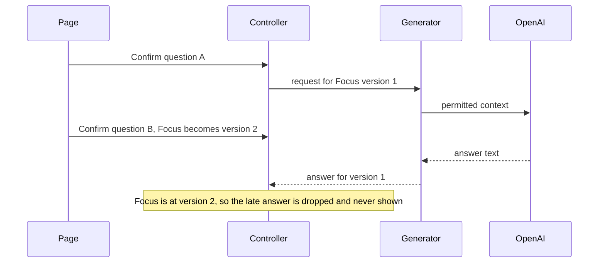

# SPRINT-003 architecture review: where a proposed answer fits

SPRINT-003 gives Alice (Alice.Good.Meetings) a new page layout and a proposed answer to the Focus question. This first-pass review asks how the browser page and the local service can support each commitment in the [review brief](../07-planning/03.6-sprint-003-review-brief.md).
The existing design can carry the sprint with one new part, an answer generator inside the local service. The stage 05 documents still defer answer suggestions and describe an older page, so the verdict is **CHANGE_REQUIRED**.

*Proposed, not implemented. The controller and the generator both run in the local service. The GOOD / LAND IT / STOP cue is absent because it never leaves the page and takes no part in this path.*

## Baseline and sources

Brief SHA-256 `3a1a604830617a0fb4f570afbea0b685822725b7e9bbb63c92c3e8bad89fefe4`, sprint record `c81510f0…e1ddc4`, branch `sprint-03` at `7d60c0f`, reviewed on 16 November 2026. I recomputed the hashes of the seven stage 05 documents, the root `AGENTS.md` and the five application files on the [sources page](../07-planning/03.6.2-sprint-003-brief-sources.md); all match.
The code was read, not run: no test, service start or OpenAI request. No acceptance is recorded for any stage 05 document, and the [README](README.md) calls the package a draft proposal.

## How each commitment is supported

| ID | Support in the baseline | Gap or obligation |
| --- | --- | --- |
| S003-LAYOUT | The cue is computed and drawn in the page alone (`tick` in `app.js`), so rearranging cards cannot affect it; the service is untouched. | Layout B does not place the two diagnostic panels, Clear live or the manual cue buttons. The element IDs and the no-overlap check in `poc/browser-protocol.mjs` are a contract: keep them, or change the check in the same step. |
| S003-PREVIEW | None. The service serves a fixed list of files (`server.mjs`). | The preview is a separate static page with sample content, no microphone and no OpenAI, stored under `poc/` or `images/`; a new file at the root is outside sprint scope. If the service serves it, it needs its own entry in that list. |
| S003-GLANCE | [01.1](01.1-streaming-and-replay.md) already requires complete, validated updates instead of continuous rewriting. | Apply it to the answer: shown once, complete, within a length limit the controller enforces as it does for today's 500-character reply. The limit depends on S003-Q1. |
| S003-ANSWER | Focus has a version and one writer (`confirm` in `session.mjs`); the page ignores older state revisions. Nothing generates an answer. | Add the generator and the version binding described below. |
| S003-NOKEY | `/health` reports whether a key is configured without exposing it. A session without a key is refused with a status and the cue keeps running in the page. | The page reads that flag and says answers are unavailable, also when the service is unreachable or a request fails. `start.sh` cannot start without `poc/.env.local` (Node exits with code 9), and that file is absent in this checkout. Without a key nothing is transcribed, so no Focus question can be set: "still works" can only mean the page, the cue and a clear status. |
| S003-TESTS | Traces to the rule that deterministic checks never call OpenAI ([poc.test.md](../../../poc/poc.test.md)); the model call is injected into `createPocServer`. | Inject the generator the same way. `node --test` reaches the service, not the page: what the page displays needs the scripted browser check or the preview. |
| S003-RUN | Traces to the run steps in [poc/README.md](../../../poc/README.md) and to one service on one fixed local port, where a second start cannot bind. | Reuse only a process that answers `/health` as this service, otherwise start one; stop with a clear message if another program holds the port; start without a key file and never print it. The service loads its code once, so a reused process may predate a change: `/health` needs a start or build marker. |
| S003-LIVE | The audit log records timed events without text, and the page acknowledges each revision it renders. | Add answer events (requested, shown, dropped, failed, with duration and Focus version) so the recorded result can say how long an answer took. |

## The proposed answer path

A separate **answer generator** in the local service makes one bounded model call per Focus question and hands its text to the controller, which alone decides what the page may show. This keeps the split recorded in the [Agents SDK decision](decisions/Use%20Open%20AI%20Agent%20SDK/README.md): the model proposes and the application owns state.
Each request carries the session and the Focus version. The controller accepts a result only while that session is active and the version is unchanged; a new Confirm cancels the earlier request and clears the old answer in the same update that changes Focus. The answer has its own state field and card, with no write path to Focus or Live.
Two alternatives were set aside. Adding the answer to the interview agent's output would regenerate it as often as every 2.5 seconds while speech arrives and would slow the Live question. Calling OpenAI from the page would put the key outside the service.
Three points go to 08 Specs. The generator and the interview agent may run together, which the "one reasoning request at a time" rule in 01.1 does not yet allow. Publishing an answer must not make the controller discard an in-flight Live update as stale. The `answer` message and `reply` field already carry the interview agent's output, so the new field needs its own name and must stay out of that agent's input.

## Open questions

- **S003-Q1, form:** both forms use the same parts. This package favors brevity ("brief private visual guidance"); the choice sets the output shape, the length limit and the generation time. It does not block the verdict.
- **S003-Q2, trigger:** automatic generation starts at Confirm, with no new control and one billable request per confirmed question. On request adds one page control and one more action during the interview, and criterion 3 would then read differently. It does not block the verdict.
- **S003-Q3, inputs:** the Focus question already reaches OpenAI inside the interview agent's input, so the question alone sends nothing new; for an experience question it can offer structure only, never invented facts ([UC-03](../03-system-model-and-use-cases/01.3-experience-question.md)). Other context is a new input that needs the open "Capture and data" choice in [03](03-planned-decisions.md) and a Git-ignored place inside scope. It does not block the verdict, but that option adds a decision package before design.

## Amendments proposed to stage 05, not applied

| File | Change |
| --- | --- |
| [02-current-architecture.md](02-current-architecture.md) | Rewrite for revision `7d60c0f`. It says the page has no local service, transcription, agent or retained question, all of which now exist, and that the sprint is inactive. |
| [01-architecture.md](01-architecture.md) and [README.md](README.md) | Replace "answer suggestions remain later"; add the answer generator to the component table and the page states with and without a key; link this review. |
| [01.1](01.1-streaming-and-replay.md) | Allow one request of each kind at a time; add the answer request and result, with their Focus version, to the interface table and the failure boundaries. |
| [01.2](01.2-interview-state.md) | Add the proposed answer to the session information, owned by the controller and tied to the Focus version; align "active" and "candidate" question with Focus and Live. |
| [03-planned-decisions.md](03-planned-decisions.md) and a new decision package | Record where answers are generated and, once Pablo answers S003-Q3, what leaves the Mac. |

## Uncertainty and what was not established

One feasibility risk may merit a 06 POC experiment: the time from Confirm to a visible answer. The only measurement is 1482 ms for a one-sentence reply in one synthetic trial ([results](../../../poc/RESULTS.md)); a longer answer that lands after Pablo starts speaking would distract him. S003-LIVE can serve as that experiment if learning this at the end of the sprint is acceptable.
Not established: any runtime behavior, the answer model and its cost, whether the run command should also open the page, and whether a key file exists where Pablo runs the service.

Return to the [architecture index](README.md).
