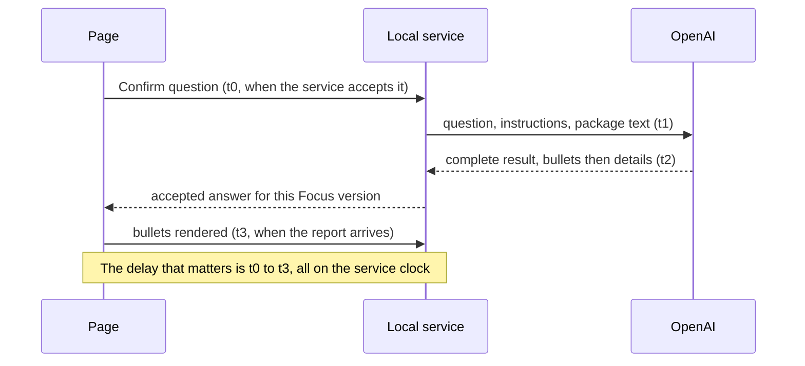

# How long until the bullets are visible?

Pablo confirms a question and takes a moment before he answers. The bullets help only if they are on the page within that moment; later, they pull his eyes away while he is speaking.
This page frames that feasibility question and the evidence that would settle it. On 16 November 2026 Pablo chose "Learn it in the live session", as relayed by 00 Governance: no 06 POC experiment runs before building, and the measurement is deferred to the sprint's live session. Nothing was measured here and no OpenAI request was made.

*Proposed measurement points. The page's render report already exists for question updates; the answer events are part of the design, not built.*

## The question

With the preparation package at its expected size in the request, and one call producing bullets and details, how long is it from Confirm to visible bullets (t0 to t3)? Is the slowest case shorter than the pause Pablo takes before he starts to answer?

## Why the answer is not known

The only timing on record is 1482 ms for a one-sentence reply to a small input, in one synthetic trial ([POC results](../../../poc/RESULTS.md)).
An answer request is far larger at both ends. The whole package goes in, and bullets plus details come out. Because one result carries both parts, the bullets wait for the details to finish.
No acceptable delay has been agreed. Evaluation finds no justified limit, and the provisional two-second target for showing a question does not transfer.

## Evidence that would settle it

- **Delay:** t0 to t3 for at least ten fresh interview questions at each of three package sizes: none, about 5,000 characters, and the 20,000-character limit Pablo accepted. Report every value, the median and the slowest.
- **Inputs:** invented questions and a synthetic package of the right size. Never Pablo's real documents, a benchmark recording or its transcript.
- **The pause to compare with:** the time from Confirm to his next speech, taken from the timed audit events of a live session, or a number Pablo states.
- **Settled when:** the slowest delay at the chosen package size is shorter than his usual pause. Then one call stays.
- **If not:** try, in this order and measuring each time, a shorter details limit, a smaller package limit, showing the bullets from a partial result, and two calls. The last two change what Pablo selected ("for now is one call") and need his decision.

## What Pablo chose, and what it means

A separate experiment would have taken about thirty billable OpenAI requests and an answer generator built ahead of the sprint. He chose to learn the delay from the sprint's own live session (S003-LIVE) instead.
That costs nothing extra and finds a problem only after the feature is built. Until then the details length limit is a provisional setting, and the 20,000-character package limit is an accepted default he can still change. The evidence listed above describes a fuller measurement that stays available if the live session raises doubt.
The measurement shows speed only. Whether the bullets help him, or distract, is judged in the live session under the [evaluation criteria](../04-benchmarks-and-eval-strategy/01.2-evaluation-criteria.md).

Draft of 16 November 2026 for item C5 of the [alignment report](../07-planning/03.7.2-sprint-003-conflicts.md), updated with his choice the same day. No acceptance of this page is recorded.
[Proposed answer](01.3-proposed-answer.md) · [Planned decisions](03-planned-decisions.md) · [Architecture index](README.md)
