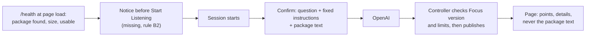

# SPRINT-003 architecture review, version 2: the amended baseline

This second first-pass review asks how the solution supports the need in the [version 2 brief](../07-planning/03.8-sprint-003-review-brief-v2.md). It was written before reading the other stages' new reports and is read-only: it proposes amendments and applies none.
**Verdict: `CHANGE_REQUIRED`.** The design carries every commitment, and no decision is needed from Pablo. Purpose rule B2, that he is told before a session that package text leaves his Mac, is in no architecture page, and four smaller gaps follow.

*The data path with the missing notice added in front. Only the flag and the size reach the page; the text never does.*

## Baseline and sources

Sprint snapshot SHA-256 `90d6dab6…69131`, brief `58a423ee…57f16`, Git HEAD `fe3c00e`. I recomputed the hashes of the fifteen stage 05 pages the brief lists: all match. Two more pages are read and unlisted: the stage `README.md` (`04fd1a3e…`) and `01-where-answers-are-generated.md` (`10bdc0c2…`).
Also read: the [record amendment](../07-planning/03.7.4-sprint-003-record-amendment.md), Purpose's [prepared-context page](../02-purpose/03.2-sprint-003-prepared-context-proposal.md), and `poc/server.mjs`, `poc/start.sh` and the file list of `poc/context/` without package text. Nothing was run and no request was made.

## Support for each commitment

| ID | Support and verdict |
| --- | --- |
| S003-LAYOUT | The cue is computed in the page alone, so the service is untouched. No change; where the buttons and panels sit (C9) is for the preview and 08. |
| S003-PREVIEW | No current page says where the preview lives. **Amend** (A1). |
| S003-GLANCE | The controller publishes both parts together, complete, within limits, so the details cannot move the cue. Limits are 04 and 08 work. No change. |
| S003-ANSWER | Generator, Focus version binding, always replace and one retry are in 01.3 and 01.1. No change. |
| S003-NOKEY | `/health`, the page states and the refused session are covered in 01.4. Supported; the notice below is the gap. |
| S003-TESTS | `reason` and `connect` are injected in `createPocServer`, so the generator can be too. **Amend** (A4). |
| S003-PAGECHECK | Same injection, but no page says how the seven states are forced without OpenAI. **Amend** (A4). |
| S003-RUN | 01.4 covers reuse, the start marker and a missing key file. Still proposed in detail; no change. |
| S003-LIVE | Audit events carry duration and Focus version. No change; 03.2 and 01.5 define the delay. |
| S003-DETAILS | Same call, separate fields, shown with the bullets. No change. |
| S003-CONTEXT | Location, limit, skips and exclusions are decided in the package page. **Amend** (A2, A3). |
| S003-STATEMENTS | Wording exists in 03-data-statements.md, unapplied and now out of date. **Amend** (A5). |

## Missing, contradictory or ambiguous

- **B2 is absent.** [01.4](01.4-service-start-and-key.md) says the page reads `/health` once to learn what is unavailable, but no row tells him the package text will be sent. The no-package case is covered by the General label.
- **Criterion 9 reads too wide.** "Only those are sent to OpenAI" is true of the answer request. Audio and transcript still go to the interview agent. 01-architecture.md already separates them, so the sentence needs a scope.
- **Skipped-file listing.** 02-preparation-package.md says the loader lists a skipped `README.md`, but 01.4 says `/health` never names files inside the package. The destination is unstated.
- **Printed request.** The accepted print option shows the package text in a terminal that other tools and sessions may read. The package page says the text never goes to the page, the log or a test, and is silent on the terminal.
- **Carry-forward of my 17 November review.** Confirmed: one local service owns the key and the generator is a new part. Corrected: its open questions S003-Q1 to Q3 are now answered, and its current-architecture and package points were applied on 18 November. Its hash `35dd2ebc…` equals the committed bytes since `112cad2`; the older hash in the alignment report is unexplained, and I changed nothing.

## Required amendments

- **A1** (01.4): the preview is a static page with sample content, no microphone, no key and no package, served from a fixed entry. Effect: 04 and 06 use it for the preview state set.
- **A2** (01.4, 01.5): add the notice before Start Listening, from a new usable flag on `/health` with states found, none, over the limit and skipped. Effect: 03 adds it to UC-05; 04 checks it; 02's B2 is then supported.
- **A3** (package page, 01.5): the skipped-file list goes to the audit and start log only, and the print option warns that its output is private text.
- **A4** (01.1 or 01.3): the generator and the service's transcription connection are injected, so the page check can drive all seven states from fixtures.
- **A5** (03-data-statements.md): say "except `README.md`, within 20,000 characters", and scope criterion 9's "only" to the answer request. Effect: 07's record wording and the two data pages.

## Uncertainty and downstream

No time, cost or request size is measured; the live session settles the delay as Pablo chose. Whether a key file exists where he runs the service was not checked. This report approves nothing and changes no state. Return to the [architecture index](README.md).
