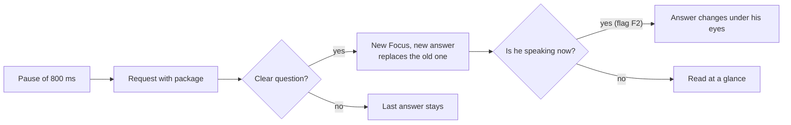

# The built flow: what to change, and where it strains the Purpose

Code for the automatic flow and the package hints exists in the working tree, uncommitted, and 85 offline tests are reported to pass. This page assesses it against the design on 18 November 2026: what Architecture would change, and where the flow threatens brief, glanceable cues.
Read from `poc/vocabulary.mjs`, `agent.mjs`, `session.mjs` and `server.mjs`; I did not run the tests or the service, so passing tests are reported by others, not observed here. Verdict: ratify with changes. No acceptance is recorded.

*The path where the Purpose constraint is most at risk: a replacement that lands while he speaks.*

## What Architecture would change in the code

| # | Change | Why |
| --- | --- | --- |
| C1 | Print the post-pause request and the transcription hint under the accepted print option. Today it is wired only to the separate answer request. | He accepted that he can see exactly what is sent; the largest request is the one not covered. |
| C2 | Add a source tag (speech, button) to Focus changes and to the audit. | The channel model needs it, and a test can then tell the two paths apart. |
| C3 | Skip the request when no new speech arrived since the last reading. | I did not see this guard before the call; a full package per idle pause is the main cost. |
| C4 | Optionally hold a new answer until the next pause when he is speaking (flag F2). | Keeps the text still while he reads and talks. Needs his decision. |
| C5 | Say in the audit how many terms were sent, and show the term list in the print output. | Personal names from the package leave as a hint; he should see them once. |

## Flags against the Purpose constraint

| # | Flag | Effect and mitigation |
| --- | --- | --- |
| F1 | The Focus question can now change at every pause, with no human gate. | A misheard or side remark could replace a correct question. Mitigate: replace only on a clear reading, keep the last answer otherwise, and keep Confirm and Clear live as a manual repair. |
| F2 | An answer can arrive 3 to 6 seconds after the pause, often after he has started speaking, and replaces the old one in place. | Moving text pulls his eyes. Mitigate with C4, or accept it knowingly. |
| F3 | The monitor line adds two lines of changing text (audio, state and the last words heard). | It is a diagnostic. Keep it small and visually behind the cue, Focus and bullets, and let him hide it. |
| F4 | An 800 ms pause is shorter than many thinking pauses. | Extra readings and extra cost; the later pause corrects them. Tune the value in the live session. |
| F5 | Criterion 3 still says "when a Focus question is confirmed". | 07 and Pablo amend the sprint record; not an Architecture page. |

## Material uncertainty

No cost, delay or accuracy was measured for the one-call flow. Whether the term hint changes recognition is unobserved. Stage 06 may take the delay; Pablo chose to learn it live.

[Decision](decisions/Automatic%20question%20flow%20and%20input%20channels/README.md) · [Input channels](01.6-input-channels.md) · [Architecture index](README.md)
