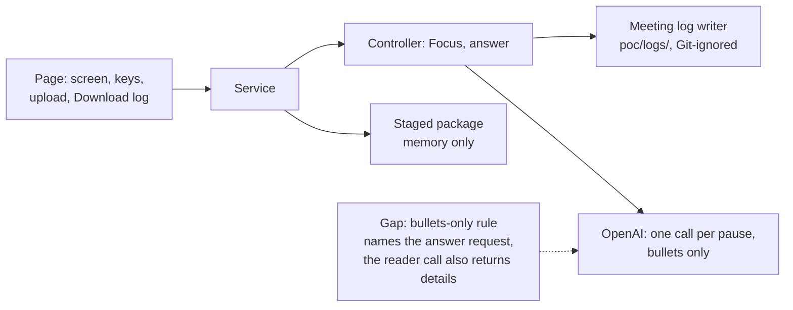

# SPRINT-004 architecture review: first pass on the proposed sprint

This is Architecture's independent first-pass report on the [SPRINT-004 brief](../07-planning/03.15-sprint-004-review-brief.md), written on 19 November 2026 before seeing the reports of 02, 03 and 04. It is read-only against the baseline and approves nothing.
**Verdict: `CHANGE_REQUIRED`.** The design supports every commitment and no decision is needed from Pablo. Four wording and scope gaps need small amendments, none of them in application code.

*What SPRINT-004 adds to the service, with the one contract gap marked.*

## Baseline and sources

Baseline: the brief (SHA-256 `f287d715…949d9a`), plan [03.14](../07-planning/03.14-sprint-004-working-plan.md) `9eed53db…` and [03.14.1](../07-planning/03.14.1-sprint-004-documents-and-decisions.md) `f17b7383…`, Git HEAD `7d06df1`, with uncommitted drafts. No sprint snapshot exists because none is active.
Read, with hash prefixes: my 01-architecture `1acac27d`, 01.3 `3c7e4d76`, 01.6 `1ca62352`, 01.7 `f1daf54e`, 01.8 `c6550c1a`, 01.8.1 `fca360b1`, 01.9 `cb72de74`, 01.10 `d841546f`, 01.10.1 `a9638182`, 02-current `f69d7574`; 08's 03.7 `eb8741b0`, 03.7.1 `09bdee86`, 03.7.4 `e1d3b83c`, 03.7.5 `4ba55a70`, 03.7.6 `f8deec60`, 03.7.7 `72c3c228`, 03.7.8 `d4aaad1b`; root `AGENTS.md` (45 nonblank lines). Nothing was run.

## Support for each commitment

| ID | Support and verdict |
| --- | --- |
| S004-STATUS | `GET /package` in 01.8, 01.8.1 and 08's SU-8. Supported. "Package name" in criterion 1 has no source for several files; 08 shows count, characters and source only. **Amend** (A4). |
| S004-UPLOAD | `PUT` and `DELETE /package`, limits, 409 while listening, old package kept on refusal, survives Stop: 01.8 and 01.8.1. Supported. |
| S004-LOG | One append-only writer in `poc/logs/`, separate from the audit, no package files: 01.10. Supported. The provisional 5 MB cap makes "complete" conditional; **amend** (A3). |
| S004-DOWNLOAD | `GET /log`, Host check, 127.0.0.1, newest complete lines: 01.10. Supported. |
| S004-SCREEN | The `transcript` snapshot message and the Question and candidate states are in 01.10 and the controller's Focus and Live. Bullets-only is a contract change; **amend** (A1). |
| S004-CUE | The cue is computed in the page alone, so keys and the 10-second hold touch no service. Supported. 01.6 still lists the two buttons as tools; **amend** (A2). |
| S004-GUARD | C1 and C3 accepted in 01.9, sized by me and unconfirmed by 08. Traces to the 18 November print decision and to cost. Supported. |
| S004-STATEMENTS | Wording is in 01.10.1. Supported, with one limit below. |
| S004-CARRY | Flow and what is sent are in 01.7 and 01.10.1. **Amend** wording (A4). |

## Missing, contradictory or ambiguous

- **Bullets only (A1).** 08's AD-1 and AD-2 speak of "the answer request" and its `{bullets}` result. In the built flow the post-pause reader call returns the question, coverage, bullets and details (01.7, `proposalSchema`), and the separate answer request is only a fallback. A rule that rejects `details` in one place leaves the other returning it. Both schemas and instructions must change together.
- **Criterion 8 wording (A4).** "Package text goes to the answer request" is no longer true: it goes in the post-pause request. The sentence needs that scope.
- **Root `AGENTS.md` size.** It has 45 nonblank lines. Upload and log sentences fit only if each stays one or two lines; the 50-line limit is a real constraint on 01.10.1's wording.
- **Resolved, no change:** known tension 1 (no refusal to log; Pablo decided) and tension 2 (statements warn; no exclude rule). Tension 4 is page-only.
- **Known tension 3.** His package is about 130 KB against 20,000 characters; the design only refuses it. This is Pablo's decision and a measurement for later.

## Required amendments

- **A1** (08, 01.3, 01-architecture, 01.7): the bullets-only contract applies to the reader call and the fallback answer request, in schema, instructions and the `proposed` message. Effect: 08 reissues AD-1 to AD-3; 04's check ST4-32 covers both.
- **A2** (01.6): the tools are the keys G, L, S, Esc, Confirm and Clear, with no on-screen cue buttons; Pablo accepted that in 08's Q1. Effect: 03 and 04 list the keys.
- **A3** (07, 08): say the log is complete up to 5 MB, then a `log_full` event. Effect: criterion 3 and 04's completeness check.
- **A4** (07): drop "name" from criterion 1; scope criterion 8 to the post-pause request. Effect: 03's UC-07 and 04's wording check.

## Uncertainty and downstream

- **Stage 06:** no POC decision is needed. The parts are an HTTP route, file appends and in-memory state. The log writes must not block audio handling, which 04 can test. Raising the 20,000 limit later, for his 130 KB package, needs a measured delay and cost, which should be framed for 06 in SPRINT-005.
- Delay, cost and answer quality of the one-call flow remain unmeasured; the live session settles them as he chose. `02-current-architecture.md` describes SPRINT-003's revision and is rewritten after the build.
- Later, out of scope: shared-server security, and the logs travelling with any copy of the project.
[Architecture index](README.md)
