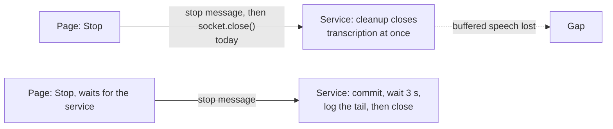

# SPRINT-005 architecture review: first pass on a faster Alice

This is Architecture's independent first-pass report on the [SPRINT-005 brief](../07-planning/03.20-sprint-005-review-brief.md), written on 22 November 2026 before seeing the reports of 02, 03 and 04. It is read-only against the baseline and approves nothing.
**Verdict: `CHANGE_REQUIRED`.** 09's findings hold and the cheap steps need no new component. One rule needs a page change that the plan says is not needed, and two wording points need fixing; no decision is needed from Pablo.

*Why S005-STOP needs the page to change: it closes the socket right after sending stop, so the service cannot drain.*

## Baseline and sources

Sprint SPRINT-005 active, branch `sprint-05` from `673c3bd`; brief SHA-256 `e9f5613a…b2029`; sprint file `f17247ac…`. Read, with prefixes: plan 03.18 `79d69c59`, 08's 03.11 `52fbaeff` and 03.11.1 `3e6d122d`, 09's 08 `4e2b0c8f`, 08.2 `c16bb87b` and 08.3 `839c6b30`, my 01.7 `c7d6d855` and 01.10 `1cbf82d2`. Code read in the working tree: `session.mjs` `f6236d6c`, `server.mjs` `8c46b6eb`, `agent.mjs` `f3248c6c`, `app.js` `7108ccb2`. Nothing was run.

## Findings you asked for

| Question | Finding |
| --- | --- |
| Partial text (C1) | **Confirmed.** `observe()` calls `schedule()` on a partial delta of 8 or more characters. `validate()` rejects a changed final only when the final has arrived; a reply that returns first sets the Question from partial words and nothing corrects it. Final-only (RT5-1) removes the waste and that risk. |
| Stop (C-STOP) | **Confirmed, and the cause is narrower than 08 says.** The page sends `stop` and calls `socket.close()` in the same step (`app.js` 537, 538). The service's `cleanup` closes transcription at once, so buffered speech is lost. A service-side drain alone cannot work. |
| How Stop reaches the service | By a `stop` message on the session socket. For a drain the page must leave the socket open, show Stopping, and close only when the service closes it or after about 4 seconds. The service, on `stop`, commits buffered audio, waits up to 3 seconds for the final items, logs them, then closes. |
| Version bump | **No bump.** `model_call`, `question_timing` and `speech_lost` add events and fields, and dropping `reply` removes one. Version stays 1 if ML-1 says a reader ignores unknown types and fields. The header's `revision` already tells before-files from after-files. A bump is for a changed meaning or a removed event. |
| Prompt caching | **Plausible, unverified.** Today the package is the last key in one JSON string after the changing snapshot, so no long prefix repeats. Package-first makes a long, identical prefix. Caching of repeated prompt prefixes normally needs about a thousand tokens, so it helps only with a package of a few thousand characters or more, and I could not check it for this model. The logged `cachedTokens` decide, as RT5-3 says. |
| Data statements | **No change.** Nothing new is sent and fields are dropped. The tail words at Stop now reach transcription, but microphone audio while listening is already stated. `model_call` holds counts only (ML-11). |

## Gaps and amendments

- **A1 (07, 08):** the plan says `app.js` changes only for a log field. RT5-6 needs the Stop change above, and 08's "Nothing changes on the page" is wrong. Add it to the scope sentence and to RT5-6; 04 adds a page check.
- **A2 (08):** RT5-6 says a disconnect cannot drain. That is true, and the page's own Stop must therefore not look like one.
- **A3 (08, ML-1):** state the compatibility rule above, so a new event never needs a bump.
- **A4 (08):** RT5-2 drops `reply`, but the snapshot also carries `state.reply` and `validate()` rejects an empty one. Remove both, and the connected-event wording in the instructions.
- **Order (07):** log first, then each behaviour step as its own revision, so 04's before-runs use the old code and `revision` names each run. Token usage from the SDK is unconfirmed; `null` is allowed, but 09 should check it first.

## Downstream

No stage 06 decision: the steps are order changes and a drain. The two-lane redesign, local models and a faster pause rule stay out of scope. `02-current-architecture.md` is still stale and is rewritten after the build.
[Architecture index](README.md)
