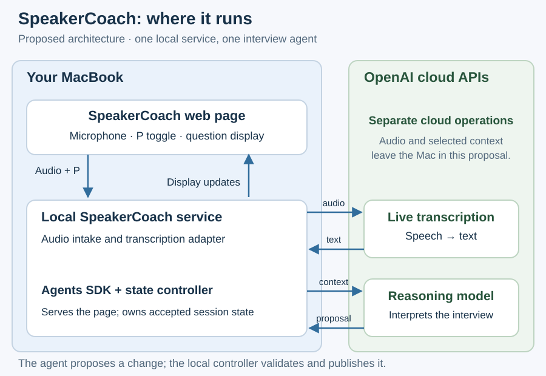

# SpeakerCoach architecture

SpeakerCoach should listen throughout an interview and keep the interviewer's question visible while Pablo answers.
The proposed design adds a small service on his MacBook to the existing browser page, with cloud transcription and reasoning.
This package records the architecture discussion of 25 October 2026. It is a draft proposal, not an implemented or formally accepted design.

## Read in order

| Document | What it explains |
| --- | --- |
| [01 Architecture](01-architecture.md) | Components, local/cloud placement and the agent's responsibilities. |
| [01.1 Streaming and replay](01.1-streaming-and-replay.md) | Continuous audio, asynchronous advice, timing, recovery and evaluation isolation. |
| [01.2 Interview state](01.2-interview-state.md) | Questions, answers, uncertain speaker observations and stable display behavior. |
| [02 Current architecture](02-current-architecture.md) | What source inspection establishes today, and what offline experiments do not establish. |
| [03 Planned decisions](03-planned-decisions.md) | Candidate choices, alternatives and the evidence needed before implementation. |

The editable SVG diagrams live in `images/`. Each substantive document embeds its own explanation.
The first outcome remains [question retention](../02-purpose/03-planned-improvements.md); contextual answer suggestions remain later work.
Use the [system model](../03-system-model-and-use-cases/01-system-model.md) and accepted [evaluation strategy](../04-benchmarks-and-eval-strategy/01-evaluation-strategy.md) alongside this package.

No application sprint or release is active. Saving these documents does not record design acceptance, start a sprint or establish runtime performance.
[Project documentation](../README.md)
