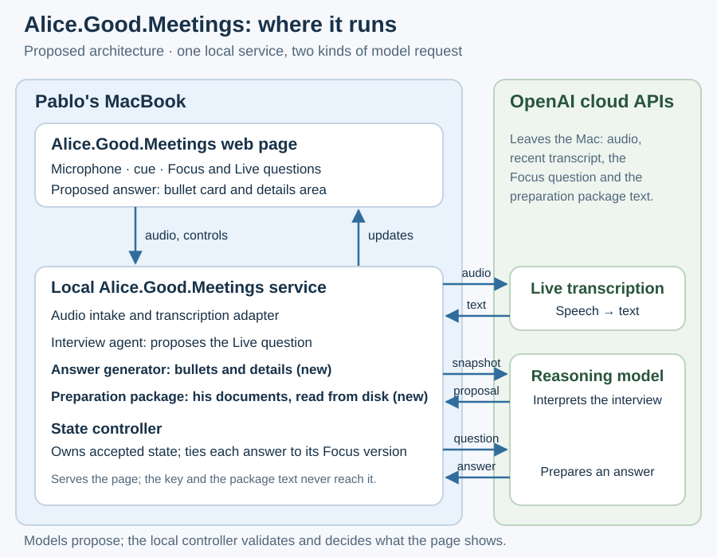

# Alice.Good.Meetings architecture

Alice.Good.Meetings listens throughout an interview, keeps the question Pablo confirmed visible while he answers and, with SPRINT-003, proposes an answer to it.
A small service on his MacBook serves the web page and uses cloud transcription and reasoning. Question capture exists as a proof of concept; the proposed answer is designed here and not built.
This package began with the architecture discussion of 25 October 2026 and was amended on 16 and 18 November 2026. It is a draft proposal, not a formally accepted design.

## Read in order

| Document | What it explains |
| --- | --- |
| [01 Architecture](01-architecture.md) | Components, local/cloud placement and what each model call owns. |
| [01.1 Streaming and replay](01.1-streaming-and-replay.md) | Continuous audio, asynchronous requests, timing, recovery and evaluation isolation. |
| [01.2 Interview state](01.2-interview-state.md) | Phases, the Focus and Live questions, uncertain speaker observations and stable display behavior. |
| [01.3 Proposed answer](01.3-proposed-answer.md) | The answer generator, one result with bullets and details, and its tie to the Focus version. |
| [01.4 Service start and key](01.4-service-start-and-key.md) | What the run command does, and what the page shows with and without a key. |
| [01.5 Pending state and inputs](01.5-pending-state-and-inspectable-inputs.md) | The pending answer state, how the request inputs are inspected, the answer after Stop, the start marker and what one call does to the delay. |
| [02 Current architecture](02-current-architecture.md) | What the source at revision `7d60c0f` (rechecked at `bde3f7a`) does today, and what it does not establish. |
| [03 Planned decisions](03-planned-decisions.md) | Choices selected, proposed and open, and the evidence still needed. |
| [03.1 SPRINT-003 review](03.1-sprint-003-architecture-review.md) | The first-pass review of 16 November 2026. Its amendments are now applied in the pages above. |
| [03.2 Answer delay question](03.2-answer-delay-question.md) | The answer-delay question and its evidence; by Pablo's choice it is measured in the live session. |

Decision records: [Use Open AI Agent SDK](decisions/Use%20Open%20AI%20Agent%20SDK/README.md), selected for the POC, and [Proposed answer and its context](decisions/Proposed%20answer%20and%20its%20context/README.md), mostly selected by Pablo on 16 November 2026, with the separate generator and the other recommended defaults accepted on 18 November 2026.

The editable SVG diagrams live in `images/`; newer pages embed Mermaid diagrams in their own source. Each substantive document carries its own explanation.
The outcome in view is a [proposed answer beside the Focus question](../02-purpose/03-planned-improvements.md); other kinds of meeting come later.
Use the [system model](../03-system-model-and-use-cases/01-system-model.md) and the [evaluation strategy](../04-benchmarks-and-eval-strategy/01-evaluation-strategy.md) alongside this package.

SPRINT-003 is active. Saving these documents records no design acceptance, starts no coding and establishes no runtime performance.
[Project documentation](../README.md)
