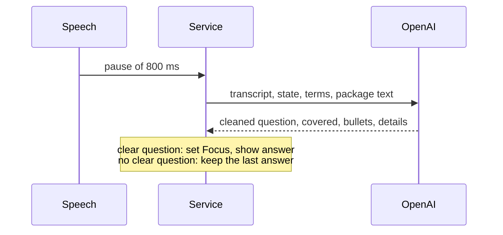

# One call after each pause, or two

Something must read the question after a pause and prepare the answer. The choice sets how often the package leaves the Mac, how long the answer takes, and how the wrong-word problem ("BBC" for "CIBC") is fixed.
Pablo directed option A on 18 November 2026 and it is built. Architecture proposes to ratify it for this sprint and to keep option B as the first alternative if the live session shows a cost or delay problem.

*Option A as built. In option B the package text joins only a second request, sent when a clear question was read.*

## Options compared

| Option | What it offers | What it costs | Status |
| --- | --- | --- | --- |
| A. One call per pause with terms and package | One round trip; the reader sees the package, so names are corrected in the same reading | Package text in every pause request, even when nothing was asked; a longer output, so every reading waits | Directed; proposed to ratify |
| B. Reader gets terms only; answer call gets the package | Package text only when a question was read; the earlier split of responsibilities holds; terms alone fix "CIBC" | Two calls in sequence, so the answer comes later | Fallback path already exists |
| C. Confirm only, as before | No automatic flow | Pablo must press a button while speaking | Superseded by his direction |

## What drives the choice

The reader runs on every pause, as often as every 2.5 seconds, and most pauses carry no question. Sending 7,000 to 20,000 characters each time is the main cost of A; the agent call alone took 2.3 to 5.7 seconds in the service log, and the added answer text makes that longer. No new timing was measured.
Option B needs only the local term list to correct names, so it keeps the exposure lower, but adds a second wait. Pablo said two calls may come later; a result with separate fields allows either.

## Reconsider when

The live session or the audit shows too many pause requests without a question, a cost Pablo does not accept, or bullets arriving after he starts speaking.

[Decision](README.md) · [Automatic flow](../../01.7-automatic-question-flow.md)
