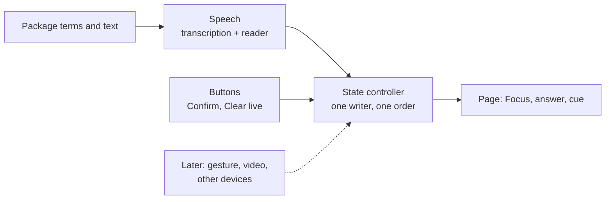

# Automatic question flow and input channels

On 18 November 2026 Pablo changed how Alice learns the question: after a pause she reads it herself and sets the Focus question, with no Confirm, and the same call prepares the answer. He also set a principle that Alice takes cues from many channels and never loses one when another is added.
Architecture assessed this on 18 November 2026 and proposes to ratify it, with the changes in the [code assessment](../../03.4-18-november-code-assessment.md). Pablo's directions are his stated choices as relayed by 00 Governance; the assessment is Architecture's and is not approved.

*Every channel proposes or commands through the same controller, so a channel can be added without changing another.*

## Decided and proposed

| Point | Status | Basis |
| --- | --- | --- |
| Never remove an input tool when adding another; Confirm and Clear live stay as an optional manual tool | Directed by Pablo | His chat direction of 18 November 2026, relayed by 00 Governance |
| After a pause of 800 ms (`ALICE_PAUSE_MS`) one call returns the cleaned question, whether the package covers it, and the points and details; the Focus question is set automatically | Directed by Pablo | Same; code exists in the working tree |
| If no clear question is heard, the last answer stays | Directed by Pablo | Same |
| Package terms go to transcription as a hint, and terms and text go to the question reader | Directed by Pablo | Same; changes what leaves the Mac |
| Ratify the one call as built, with the separate answer request as fallback | Proposed | [Flow alternatives](01-flow-alternatives.md) |
| Model inputs as channels that send readings or commands to the controller | Proposed | [Input channels](../../01.6-input-channels.md) |

## Consequences

- The 4 November rule that only Confirm writes Focus ends; the controller now also writes Focus after a pause. It remains the only writer.
- Package text now goes to OpenAI after every pause, not only once per question. Cost and exposure grow with the number of pauses.
- The earlier rule that the package stays out of the interview agent's input no longer holds.

## Revisit when

- The live session shows answers arriving while he speaks, or wrong readings flipping the Focus question.
- A measured cost per pause is too high.
- A gesture, video or device channel is added: it needs its own data decision.

Status: draft of 18 November 2026, no acceptance recorded. [Flow alternatives](01-flow-alternatives.md) · [Input channels](../../01.6-input-channels.md) · [Architecture index](../../README.md)
