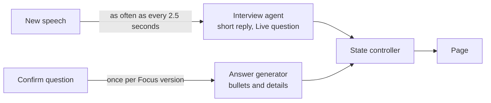

# Where the answer is generated

Something has to turn the Focus question and the preparation package into bullets and details. That work could sit in a new part of the local service, inside the existing interview agent, or in the page.
Architecture recommends a separate answer generator in the local service. This is a proposal of 16 November 2026. It was not among the questions put to Pablo that day, so he has not selected it.

*Two kinds of model request with different rhythms. Keeping them apart lets the Live question stay quick while an answer is prepared once.*

## Options compared

| Option | What it offers | What it costs | Status |
| --- | --- | --- | --- |
| A. Separate generator in the local service | One request per Focus version; the key and the package stay in the service; the controller still validates everything shown; the Live question is untouched | A second model request can run beside the interview agent, and the answer gains its own failure state | Recommended |
| B. Add the answer to the interview agent's output | No new part | That agent reruns while speech arrives, so the answer would be rewritten and the whole package resent each time; the Live question would wait for a long output; the result could not be tied to one Focus version | Set aside |
| C. The page calls OpenAI | No service change | The key and the package would be in the browser, against the rule that the key lives only in the service | Rejected |
| D. Two calls, bullets first | Bullets could appear sooner | Two requests per question, each carrying the package | Not selected by Pablo: "for now is one call" |

## What drives the choice

The interview agent is on the path that keeps the Live question current, and its requests start as little as 2.5 seconds apart. A proposed answer is needed once per confirmed question and is much longer. Mixing them would make the frequent request slow and the rare one repetitive.
Option A also keeps the existing split from the [Agents SDK decision](../Use%20Open%20AI%20Agent%20SDK/README.md): a model proposes, and application code owns state and decides what the page shows.
The generator has no tools. It can be a second Agents SDK agent or a direct model call; that record already names a direct call as the simpler baseline. Either fits this decision, and the detailed design chooses. Its model can be configured separately from the interview agent's.

## Evidence and its limits

Read from source at revision `7d60c0f`: the interview agent's scheduling, its input and the controller's checks. Nothing was run.
No measurement exists of how long an answer takes. The only timing on record is 1482 ms for a one-sentence reply in one synthetic trial ([POC results](../../../../../poc/RESULTS.md)), with a far smaller input and output than an answer will have.
That option A leaves the Live question's speed unchanged is an expectation from the design, not a measurement.

## Reconsider when

- The live session, where Pablo chose to learn the delay, shows one call is too slow for the bullets: then option D, or showing the bullets from a partial result, becomes the question.
- Answers should take account of what was just said in the conversation: the input list would grow, and the grounding rule with it.
- A measured cost or delay makes two concurrent requests a problem for the Live question.

[Decision](README.md) · [The preparation package](02-preparation-package.md)
