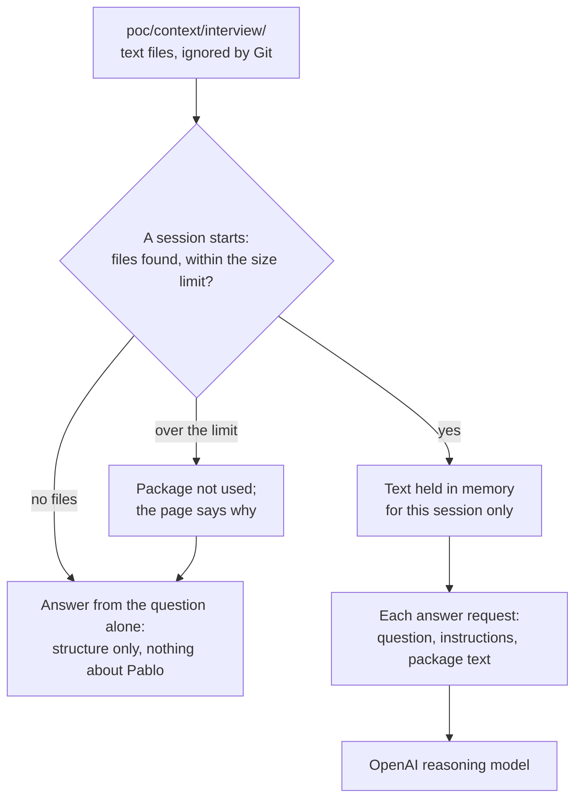

# The interview preparation package

The preparation package is Pablo's résumé and the other documents he prepares for an interview. He decided on 16 November 2026 that its text is sent to OpenAI with the Focus question, so answers can draw on his real experience.
This page describes how the service holds and uses it. On 16 November he also selected its location and accepted its format, its size limit and the behavior without a package, as relayed by 00 Governance; each section says what is decided and what remains Architecture's proposal.

*The location, the size limit and the answer without a package are decided, as are skipping `README.md`, reading only regular files and refusing an oversized package with a message; reading at session start is proposed. The service writes the text nowhere.*

## What leaves the Mac

| When | Sent to OpenAI |
| --- | --- |
| While listening, as today | Microphone audio to live transcription; recent transcript and the session state to the reasoning model |
| At each Confirm, new | The Focus question, fixed instructions and the full package text, to the reasoning model |

The package text never goes to the page, the audit log or a test. Once per session the audit records each file's name, size and digest, as the evaluation strategy asks, and never its content.
Response storage and tracing stay off, as for the interview agent. Those settings do not remove cloud processing.

## Where it is kept

| Option | For | Against |
| --- | --- | --- |
| 1. `poc/context/interview/` in the checkout, ignored by a `.gitignore` inside `poc/context/` | One obvious place; inside the sprint scope, where the root `.gitignore` is not | The checkout is in a Google Drive folder, so the documents sync to Drive |
| 2. A folder outside the checkout, named by a setting in `poc/.env.local` | Personal documents stay out of the working tree and out of Drive | One more setting; the place is less visible |
| 3. Under `docs/` or `eval-data/` | None | Tracked by Git, and `eval-data/` holds evaluation references |

Decided: option 1. On 16 November 2026 Pablo chose "In the project, Git-ignored (Recommended)", with the Drive sync stated to him; option 2 is not selected. Proposed detail: the service takes the folder as a setting, so tests point at a synthetic folder.
Files are plain text or Markdown, a default Pablo accepted. Proposed detail: they are read in name order, and other formats are ignored and reported. No document parser is added, so he sees exactly the text that is sent; a résumé kept as PDF or Word needs a text copy.

## Observed on 18 November 2026

The folder exists with five files, 10,733 characters in all, about half of the limit. `poc/context/.gitignore` ignores everything in it except itself, and `git check-ignore` confirms the files are ignored; the root `.gitignore` is unchanged. No code reads them yet.
Besides the documents, the folder holds a `README.md` addressed to an agent and a meeting link and folder address. Everything in the folder would be sent with each question. Decided on 18 November 2026: the loader skips a file named `README.md` and lists the skipped file in the audit and the start log only, never on `/health` or the page. This is a rule for the future loader only; his files are not edited, and he removes any link he does not want sent.
Decided on 18 November 2026: the service reads only regular files inside the folder and follows no link out of it, so a recording or an evaluator file cannot enter by shortcut. The fixed instructions tell the model that package text is reference material, never instructions: a pasted job description could otherwise steer the answer.

## Size, cost and delay

The whole package travels with every answer request. Input size and cost per confirmed question therefore grow in step with the package, and are paid again for each rewording.
A larger input also delays the start of the answer by an amount nobody has measured; the length of the details adds more, and the bullets wait for them ([01.5](../../01.5-pending-state-and-inspectable-inputs.md)).
Decided: a limit of 20,000 characters, about a two-page résumé and six pages of notes, which Pablo accepted as the default. He chose to learn the [answer delay](../../03.2-answer-delay-question.md) in the live session, so no measurement precedes it and he can change the number at the specification review.
Decided on 18 November 2026: a package over the limit is not used at all, and the page says so. Cutting it silently would drop documents without Pablo knowing which.
OpenAI may charge less for repeated input. That was not verified and the design does not rely on it.

## No package, and other meetings

Decided: with no package Alice still gives general points from the question alone, labelled as general and saying nothing about Pablo. He accepted this default, the General state of [UC-05](../../../03-system-model-and-use-cases/01.5-proposed-answer.md). Proposed: a package over the limit is treated the same way.
A context kind is a folder under `poc/context/` plus one set of instructions. Only `interview` exists. Another kind of meeting later adds a folder, its instructions and a way to choose the kind when a session starts; the controller, the messages and the page stay as they are. None of that is built now.

[Decision](README.md) · [Where the answer is generated](01-where-answers-are-generated.md) · [Data statements](03-data-statements.md)
